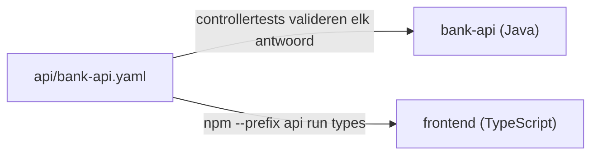

# api: het contract tussen frontend en bank-api

`bank-api.yaml` is de afspraak over de JSON die tussen de frontend en `bank-api` gaat (ADR 0034). Beide kanten worden ertegen getest:

- **de backend** moet antwoorden zoals het contract zegt: elke controllertest controleert het antwoord;
- **de frontend** krijgt zijn types uit het contract: wie een veld gebruikt dat er niet in staat, krijgt een fout van de compiler.

Er is dus één bron. Verandert die, dan valt elke kant die niet meeverandert al in de commit stage om, en niet pas in de acceptatietests.



## Eén voorbeeld, aan beide kanten: wie ben ik?

De frontend vraagt `GET /api/ik` op, om te weten of de gebruiker beheerder is (ADR 0037).

### Het contract

[`bank-api.yaml`](bank-api.yaml):

```yaml
  /api/ik:
    get:
      responses:
        "200":
          content:
            application/json:
              schema:
                $ref: "#/components/schemas/Ik"
...
    Ik:
      type: object
      additionalProperties: false
      required: [gebruikersnaam, beheerder]
      properties:
        gebruikersnaam:
          type: string
        beheerder:
          type: boolean
```

### De backend levert het

[`IkController.java`](../backend/bank-api/src/main/java/nl/banksim/api/beveiliging/IkController.java):

```java
@GetMapping("/api/ik")
IkJson ik(Authentication authenticatie) { ... }

record IkJson(String gebruikersnaam, boolean beheerder) {
}
```

[`IkControllerTests.java`](../backend/bank-api/src/test/java/nl/banksim/api/beveiliging/IkControllerTests.java) importeert `ApiContract`. Daardoor wordt elk antwoord in deze test ook tegen het schema `Ik` gecontroleerd:

```java
@WebMvcTest(IkController.class)
@Import({ApiContract.class, BeveiligingConfig.class, IngelogdeGebruiker.class})
class IkControllerTests {
```

### De frontend gebruikt het

Uit het contract gegenereerd, in [`bank-api.d.ts`](../frontend/src/app/api/bank-api.d.ts). Dit bestand bewerk je nooit met de hand:

```ts
Ik: {
    gebruikersnaam: string;
    beheerder: boolean;
};
```

Met een leesbare naam, in [`schemas.ts`](../frontend/src/app/api/schemas.ts):

```ts
export type Ik = Schemas['Ik'];
```

Gebruikt in het scherm, [`ik.ts`](../frontend/src/app/ik.ts):

```ts
.get<Ik>('/api/ik')
.pipe(map((ik) => ik.beheerder), ...)
```

En in de testdata van de Vitest-tests, [`app.spec.ts`](../frontend/src/app/app.spec.ts):

```ts
http.expectOne('/api/ik').flush({ gebruikersnaam: 'beheerder', beheerder: true } satisfies Ik);
```

Het veld heet dus aan beide kanten `beheerder`, omdat beide kanten het uit hetzelfde contract hebben, en niet omdat iemand eraan gedacht heeft.

## Wat er gebeurt als het contract verandert

Stel dat iemand in het contract `beheerder` hernoemt naar `isBeheerder`, en de code niet aanpast. Dit zijn de echte meldingen.

**Backend:** `IkControllerTests` faalt, omdat het antwoord niet meer bij het contract past:

```
Object instance has properties which are not allowed by the schema: ["beheerder"]
Object has missing required properties (["isBeheerder"])
```

**Frontend:** na het genereren van de types faalt de typecontrole in `ik.ts`:

```
src/app/ik.ts(17,22): error TS2551: Property 'beheerder' does not exist on type
'{ gebruikersnaam: string; isBeheerder: boolean; }'. Did you mean 'isBeheerder'?
```

Vergeet iemand de types opnieuw te genereren, dan doet de pipeline het. Die faalt als het gegenereerde bestand afwijkt van wat er gecommit is.

En een nieuw endpoint dat niet in het contract staat? Dan faalt [`ContractDektAlleEndpointsTests`](../backend/bank-api/src/test/java/nl/banksim/api/ContractDektAlleEndpointsTests.java): die vergelijkt de endpoints van de applicatie met die in het contract.

## Een wijziging aan de API

1. Pas `bank-api.yaml` aan.
2. Draai `npm --prefix api run types`, en commit `frontend/src/app/api/bank-api.d.ts` mee.
3. Maak de backend en de frontend groen. De meldingen hierboven wijzen aan waar.

Het contract legt de vorm vast, niet het gedrag: welke klant welke rekening mag zien, testen de gewone tests en de acceptatietests. Hoe het onder de motorkap werkt, en waarom het OpenAPI 3.0 is en geen 3.1, staat in [ADR 0034](../doc/adr/0034-contract-first-openapi-voor-bank-api.md).
