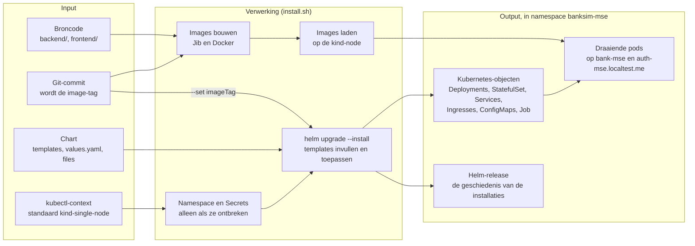

# deploy: BankSim-MSE installeren in Kubernetes

Deze map bevat alles om BankSim-MSE in een kind-cluster te zetten:
- een **Helm-chart**, die beschrijft welke Kubernetes-objecten er moeten bestaan;
- een paar **shellscripts**, die de images bouwen, de chart installeren en alles weer verwijderen.

Wat er na de installatie draait en hoe de onderdelen samenwerken, staat in [`doc/story-door-de-stack.md`](../doc/story-door-de-stack.md). Deze README gaat over hoe het er komt.

> **Er wordt niets "gebouwd" uit de chart.** Er ontstaat geen chart-pakket en geen gegenereerd bestand in de repo. Helm leest de map `banksim-mse/` rechtstreeks, vult de templates in en stuurt het resultaat naar het cluster. De output van deze map is dus de toestand van het cluster, niet een bestand.

Deze README beschrijft de werking, niet de inhoud. Welke templates er zijn, welke opties een script heeft en welke versies er gebruikt worden, staat in de bestanden zelf. De opties van een script staan in het commentaar bovenaan; `install.sh` en `uninstall.sh` tonen ze ook met `--help`.

## 1. De map in het kort

| Plek | Rol |
| --- | --- |
| `banksim-mse/` | De Helm-chart. |
| `banksim-mse/Chart.yaml` | Naam en versie van de chart. |
| `banksim-mse/values.yaml` | De standaardwaarden die de templates invullen: images, hosts, resources. Er staan nooit geheimen in (ADR 0009). |
| `banksim-mse/templates/` | De Kubernetes-objecten als Go-templates, ongeveer één bestand per onderdeel van de applicatie. Bestanden die met `_` beginnen, bevatten hulpfuncties en leveren zelf geen objecten op. |
| `banksim-mse/files/` | Bestanden die de templates letterlijk opnemen, zoals de configuratie van de Keycloak-realm. |
| `banksim-mse/tests/` | Unittests van de chart (helm-unittest): wat de templates opleveren bij gegeven waarden. |
| `scripts/` | De shellscripts: installeren, verwijderen en images bouwen, met een gedeelde bibliotheek (`lib.sh`) voor de namespace, de release, de kubectl-context en de meldingen. |
| `scripts/test/` | Tests van de scripts (bats). |

## 2. Hoe het wordt aangeroepen

Er zijn drie aanroepers. Ze gebruiken allemaal dezelfde scripts.

| Wie | Hoe | Doel |
| --- | --- | --- |
| Jij, lokaal | `make install` en `make uninstall` (in de root van de repo), of de scripts in `scripts/` rechtstreeks | Installeren in je eigen cluster `kind-single-node` |
| De pipeline | De commit stage bouwt de images één keer. De acceptance stage maakt een tijdelijk cluster `kind-banksim-mse-ci`, laadt die images en roept `install.sh` aan met `--context` en `--image-tag`. | Testen wat later draait (ADR 0002) |
| De installatiescenario's | De Playwright-scenario's in `e2e/specs/infra/` roepen `install.sh` en `uninstall.sh` aan via de shell-driver. | Bewijzen dat installeren, opnieuw installeren, upgraden en verwijderen werken |

Helm zelf roep je normaal niet met de hand aan. Het script doet dat, omdat er vóór Helm stappen nodig zijn: images, namespace en Secrets.

## 3. Input, verwerking en output



**Input**
- **De broncode.** Daaruit komen de images van de eigen onderdelen. Externe images, zoals Keycloak en PostgreSQL, staan op digest in `values.yaml`.
- **De image-tag.** Dat is de korte hash van de huidige commit, met `-dirty-<tijdstip>` erachter als er niet-gecommitte wijzigingen zijn. De tag gaat met `--set imageTag` naar Helm, zodat de templates naar precies die images verwijzen. Je ziet hem terug op `/api/versie` en in de voettekst.
- **De chart:** de templates, de waarden in `values.yaml` en de bestanden in `files/`.
- **De kubectl-context.** Die is altijd `kind-single-node`, nooit de actieve context, tenzij je `--context` meegeeft (ADR 0004).
- **De Secrets in het cluster.** Die staan bewust niet in de repo. `install.sh` maakt ze de eerste keer aan; daarna zijn ze input voor elke volgende installatie.

**Output, en waar die staat**
- **De images** staan in je lokale Docker en, na het laden, op de node van het kind-cluster. Er is geen registry. Daarom hebben de pods `imagePullPolicy: IfNotPresent`: ze gebruiken het image dat al op de node staat.
- **De Kubernetes-objecten** staan in het cluster, in namespace `banksim-mse`. Niets staat erbuiten: er zijn geen cluster-brede resources (ADR 0004).
- **De Helm-release** `banksim-mse` staat ook in die namespace. Helm bewaart hem als Secret, met per installatie een revisie. Daaraan ziet Helm bij een volgende installatie wat er veranderd is, en wat het moet weghalen.
- **In de repo** komt niets bij.

## 4. Wat install.sh doet, stap voor stap

1. **Controleren.**
   - Zijn de benodigde tools er?
   - Bestaat de kubectl-context?
   - Draait ingress-nginx in het cluster?
   
   Zo niet, dan stopt het script vóórdat het iets verandert.
2. **De tag bepalen** uit de huidige commit (zie hierboven).
3. **De images verzorgen.** Er zijn drie varianten:
   - standaard: bouwen en op de kind-node laden;
   - `--image-tag`: niet bouwen, alleen al gebouwde images laden. Dit gebruikt de pipeline;
   - `--skip-build`: niets bouwen of laden, en de tag van de bestaande installatie opnieuw gebruiken.
4. **De namespace** `banksim-mse` aanmaken, als die er nog niet is.
5. **De Secrets** aanmaken, met willekeurige wachtwoorden en client secrets. Dat gebeurt maar één keer: een bestaand Secret blijft zoals het is, en alleen ontbrekende sleutels worden aangevuld (ADR 0009). PostgreSQL leest de wachtwoorden namelijk alleen bij de eerste start op een lege schijf. Een nieuw wachtwoord zou de database dus onbereikbaar maken.
6. **Helm.** `helm upgrade --install` vult de templates in en past ze toe. Is er nog geen release, dan installeert het; anders werkt het de release bij. Met `--wait` wacht Helm tot alles klaar is.
7. **Rooktests.** Een paar HTTP-aanvragen controleren dat de frontend, de API en Keycloak antwoorden. Dat is alleen "het draait"; het echte bewijs leveren de acceptatietests.

Het script is **idempotent**: twee keer draaien geeft dezelfde toestand als één keer. Na een codewijziging draai je het gewoon opnieuw. Er komt dan een nieuwe tag, Helm ziet dat de images veranderd zijn, en Kubernetes vervangt de betrokken pods.

**Wat er daarna in het cluster gebeurt**
- **PostgreSQL** maakt bij de allereerste start de databases en de databaserollen aan. Daarna laat het een bestaande database met rust.
- **Keycloak** start. Daarna past een Job de realm toe vanuit `files/`, bij elke installatie opnieuw, ook op een bestaande realm (ADR 0017).
- **De applicatie zelf.** `bank-api` voert bij het starten zijn databasemigraties uit (Flyway).

De eerste installatie duurt daardoor merkbaar langer dan een volgende.

## 5. Verwijderen

`uninstall.sh` (of `make uninstall`) vraagt om bevestiging, en verwijdert dan:
- de Helm-release;
- de hele namespace `banksim-mse`, met de Secrets en de schijf van PostgreSQL. Alle data is dan weg.

Met `--purge` verwijdert het ook de images van de kind-node. Buiten de namespace raakt het niets, ook niet het origineel in namespace `banksim`.

Verwijder nooit los een Secret of de PostgreSQL-schijf. De wachtwoorden in de Secrets en die in de database horen bij elkaar. Wil je opnieuw beginnen, verwijder dan alles en installeer opnieuw.

## 6. Controleren

### Zonder cluster

`make iac` (in de root van de repo) draait alle controles op deze map, in vastgepinde containers (ADR 0006). Hetzelfde draait in de commit stage van de pipeline.

| Controle | Wat het bewijst |
| --- | --- |
| `helm lint` | De chart is geldig. |
| helm-unittest (`banksim-mse/tests/`) | De templates leveren bij gegeven waarden de verwachte objecten op. |
| kubeconform | De ingevulde manifesten zijn geldige Kubernetes-objecten. |
| Beleidsregels met yq | Alles staat in namespace `banksim-mse`, er zijn geen cluster-brede resources en er staan geen geheimen in de chart (ADR 0004, 0009). |
| shellcheck | De scripts hebben geen bekende shellfouten. |
| bats (`scripts/test/`) | De scripts gedragen zich zoals bedoeld, bijvoorbeeld bij de keuze van de context en het aanmaken van Secrets. |

Wil je zelf zien wat Helm naar het cluster zou sturen, vul de templates dan in zonder te installeren:

```bash
helm template banksim-mse deploy/banksim-mse --namespace banksim-mse --set imageTag=test
```

### Met een cluster

- **Rooktests:** die draaien vanzelf aan het eind van `install.sh`.
- **Installatiescenario's:** `make e2e-infra` bewijst dat opnieuw installeren niets verandert, dat een andere actieve context genegeerd wordt en dat het origineel onaangeroerd blijft. De scenario's die installaties weghalen (`@destructief`), draaien alleen in de pipeline.
- **Acceptatietests:** `make e2e` test de applicatie die nu geïnstalleerd is.
- **Zelf kijken.** Deze commando's lezen alleen:

  ```bash
  helm --kube-context kind-single-node -n banksim-mse status banksim-mse        # staat van de release
  helm --kube-context kind-single-node -n banksim-mse history banksim-mse       # alle revisies
  helm --kube-context kind-single-node -n banksim-mse get values banksim-mse    # waarmee is geïnstalleerd
  helm --kube-context kind-single-node -n banksim-mse get manifest banksim-mse  # wat er is toegepast
  kubectl --context kind-single-node -n banksim-mse get all,ingress,secret,pvc
  curl -sk https://bank-mse.localtest.me/api/versie                             # welke versie draait
  ```

**Revisies vlak na elkaar zijn normaal.** Helm maakt bij elke `helm upgrade` een nieuwe revisie, ook als er niets verandert. Niet alleen `make install` installeert: ook de installatiescenario's roepen `install.sh` aan, om te bewijzen dat opnieuw installeren niets verandert en dat de actieve context genegeerd wordt. Eén `make acceptance` geeft daardoor een paar revisies binnen enkele minuten, allemaal met dezelfde image-tag. Vergelijk ze met `helm get values … --revision <n>`. Helm bewaart standaard alleen de laatste tien revisies en ruimt oudere zelf op. Dat staat los van `revisionHistoryLimit` in `values.yaml`, want dat gaat over de oude ReplicaSets van de Deployments.

Verander niets met de hand, dus geen `kubectl apply` of `kubectl edit`. De volgende installatie zou het toch weer overschrijven, en de wijziging staat nergens in Git. Een wijziging hoort in deze map, en komt via `install.sh` in het cluster.

## 7. Iets wijzigen

| Je wilt | Wijzig | Test |
| --- | --- | --- |
| Een Kubernetes-object toevoegen of aanpassen | een template in `banksim-mse/templates/`, en eventueel een waarde in `values.yaml` | een test in `banksim-mse/tests/` |
| Iets aan de installatie of het verwijderen | een script in `scripts/` | een bats-test in `scripts/test/` |
| De Keycloak-realm (clients, rollen, rechten) | het realm-bestand in `banksim-mse/files/` | de acceptatiescenario's, eerst op je bestaande installatie |

Een paar regels gelden altijd:
- alles in namespace `banksim-mse`;
- geen geheimen in de chart, alleen verwijzingen naar Secrets;
- een nieuwe tool kan alleen met een ADR;
- eerst rood, dan groen, ook voor de infrastructuur (werkwijze hoofdstuk 9).

Zie ook de tabel "Waar komt wat" in [`CLAUDE.md`](../CLAUDE.md) en [`doc/kwaliteitscontroles.md`](../doc/kwaliteitscontroles.md).
