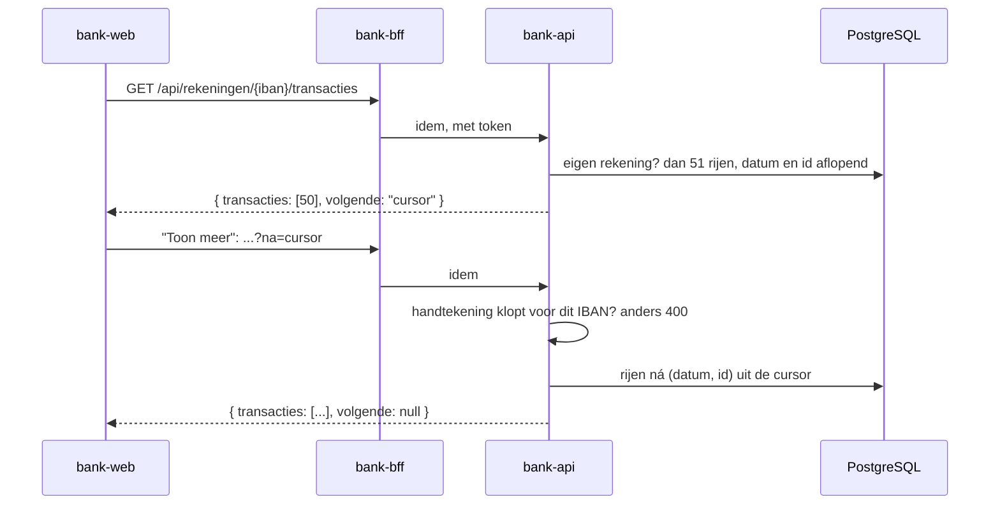

# Slice 2 controleren: transactielijst van de betaalrekening

> **Gearchiveerd op 2026-10-23, niet meer bijgehouden.** Aantallen, meldingen en commando's kunnen verouderd zijn. Hoe je nu controleert, staat in [werkwijze §10.1](../werkwijze-mse.md#101-controle-door-de-mens); de sabotages herhaalt PIT bij elke commit (ADR 0018).

Met deze instructie controleer je zelf wat er in slice 2 is gebouwd. De volgorde is dezelfde als bij [slice 1](slice-1-controleren.md):

1. Je kijkt wat er staat.
2. Je draait elke test en ziet hem groen worden.
3. Je maakt bij elke test bewust iets kapot. Dan zie je dat de test die fout echt vangt.
4. Je installeert de app, seedt een klant met transacties en bekijkt de lijst.
5. Je controleert de installatie en de pipeline.

Reken op een uur. Slice 1 moet al gecontroleerd zijn; wat daar staat, herhaalt deze instructie niet. De achtergrond staat in [werkwijze-mse.md](../werkwijze-mse.md), hoofdstuk 7 (slice 2), en in [ADR 0011](../adr/0011-keyset-paginering-met-cursor.md).

## 1. Wat is er gebouwd

Slice 2 levert twee stories:

> **S2.1** Als klant wil ik de transacties van mijn betaalrekening zien, per datum en van nieuw naar oud, zodat ik zie waar mijn geld heen gaat en vandaan komt.
>
> **S2.2** Als klant wil ik een lange transactielijst in porties van 50 zien, met "Toon meer", zodat de lijst snel laadt.

In het overzicht is het IBAN nu een knop. Die opent de betaalrekening:
- **Per dag.** De transacties staan per dag onder een kop als "Vrijdag 2 oktober 2026", met het bedrag met teken: "+3.215,00" of "−812,40".
- **Saldo.** Het saldo in het overzicht is nu het openingssaldo plus de transacties.
- **Geen transacties.** Dan staat er "Nog geen af- of bijschrijvingen.".
- **Toon meer.** De API levert 50 transacties tegelijk, met keyset-paginering en een ondertekende cursor (ADR 0011). "Toon meer" haalt de volgende 50 op.



| Laag | Waar | Wat het doet | Test |
| --- | --- | --- | --- |
| Acceptatietest | `e2e/specs/betaalrekening.spec.ts` | Drie scenario's: "Transacties per datum, nieuw naar oud, met teken", "Rekening zonder transacties" en "Toon meer laadt per 50 transacties", elk via de API en drie browsers | Is zelf de buitenste lus |
| API | `backend/bank-api`, package `transactie` | `GET /api/rekeningen/{iban}/transacties[?na=…]`: een pagina van 50; 404 voor de rekening van een ander; 400 voor een ongeldige cursor | `TransactieControllerTests`, `CursorTests`, `JdbcTransactieRepositoryTests` (Testcontainers) |
| API, saldo | `backend/bank-api`, `JdbcRekeningRepository` | Saldo = openingssaldo + som van de transacties | `JdbcRekeningRepositoryTests` |
| Seed | `backend/bank-seed` | `transactie` boekt er één; `transacties` boekt er veel in één pod, maar pas als ze allemaal geldig zijn | `SeedCommandoTests`, `JdbcTransactiesTests` |
| Schema | `db/migration/V2__transacties.sql` | Tabel `transactie` met index `(iban, datum DESC, id DESC)` | Via de repositorytests van `bank-api` en `bank-seed` |
| Frontend | `frontend/src/app` | `Betaalrekening` (per dag, melding, "Toon meer"), `datum/datumregel.ts`, `geld/bedrag.ts` (`bedragMetTeken`), `App` (laadt pagina's en voegt ze achteraan toe) | `betaalrekening.spec.ts`, `datumregel.spec.ts`, `bedrag.spec.ts`, `app.spec.ts` (Vitest) |
| Scripts | `deploy/scripts/install.sh` | Maakt de cursorsleutel aan in het Secret `bank-api`, en vult een bestaand Secret aan zonder bestaande waarden te veranderen | `test/secrets.bats` |

De chart is niet veranderd. `bank-api` krijgt alle sleutels van het Secret al via `envFrom`, en `BANKSIM_CURSOR_SLEUTEL` wordt in Spring de property `banksim.cursor.sleutel`.

**Leesvolgorde van de code**, van buiten naar binnen:

1. `e2e/specs/betaalrekening.spec.ts`: de scenario's.
2. `e2e/dsl/klant.ts`:
   - `heeftBetaald` en `heeftOntvangen`;
   - `heeftTransacties`, die zelf de 120 transacties bedenkt;
   - `verwachtTransacties`, die de lijst vergelijkt met wat er geseed is.
3. `e2e/drivers/rest/rest-driver.ts` (pagina's en cursor), `e2e/drivers/ui/betaalrekening-pagina.ts` (datumkop en bedrag terug naar domeinwaarden) en `e2e/drivers/shell/bank-seed.ts`.
4. `backend/bank-api/.../transactie/`: `TransactieController` → `Cursor` → `JdbcTransactieRepository`, met `Pagina` en `Positie`.
5. `backend/bank-api/.../rekening/JdbcRekeningRepository.java`: het saldo.
6. `backend/bank-seed`: `SeedCommando` (`transactie`, `transacties`) en `JdbcTransacties`.
7. `frontend/src/app`: `app.ts`, `betaalrekening.ts`, `datum/datumregel.ts`, `geld/bedrag.ts`.
8. `deploy/scripts/install.sh` (`ensure_secret`, `vul_secret_aan`) met `test/secrets.bats`.

> **Tip:** begin met een schone werkmap (`git status`). Zet na elke opzettelijke fout het bestand terug met `git checkout -- <bestand>`.

## 2. Voorbereiding

Dezelfde tools als in slice 1: Docker voor Testcontainers, en `jq` voor het seeden in sectie 4.2.

## 3. De commit stage

### 3.1 API

```bash
cd backend && ./mvnw -q -pl bank-api -am test; cd ..
```

**Verwacht:** geen fouten. De repositorytests starten een PostgreSQL-container.

**Zie hem rood.** Alle bestanden staan in `backend/bank-api/src/main/java/nl/banksim/api/`.

1. **Saldo zonder transacties.** Verander in `rekening/JdbcRekeningRepository.java` `r.openingssaldo + coalesce(` in `r.openingssaldo + 0 * coalesce(`. Nu faalt `hetSaldoIsHetOpeningssaldoPlusDeTransacties`:
   ```
   Expecting actual:
     [Rekening[soort=BETAAL, iban=NL08SIMB…, saldo=1000.00]]
   to contain exactly (and in same order):
     [Rekening[soort=BETAAL, iban=NL08SIMB…, saldo=3402.60]]
   ```
2. **Geen eigenaarscontrole.** Verander in `transactie/JdbcTransactieRepository.java` `if (!eigenRekening) {` in `if (false) {`. Nu faalt `eenRekeningVanEenAnderGeeftNiets`: `Expecting an empty Optional but was containing value: Pagina[transacties=[…Bakkerij De Korst…`. Piet ziet dan de transacties van Jan.
3. **Keyset met `<=`.** Verander in hetzelfde bestand `(datum, id) < (` in `(datum, id) <= (`. Nu falen twee tests. De volgende pagina begint dan bij de laatste transactie van de vorige pagina in plaats van erna:
   ```
   Expecting actual:
     ["Bakkerij De Korst", "Bakkerij De Korst", "Bakkerij De Korst"]
   to contain exactly (and in same order):
     ["Bakkerij De Korst", "Werkgever B.V.", "Woningstichting Thuis"]
   ```
   `eenNieuweBoekingTussenTweePaginasVerschuiftDeVolgendePaginaNiet` geeft `["Nieuwste"]` in plaats van `["Oudste"]`.
4. **Geen extra rij.** Verander `.param("limiet", aantal + 1)` in `.param("limiet", aantal)`. Nu falen drie tests, onder andere `eenPaginaMetPreciesAlleResterendeTransactiesHeeftGeenVolgende` met `Expecting Optional to contain a value but it was empty`. Zonder de 51e rij weet de repository niet dat er nog meer is.
5. **Handtekening zonder IBAN.** Verander in `transactie/Cursor.java` `bytes(iban + "," + inhoud)` in `bytes(inhoud)`. Nu falen twee tests:
   - `CursorTests.weigertEenCursorVanEenAndereRekening`, met `Expecting code to raise a throwable`;
   - `TransactieControllerTests.eenCursorVanEenAndereRekeningGeeft400`, met `Status expected:<400> but was:<200>`.

   De cursor van de ene rekening werkt dan ook op een andere.

### 3.2 Seed

```bash
cd backend && ./mvnw -q -pl bank-seed -am test; cd ..
```

**Verwacht:** geen fouten.

**Zie hem rood.** Laat `transacties` boeken terwijl hij de regels nog leest. Vervang in `bank-seed/.../SeedCommando.java` de regel `regels.add(Regel.van(args[i + 1]));` door:
```java
Regel r = Regel.van(args[i + 1]);
transacties.boek(iban, r.datum(), r.bedrag(), r.tegenpartij());
regels.add(r);
```
Verwijder ook de regel `regels.forEach(regel -> transacties.boek(…));`. Nu faalt `boektNietsAlsEenVanDeTransactiesOngeldigIs`:
```
Expecting empty but was: ["NL94SIMB0000000001 2026-10-01 -812.40 Woningstichting Thuis"]
```
De eerste, geldige transactie is al geboekt voordat de seed de tweede, ongeldige weigert. Een scenario zou dan met halve testdata verdergaan.

### 3.3 Frontend

```bash
make frontend-test
```

**Verwacht:** lint schoon, Vitest `27 passed`, de build lukt.

**Zie hem rood.**

1. **Geen melding.** Verander in `frontend/src/app/betaalrekening.ts` `@if (dagen().length === 0) {` in `@if (false) {`. Nu faalt `meldt zonder transacties dat er nog geen af- of bijschrijvingen zijn, zonder lege lijst`:
   ```
   expected undefined to be 'Nog geen af- of bijschrijvingen.'
   ```
2. **"Toon meer" vervangt de lijst.** Verwijder in `app.ts`, in `laad`, het stuk `...(na === undefined ? [] : (eerder?.transacties ?? [])), `. Nu faalt de S2.2-test van `App`:
   ```
   expected [ 'Donderdag 1 oktober 2026' ] to deeply equal [ 'Vrijdag 2 oktober 2026', …(1) ]
   ```
   Na "Toon meer" staat dan alleen de nieuwe pagina er nog.
3. **Geen plusteken.** Verander in `geld/bedrag.ts`, in `bedragMetTeken`, `'+'` in `''`. Nu falen vier tests, zoals `3215.00 wordt +3.215,00` en de groepering in `Betaalrekening`:
   ```
   expected [ [ 'Werkgever B.V. 3.215,00' ], …(1) ] to deeply equal [ Array(2) ]
   ```

### 3.4 Infrastructuur

```bash
make iac
```

**Verwacht:** `✓ Alle infrastructuurchecks groen`, met 9 bats-tests. Er zijn 2 bij gekomen in `secrets.bats`. De 20 helm-unittests zijn ongewijzigd.

**Zie hem rood.** Verwijder in `deploy/scripts/install.sh`, in `ensure_secret`, de regel `vul_secret_aan "$naam" "$@"`. Nu faalt bats: `not ok … install.sh vult een bestaand Secret aan met een ontbrekende sleutel, via stdin, en laat de rest staan`.

Dat is belangrijk voor elke bestaande installatie, zoals jouw lokale en de upgrade in CI. Daar bestaat het Secret `bank-api` al, zonder cursorsleutel. Zonder aanvulling start `bank-api` niet: `banksim.cursor.sleutel ontbreekt of is korter dan 32 tekens (ADR 0011)`. Het Secret opnieuw aanmaken kan ook niet: dan verandert het databasewachtwoord, en PostgreSQL zet dat alleen bij de eerste start (ADR 0009).

### 3.5 Alles samen

```bash
make commit-stage
```

**Verwacht:** alles groen. Daarmee controleer je ook dat je alle opzettelijke fouten hebt teruggezet.

## 4. Installeren, zelf kijken en de acceptatietest

### 4.1 Installeren

```bash
make install
```

**Verwacht**, naast wat slice 1 al liet zien:
- **Eerste installatie na slice 1:** één keer `✓ Secret bank-api aangevuld met BANKSIM_CURSOR_SLEUTEL`. Daarna staat er `Secrets aanwezig`.
- **Nieuwe installatie:** vijf regels `Secret … aangemaakt`, net als voorheen. De cursorsleutel zit er dan meteen in.

### 4.2 Zelf kijken

Maak een klant met de seed, zoals in slice 1 sectie 4.2. Gebruik nu het saldo `1000.00` en bewaar de JSON:

```bash
TAG=$(helm --kube-context kind-single-node -n banksim-mse get values banksim-mse -o json | jq -r .imageTag)
NAAM=demo-$(date +%s)
kubectl --context kind-single-node -n banksim-mse run "bank-seed-$NAAM" \
  --image="banksim-mse/bank-seed:$TAG" --restart=Never --rm --attach --quiet \
  --overrides="{\"spec\":{\"containers\":[{\"name\":\"bank-seed-$NAAM\",\"image\":\"banksim-mse/bank-seed:$TAG\",\"args\":[\"klant\",\"--alias\",\"$NAAM\",\"--betaalrekening\",\"1000.00\"],\"envFrom\":[{\"secretRef\":{\"name\":\"bank-seed\"}}]}]}}" \
  | tail -1 > klant.json
```

Geef die klant 60 afschrijvingen van € 1,00, drie per dag, vanaf 1 januari 2026, in één pod:

```bash
IBAN=$(jq -r .iban klant.json)
ARGS=$(jq -cn --arg iban "$IBAN" '["transacties", "--iban", $iban] + ([range(60) | ["--transactie",
  "\(("2026-01-01T00:00:00Z" | fromdate) + (. / 3 | floor) * 86400 | strftime("%Y-%m-%d")),-1.00,Winkel \(. + 1)"]] | add)')
kubectl --context kind-single-node -n banksim-mse run "bank-seed-$NAAM-t" \
  --image="banksim-mse/bank-seed:$TAG" --restart=Never --rm --attach --quiet \
  --overrides="{\"spec\":{\"containers\":[{\"name\":\"bank-seed-$NAAM-t\",\"image\":\"banksim-mse/bank-seed:$TAG\",\"args\":$ARGS,\"envFrom\":[{\"secretRef\":{\"name\":\"bank-seed\"}}]}]}}"
```

**Verwacht:** de laatste regel is `{"iban":"NL…SIMB…","aantal":60}`.

Log in op <https://bank-mse.localtest.me> met de gebruikersnaam en het wachtwoord uit `klant.json`. Daarna:

1. **Overzicht.** Je ziet het IBAN met **€ 940,00**: € 1.000,00 min 60 × € 1,00.
2. **Openen.** Klik op het IBAN. Bovenaan staat **Dinsdag 20 januari 2026** met Winkel 60, 59 en 58, elk **−1,00**.
3. **Onderaan de eerste 50.** Dat is Winkel 11. Ze staat onder **Zondag 4 januari 2026**, samen met Winkel 12. Daaronder staat de knop **Toon meer**.
4. **Toon meer.** Klik erop. Winkel 10 komt onder dezelfde kop "Zondag 4 januari 2026", niet onder een tweede kop met die datum. Daarna volgen 3 en 2 januari, en als laatste **Donderdag 1 januari 2026** met Winkel 3, 2 en 1. De knop is weg.

Een rekening zonder transacties zie je met een klant die je alleen met het eerste commando maakt: "Nog geen af- of bijschrijvingen.".

**De cursor in de browser.** Open in hetzelfde tabblad:
- `https://bank-mse.localtest.me/api/rekeningen/<IBAN>/transacties`. Je ziet `"volgende":"…"`, een string met een punt erin: positie en handtekening, allebei in base64url.
- dezelfde URL met `?na=onzin`. Dat geeft **400**.

Ruim `klant.json` daarna op. Er staat een wachtwoord in.

### 4.3 De acceptatietests

```bash
make e2e
```

**Verwacht:** 20 geslaagd. Dat zijn vijf scenario's, elk in `rest`, `chromium`, `firefox` en `webkit`: de versie, het overzicht, en de drie scenario's van de betaalrekening.

Elk betaalrekeningscenario start twee seed-pods: één voor de klant en één voor de transacties. Bij "Toon meer" gaan alle 120 transacties in één pod. Een pod per transactie zou per stuk een paar seconden kosten.

### 4.4 Zie de acceptatietest rood

1. Verander in `frontend/src/app/app.ts` `[meer]="geladen.volgende !== null"` in `[meer]="false"`.
2. Installeer met `make install`. Dat bouwt de images zonder tests, dus de fout komt in het cluster.
3. Draai `make e2e`.

**Verwacht:**
- **`[rest]` slaagt.** De API levert de cursor gewoon.
- **`[chromium]`, `[firefox]` en `[webkit]` falen** bij "Toon meer laadt per 50 transacties":
  ```
  Error: "Toon meer" bij Jan
  Expected: true
  Received: false
  ```
  Ze falen bij de stap **Dan** ziet Jan de nieuwste 50 transacties en "Toon meer". De eerste 50 transacties kloppen dus, alleen de knop ontbreekt.

Zet de regel terug, en draai opnieuw `make install` en `make e2e`. Alles is weer groen.

## 5. De installatie

```bash
make e2e-infra
```

**Verwacht:** 3 geslaagd en 1 overgeslagen, net als in slice 1. Het scenario "Opnieuw installeren verandert niets" vergelijkt ook de Secrets. Zou `install.sh` de cursorsleutel bij elke installatie opnieuw zetten, dan faalt dit scenario.

## 6. De pipeline

```bash
gh run list --limit 5
```

**Verwacht:** de laatste run op `main` is groen. In de log van de acceptance stage zie je:
- vijf aangemaakte Secrets: het CI-cluster is vers, dus `bank-api` krijgt de cursorsleutel meteen;
- `20 passed` voor de acceptatietests;
- `7 passed` voor de installatiescenario's, met de upgrade.

**Rood gezien in CI tijdens slice 2:**

| Run | Faalde in | Oorzaak | Opgelost |
| --- | --- | --- | --- |
| `39587594544` | Commit stage, backend: `BffTests` (af en toe) | Een GET via de BFF kreeg een lege chunked body. De JDK-`HttpClient` liep daarop stuk met een NPE in `Http1Exchange`. Alleen HTTP/1.1 afdwingen was niet genoeg. | `BufferingClientHttpRequestFactory` en de test `stuurtEenGetZonderBodyDoorZonderBody` (`b236b4e`). Sindsdien vier groene runs. |

## Checklist

- [ ] `bank-api` groen, en rood gezien bij:
  - een saldo zonder transacties;
  - geen eigenaarscontrole;
  - keyset met `<=`;
  - geen extra rij;
  - een handtekening zonder IBAN.
- [ ] `bank-seed` groen, en rood gezien bij boeken vóór de controle.
- [ ] `make frontend-test` groen (27 tests), en rood gezien zonder melding, met "Toon meer" dat de lijst vervangt, en zonder plusteken.
- [ ] `make iac` groen (9 bats-tests), en rood gezien zonder `vul_secret_aan`.
- [ ] `make commit-stage` groen, dus alle wijzigingen teruggezet.
- [ ] `make install` geslaagd; bij een bestaande installatie één keer "Secret bank-api aangevuld met BANKSIM_CURSOR_SLEUTEL".
- [ ] Zelf gekeken met 60 geseede transacties:
  - € 940,00 in het overzicht;
  - 4 januari onder één kop over de grens van 50;
  - na "Toon meer" geen knop meer;
  - `?na=onzin` geeft 400.
- [ ] `make e2e` geeft 20 geslaagd, en rood gezien in alleen de browsers als "Toon meer" ontbreekt.
- [ ] `make e2e-infra` geeft 3 geslaagd.
- [ ] Laatste pipeline-run op `main` groen, met 20 acceptatietests en 7 installatiescenario's.
