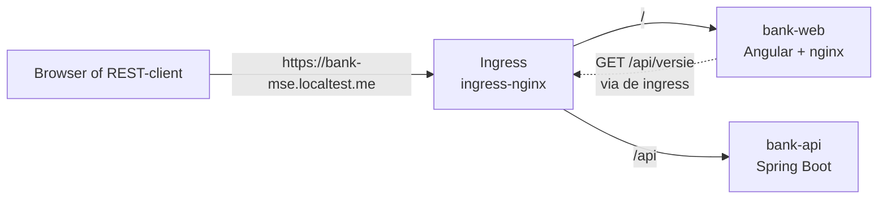

# Stap 0 controleren: het walking skeleton

> **Gearchiveerd op 2026-10-23, niet meer bijgehouden.** Aantallen, meldingen en commando's kunnen verouderd zijn. Hoe je nu controleert, staat in [werkwijze §10.1](../werkwijze-mse.md#101-controle-door-de-mens); de sabotages herhaalt PIT bij elke commit (ADR 0018).

Met deze instructie controleer je zelf wat er in stap 0 is gebouwd. Je doet het in deze volgorde:

1. Je kijkt wat er staat.
2. Je draait elke test en ziet hem groen worden.
3. Je maakt bij elke test bewust iets kapot. Dan zie je dat de test die fout echt vangt. Een test die nooit rood is geweest, bewijst niets.
4. Je installeert de app in het cluster en bekijkt hem.
5. Je controleert dat de installatie niets buiten namespace `banksim-mse` raakt.

Reken op ongeveer een uur. De achtergrond staat in [werkwijze-mse.md](../werkwijze-mse.md), hoofdstuk 3, en in de ADR's in [`adr/`](../adr).

## 1. Wat is er gebouwd

Het skelet doet functioneel bijna niets: de startpagina toont de versie van de API. Dat is bewust zo. Het doel is dat elke laag één keer van begin tot eind werkt. Elke laag heeft een eigen test.



| Laag | Waar | Wat het doet | Test |
| --- | --- | --- | --- |
| Acceptatietest | `e2e/` | Scenario "De startpagina toont de versie". Draait via de API en via drie browsers. | Is zelf de buitenste lus |
| Backend | `backend/bank-api` | `GET /api/versie` geeft `{"versie": "..."}` | `VersieControllerTests` (JUnit/MockMvc) |
| Domein | `backend/bank-domain` | Nog leeg. De module staat klaar voor slice 1. | – |
| Frontend | `frontend/` | Toont "Versie …" in de voettekst | `app.spec.ts` (Vitest) |
| Helm-chart | `deploy/banksim-mse` | Deployments, services en ingress, alles in `banksim-mse` | helm-unittest in `deploy/banksim-mse/tests/` |
| Scripts | `deploy/scripts` | `install.sh`, `uninstall.sh`, `build-images.sh` | bats in `deploy/scripts/test/` |
| Pipeline | `.github/workflows/ci.yml` | Commit stage en acceptance stage | actionlint (alleen de syntax) |

**Leesvolgorde van de code.** De volgorde gaat van buiten naar binnen, net zoals het skelet test-first is gebouwd:

1. `e2e/specs/skelet.spec.ts`: het scenario, in domeintaal.
2. `e2e/dsl/bank.ts` en `e2e/dsl/bezoeker.ts`: de DSL, dus wat een bezoeker kan doen en verwachten.
3. `e2e/drivers/rest/rest-driver.ts` en `e2e/drivers/ui/`: hoe de DSL het systeem aanspreekt, via HTTP of via de browser.
4. `backend/bank-api/.../versie/VersieController.java` met de bijbehorende test.
5. `frontend/src/app/app.ts` met `app.spec.ts`.
6. `deploy/banksim-mse/templates/` met `tests/`.
7. `deploy/scripts/install.sh` met `test/*.bats`.
8. `.github/workflows/ci.yml`.

> **Tip:** begin met een schone werkmap (`git status`). Dan laat `git diff` precies zien wat je kapotmaakt, en zet `git checkout -- <bestand>` een bestand terug.

## 2. Voorbereiding

Controleer dat de tools er zijn. Alle commando's draai je vanuit de root van het project.

```bash
java -version                                 # 21
/opt/homebrew/opt/node@24/bin/node --version  # v24.x (de Makefile zet deze Node in het PATH)
docker version --format '{{.Server.Version}}' # Docker/OrbStack draait
kind version                                  # 0.31
helm version --short                          # v4.x
kubectl config get-contexts -o name           # bevat kind-single-node
kubectl --context kind-single-node -n ingress-nginx get deploy ingress-nginx-controller
make help                                     # overzicht van alle targets
```

**Verwacht:** elk commando geeft een versie of een resultaat, zonder foutmelding.

## 3. De commit stage: unit- en infrastructuurtests

Dit zijn de snelle tests. In CI draaien ze bij elke push. Voor geen van deze tests is een cluster nodig.

### 3.1 Backend

```bash
make backend-test
```

**Verwacht:** het commando eindigt zonder fout. Met `-q` toont Maven alleen fouten.

**Zie hem rood.** Verander in `backend/bank-api/src/main/java/nl/banksim/api/versie/VersieController.java` deze regel:

```java
return new Versie(versie);
```

naar:

```java
return new Versie("vast");
```

Draai `make backend-test` opnieuw. Je verwacht `geeftDeIngesteldeVersie` te zien falen, met de melding `expected:<1.2.3> but was:<vast>`. Zet de regel daarna terug en controleer dat de test weer groen is.

### 3.2 Frontend

```bash
make frontend-test
```

**Verwacht:**
- lint is schoon;
- Vitest meldt `1 passed`;
- de build lukt.

**Zie hem rood.** Verander in `frontend/src/app/app.ts` de tekst `Versie {{ versie }}` naar `Release {{ versie }}`. Draai `make frontend-test` opnieuw. Nu faalt `toont de versie uit de API in de voettekst`. Laat de wijziging nog even staan: je gebruikt hem straks bij de acceptatietest in 4.3. Wil je nu verder, zet hem dan terug.

### 3.3 Infrastructuur

```bash
make iac
```

Het script `scripts/iac-check.sh` draait de tools in vastgepinde Docker-images (ADR 0006). De eerste keer worden die images gedownload. Dit zijn de stappen:

| Stap | Controleert |
| --- | --- |
| `helm lint` | De chart is geldig |
| `helm unittest` | 5 tests: namespace, host, routes, image-tag en versie |
| Namespace-check | Alles staat in `banksim-mse` en er zijn geen cluster-brede resources (ADR 0004) |
| `kubeconform` | De manifesten zijn geldig voor Kubernetes 1.35.0 |
| `shellcheck` | De scripts |
| `bats` | 4 tests: de contextbeveiliging en `--image-tag` |
| `actionlint` | De CI-workflow |

**Verwacht:** de laatste regel is `✓ Alle infrastructuurchecks groen`. Op een Mac met Apple Silicon draait helm-unittest via amd64-emulatie. Dat is trager, maar werkt.

**Zie hem rood.** Probeer deze drie fouten één voor één. Zet na elke fout de wijziging terug.

1. **Verkeerde host.** Verander in `deploy/banksim-mse/values.yaml` de waarde van `hosts.bank` in `bank.localtest.me`. Dat is de host van het origineel. Nu faalt `helm unittest`, met de test `luistert op een eigen host`.
2. **Resource buiten de namespace.** Maak een nieuw bestand `deploy/banksim-mse/templates/te-veel.yaml` met deze inhoud:
   ```yaml
   apiVersion: rbac.authorization.k8s.io/v1
   kind: ClusterRole
   metadata:
     name: te-veel
   rules: []
   ```
   Draai de check. De helm-unittests slagen nog, want het nieuwe bestand valt buiten hun templates. De namespace-check stopt wel, met `Niet toegestaan: ClusterRole/te-veel`. Daarom bestaat die check naast de unittests. Verwijder het bestand daarna weer.
3. **Script kiest de verkeerde context.** Verander in `deploy/scripts/lib.sh` de regel `KUBE_CONTEXT="kind-single-node"` in `KUBE_CONTEXT="$(kubectl config current-context)"`. Nu faalt bats: `install.sh gebruikt kind-single-node, ook als een andere context actief is`.

### 3.4 Alles samen

```bash
make commit-stage
```

Dit draait de backend, de frontend, de infrastructuurchecks en de typecheck van `e2e/`. Dat zijn dezelfde controles als de commit stage in CI. **Verwacht:** alles is groen. Dit is meteen de controle dat je alle opzettelijke fouten hebt teruggezet.

## 4. Installeren en de acceptatietest

### 4.1 Installeren in het cluster

```bash
make install
```

**Verwacht:** het script laat de volgende stappen zien:
1. vereisten en context;
2. de images bouwen: `bank-api` met Jib, `bank-web` met Docker;
3. de images laden in kind;
4. namespace, Helm-release en rooktests.

Het eindigt met:

```
✓ https://bank-mse.localtest.me/ → 200
✓ https://bank-mse.localtest.me/api/versie → 200
BankSim-MSE draait op https://bank-mse.localtest.me (namespace banksim-mse, context kind-single-node).
```

Controleer daarna zelf:

```bash
kubectl --context kind-single-node -n banksim-mse get pods,svc,ingress
curl -sk https://bank-mse.localtest.me/api/versie; echo
helm --kube-context kind-single-node -n banksim-mse list
```

**Verwacht:**
- De pods `bank-api` en `bank-web` hebben de status `Running 1/1`.
- De ingress `bank` heeft host `bank-mse.localtest.me`.
- `curl` geeft iets als `{"versie":"5c68299-dirty-1792265617"}`.

De versie is de image-tag. Die bestaat uit de korte git-hash met `-dirty-<tijdstempel>` erachter, omdat er niet-gecommitte wijzigingen zijn. Elke build krijgt zo een unieke tag. Na een commit wordt het alleen de hash.

Open daarna <https://bank-mse.localtest.me> in je browser. Je ziet een waarschuwing over het certificaat, want er is nog geen eigen CA. Die komt in de slice zero trust. Accepteer de waarschuwing. Je ziet nu "BankSim" en onderaan dezelfde versie als die van `curl`.

### 4.2 De acceptatietests draaien

```bash
make e2e-install   # eenmalig: Playwright en de browsers
make e2e
```

`make e2e` test wat er op dat moment geïnstalleerd is. Wil je installeren en testen in één stap, gebruik dan `make acceptance`. Het verschil met de acceptance stage in CI staat in [werkwijze-mse.md](../werkwijze-mse.md), hoofdstuk 3, "Acceptatietests lokaal en in CI".

**Verwacht:** 4 tests geslaagd. Het is hetzelfde scenario in vier projecten:

```
✓ [rest]     › skelet.spec.ts › De startpagina toont de versie
✓ [chromium] › skelet.spec.ts › De startpagina toont de versie
✓ [firefox]  › skelet.spec.ts › De startpagina toont de versie
✓ [webkit]   › skelet.spec.ts › De startpagina toont de versie
```

Bekijk het rapport met `npm --prefix e2e run report`. Klik een test open. Je ziet de stappen **Als** een bezoeker BankSim opent en **Dan** wordt de versie van BankSim getoond. Die stappen komen uit de DSL, niet uit losse Playwright-aanroepen.

### 4.3 Zie de acceptatietest rood

Dit is de belangrijkste controle. Je ziet hier dat de twee drivers echt iets anders testen.

1. Verander in `frontend/src/app/app.ts` de tekst `Versie {{ versie }}` in `Release {{ versie }}`. Als je die wijziging uit 3.2 nog hebt staan, hoef je niets te doen.
2. Installeer opnieuw met `make install`. Dat bouwt een nieuw `bank-web`-image.
3. Draai de tests met `make e2e`.

**Verwacht:**
- `[rest]` slaagt, want de API is niet veranderd.
- `[chromium]`, `[firefox]` en `[webkit]` falen. De melding is: `Expected pattern: /Versie \S+/`.
- Het rapport bevat een screenshot en een trace.

Zet de tekst terug en draai `make install` en `make e2e` opnieuw. Nu zijn alle 4 de tests weer groen.

Je kunt ook het omgekeerde proberen: maak de API kapot en laat de UI heel. Zet `return new Versie("");` in `VersieController` en draai `make install`. Dat bouwt de images zonder unittests (`-DskipTests`), dus de kapotte API komt gewoon in het cluster. De rooktest slaagt nog, want die controleert alleen de status 200. Het scenario faalt wel, in alle 4 de projecten, omdat een lege versie niet aan `^\S+$` voldoet. Daar zie je het verschil tussen een rooktest en een acceptatietest. Zet de regel daarna terug.

## 5. Veiligheid: alleen `banksim-mse` op `kind-single-node`

ADR 0004 belooft dat de scripts nooit een ander cluster of een andere namespace aanraken. Het installatiescenario controleert dat automatisch:

```bash
make e2e-infra
```

**Verwacht:** 3 geslaagd en 1 overgeslagen.
- **Geslaagd:**
  - "Opnieuw installeren verandert niets";
  - "Een andere actieve kubectl-context wordt genegeerd";
  - "Een onbekende context wordt geweigerd".
- **Overgeslagen:** "Het origineel in namespace banksim blijft onaangeroerd". Dat gebeurt alleen als namespace `banksim` niet bestaat.

De scenario's met `@destructief` ("Installeren …" en "Verwijderen laat niets achter") draaien alleen in CI. Ze verwijderen de installatie, en dat wil je op `kind-single-node` niet.

**Zie hem rood.** Verander in `deploy/banksim-mse/templates/bank-api.yaml` de pod-template. Zet onder `template.metadata` een annotatie `geinstalleerd-op: {{ now | quote }}` en draai `make e2e-infra`. "Opnieuw installeren verandert niets" faalt dan: de generation van `Deployment/bank-api` gaat omhoog en er verschijnt een nieuwe pod. Zet het daarna terug en draai `make install`.

Dezelfde controles kun je ook met de hand doen:

```bash
# Een context die niet bestaat, wordt geweigerd voordat er iets gebeurt.
deploy/scripts/install.sh --context bestaat-niet
# Verwacht: ✗ kubectl-context 'bestaat-niet' bestaat niet (kies een andere met --context)

# De actieve kubectl-context doet er niet toe.
kubectl config current-context
#   Zet hem tijdelijk op iets anders, bijvoorbeeld: kubectl config use-context <andere-context>
#   Draai dan: deploy/scripts/install.sh --skip-build
#   Verwacht: "Context kind-single-node", en de installatie gaat naar single-node.
#   Zet daarna je context terug.

# Opnieuw installeren is idempotent.
deploy/scripts/install.sh --skip-build
helm --kube-context kind-single-node -n banksim-mse history banksim-mse
# Verwacht: een extra revisie en dezelfde image-tag. De pods blijven Running.

# Alle resources van het project dragen het label van de release.
kubectl --context kind-single-node get all,ingress -A -l app.kubernetes.io/instance=banksim-mse
# Verwacht: alles staat in namespace banksim-mse.
```

Staat het origineel geïnstalleerd in namespace `banksim`? Controleer dan dat dat er niets van merkt:

```bash
kubectl --context kind-single-node -n banksim get pods
```

### Verwijderen en opnieuw installeren

```bash
make uninstall          # vraagt om bevestiging, gebruik -y in het script om dat over te slaan
kubectl --context kind-single-node get ns banksim-mse                                      # Verwacht: NotFound
kubectl --context kind-single-node get all,ingress -A -l app.kubernetes.io/instance=banksim-mse  # Verwacht: No resources found
make install && make e2e                                                                  # Verwacht: weer alles groen
```

## 6. De pipeline op GitHub

Elke push naar `main` start de workflow `.github/workflows/ci.yml`. Bekijk de runs op <https://github.com/edwinbulter/banksim-mse/actions>, of in de terminal:

```bash
gh run list --limit 5
gh run view <run-id>
```

Zo ziet een run eruit:

1. **Commit stage.** De jobs `backend`, `frontend`, `infrastructuur` en `images` draaien parallel. Samen duren ze ongeveer een minuut.
2. **Acceptance stage.** Deze start alleen als de hele commit stage groen is. Hij maakt een tijdelijk kind-cluster `banksim-mse-ci` en installeert ingress-nginx. Daarna installeert hij met `--image-tag` precies de images uit de job `images`, die dus niet opnieuw worden gebouwd. Daarna draait hij de Playwright-tests. Tot slot maakt hij een nep-origineel in namespace `banksim` en draait hij de installatiescenario's, ook die met `@destructief`. De Playwright-rapporten staan als artefact bij de run.

**Verwacht:** de laatste run op `main` is groen, met 4 geslaagde acceptatietests in de log van de acceptance stage.

**Rood is al gezien.** De eerste twee runs faalden, en dat liet zien dat de pipeline echt tegenhoudt:

| Run | Faalde in | Oorzaak | Gevolg |
| --- | --- | --- | --- |
| 1 | Commit stage – infrastructuur | helm-unittest draait als uid 1000 en mocht niet schrijven in de checkout van uid 1001. Op macOS merk je dat niet. | De acceptance stage werd overgeslagen |
| 2 | Acceptance stage, bij de installatie | De admission-webhook van ingress-nginx nam nog geen verbindingen aan, terwijl de controller al "available" was | Er werd niets getest op een halve installatie |
| 3 | – | – | Groen: 4 acceptatietests geslaagd |

Wil je het zelf zien? Commit de wijziging uit 4.3 op een branch en push die. De job `frontend` faalt dan, en de acceptance stage start niet. Verwijder de branch daarna weer.

## Checklist

- [ ] Vereisten aanwezig (sectie 2)
- [ ] `make backend-test` groen, en rood gezien bij een vaste versie
- [ ] `make frontend-test` groen, en rood gezien bij "Release"
- [ ] `make iac` groen, en rood gezien bij een verkeerde host, een ClusterRole en de actieve context
- [ ] `make commit-stage` groen, dus alle wijzigingen teruggezet
- [ ] `make install` geslaagd, pods Running, versie zichtbaar in de browser
- [ ] `make e2e` geeft 4 geslaagd, het rapport toont de stappen Als en Dan
- [ ] Rood gezien: een kapotte UI faalt alleen in de browsers, een lege versie faalt in alle 4 de projecten
- [ ] `make e2e-infra`: 3 geslaagd (opnieuw installeren, actieve context genegeerd, onbekende context geweigerd), en rood gezien bij een wisselende annotatie
- [ ] `make uninstall` laat niets achter, en `make install` plus `make e2e` zijn daarna weer groen
- [ ] Laatste pipeline-run op `main` groen, met 4 geslaagde acceptatietests en 6 geslaagde installatiescenario's (sectie 6)
