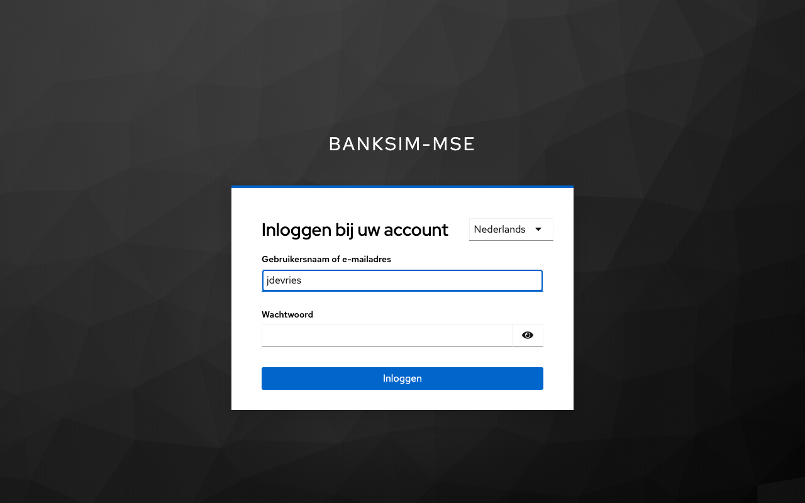
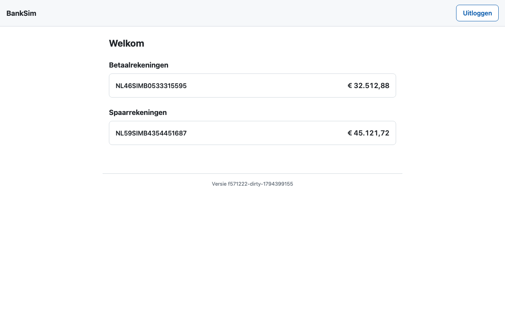
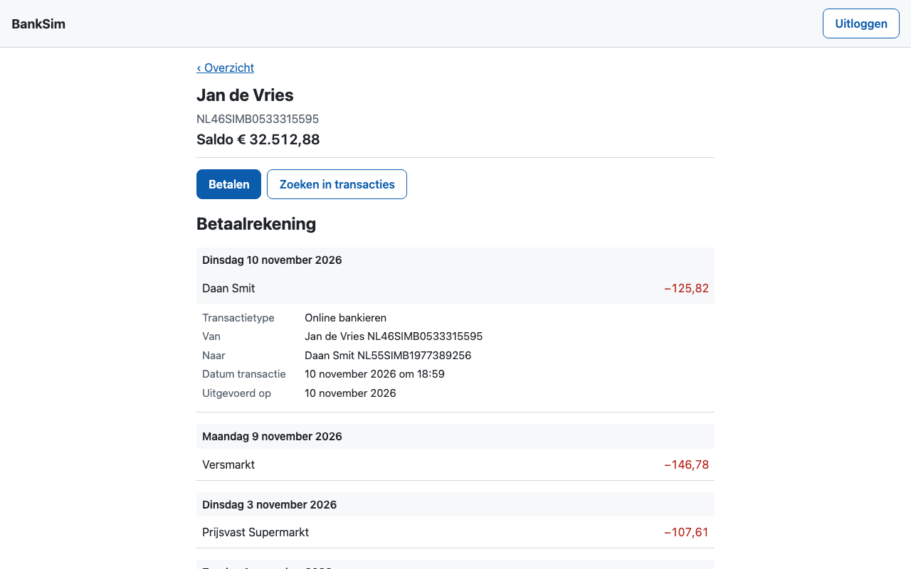
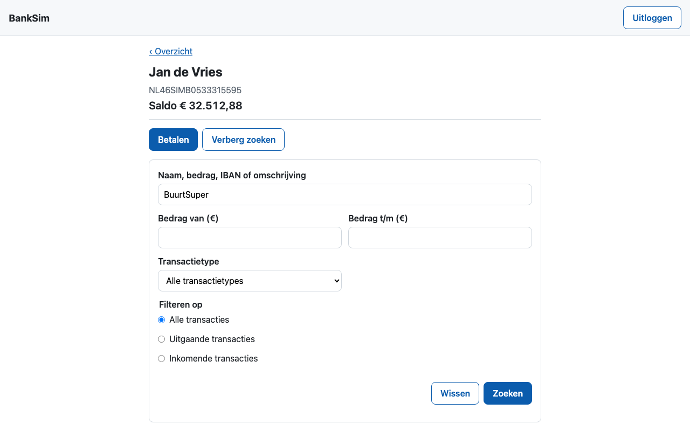
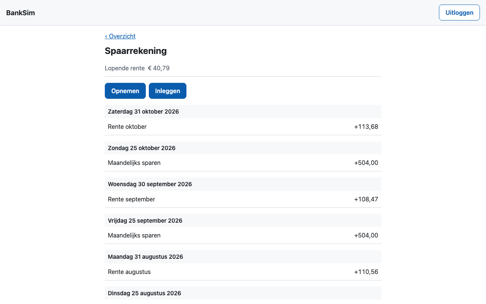
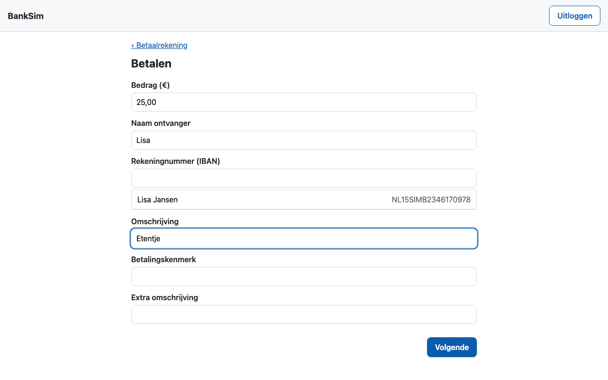
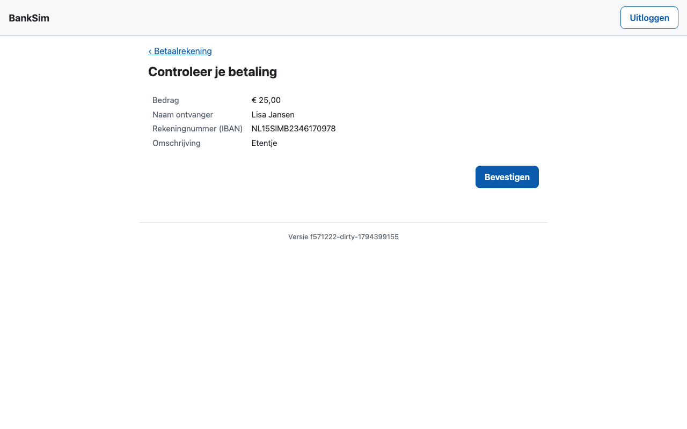
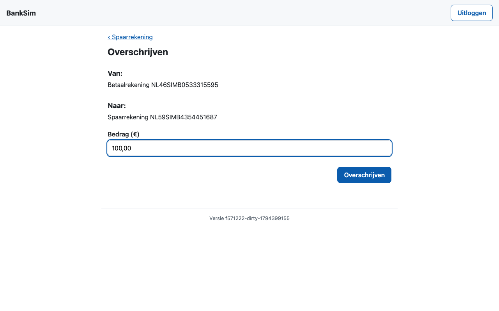
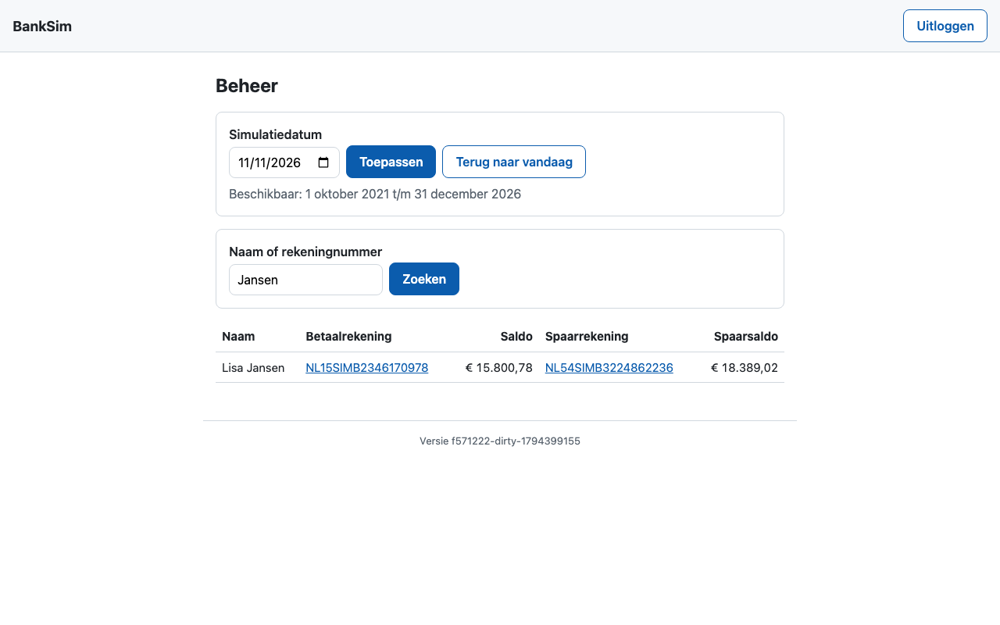
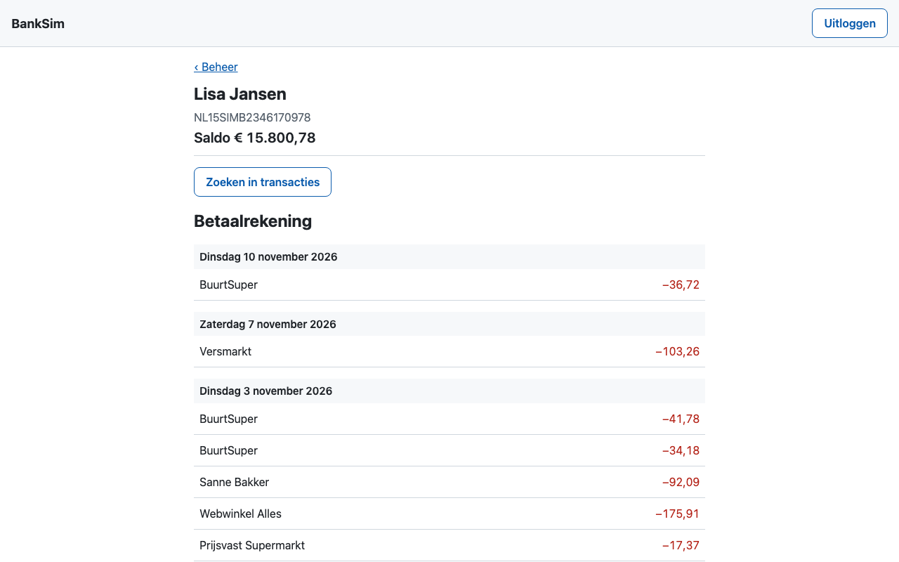

# BankSim-MSE-handleiding

Deze handleiding legt uit hoe je BankSim-MSE installeert en gebruikt. Als klant log je in, bekijk je je rekeningen en maak je geld over. Als beheerder verzet je de simulatiedatum en kijk je mee bij klanten.

BankSim-MSE is een gesimuleerde bank, opnieuw gebouwd naar het voorbeeld van [BankSim](https://github.com/edwinbulter/banksim) ([handleiding van het origineel](https://github.com/edwinbulter/banksim/blob/main/doc/banksim-handleiding.md)). Tien fictieve huishoudens hebben elk een betaalrekening en een spaarrekening, met nepdata van oktober 2021 tot en met december 2026. Er is geen echt geld, en er zijn geen echte personen of bedrijven. De [README](../README.md) geeft het overzicht voor ontwikkelaars.

> **Let op:** de opmaak is die van het origineel, maar de schermen tonen nog minder dan daar. Zo staan in de bovenbalk geen datum en geen naam, heeft een rekening op het Overzicht geen naam als *Betaalrekening*, en staat een rekeningnummer zonder spaties. Die verschillen staan op de backlog ([werkwijze, losse backlogpunten](werkwijze-mse.md#losse-backlogpunten)).

## Inhoud

1. [Vereisten](#1-vereisten)
2. [Installeren](#2-installeren)
3. [Wachtwoorden en demo-klanten](#3-wachtwoorden-en-demo-klanten)
4. [Inloggen als klant](#4-inloggen-als-klant)
5. [Rekeningen bekijken](#5-rekeningen-bekijken)
6. [Geld overmaken](#6-geld-overmaken)
7. [Inloggen als beheerder](#7-inloggen-als-beheerder)
8. [Beheerder: simulatiedatum en rekeninghouders](#8-beheerder-simulatiedatum-en-rekeninghouders)
9. [Uitloggen](#9-uitloggen)
10. [Data terugzetten en verwijderen](#10-data-terugzetten-en-verwijderen)
11. [Problemen oplossen](#11-problemen-oplossen)
12. [De schermafdrukken bijwerken](#12-de-schermafdrukken-bijwerken)

---

## 1. Vereisten

BankSim-MSE draait in een eigen namespace `banksim-mse` in een bestaand lokaal Kubernetes-cluster. Daarbuiten installeert het niets. Het origineel in namespace `banksim` mag ernaast draaien.

**Cluster**

- [OrbStack](https://orbstack.dev) of Docker, met een [kind](https://kind.sigs.k8s.io)-cluster `single-node`. De kubectl-context heet `kind-single-node`.
- [ingress-nginx](https://kubernetes.github.io/ingress-nginx/) in dat cluster, bereikbaar op poort 80 en 443 van je machine.

Controleer het cluster met:

```bash
kubectl --context kind-single-node get nodes
kubectl --context kind-single-node -n ingress-nginx get deployment ingress-nginx-controller
```

Beide commando's moeten een resultaat geven, zonder foutmelding.

**Gereedschap op je machine**

| Tool | Waarvoor |
| --- | --- |
| Java 21 (JDK) | De backend bouwen |
| Node.js 24 | De Angular-frontend bouwen en de Playwright-tests draaien. De `Makefile` zet `/opt/homebrew/opt/node@24/bin` vooraan in het `PATH` |
| kind, kubectl, Helm 4 | Images in het cluster laden en installeren |

Maven hoef je niet te installeren: de backend gebruikt de wrapper `backend/mvnw`.

**Netwerk**

De adressen `bank-mse.localtest.me` (de bank) en `auth-mse.localtest.me` (Keycloak, het inlogscherm) verwijzen altijd naar je eigen machine (127.0.0.1). Je hoeft `/etc/hosts` dus niet aan te passen.

---

## 2. Installeren

Ga naar de map van het project en start de installatie:

```bash
make install
```

Dat roept `deploy/scripts/install.sh` aan. Het script:

1. controleert de vereisten en het cluster;
2. bouwt de images en laadt ze in het kind-cluster;
3. maakt de namespace `banksim-mse` aan;
4. maakt willekeurige wachtwoorden en client secrets aan, als Kubernetes Secrets;
5. installeert PostgreSQL, Keycloak, de backend en de frontend met Helm;
6. draait een paar rooktests: antwoorden de frontend, de API en Keycloak?

Na de installatie maakt de Kubernetes Job `bank-demo` de 10 demo-klanten en de beheerder aan, met hun rekeningen en transacties. De eerste installatie duurt langer, omdat Keycloak dan voor het eerst start en de Job `keycloak-config` de realm aanmaakt.

`make install` bouwt de images zonder de tests te draaien. Wil je eerst alle tests, draai dan `make commit-stage`.

Je kunt opnieuw installeren zonder dat er iets verloren gaat: bestaande wachtwoorden en data blijven staan. Handige opties van `deploy/scripts/install.sh`:

| Optie | Effect |
| --- | --- |
| `--skip-build` | Geen nieuwe images bouwen |
| `--skip-smoke-tests` | De rooktests overslaan |
| `--image-tag <tag>` | Een bestaande image-tag installeren |
| `--context <naam>` | Een andere kubectl-context gebruiken |

Meer over de installatie staat in [deploy/README.md](../deploy/README.md).

### De certificaatwaarschuwing

BankSim-MSE heeft nog geen eigen certificaat: ingress-nginx toont zijn standaardcertificaat, en dat kent je browser niet. De browser waarschuwt daarom. Accepteer die waarschuwing voor **zowel** <https://bank-mse.localtest.me> **als** <https://auth-mse.localtest.me>, anders loopt het inloggen vast.

---

## 3. Wachtwoorden en demo-klanten

De installatie maakt de wachtwoorden willekeurig aan. Ze staan in het Secret `bank-demo`:

```bash
# Het wachtwoord van alle klanten
kubectl --context kind-single-node -n banksim-mse get secret bank-demo \
  -o jsonpath='{.data.KLANT_WACHTWOORD}' | base64 -d; echo

# Het wachtwoord van de beheerder
kubectl --context kind-single-node -n banksim-mse get secret bank-demo \
  -o jsonpath='{.data.BEHEERDER_WACHTWOORD}' | base64 -d; echo
```

Alle tien klanten hebben hetzelfde wachtwoord.

| Gebruikersnaam | Naam | Situatie |
| --- | --- | --- |
| `jdevries` | Jan de Vries | Werknemer, woont alleen, huurt |
| `sbakker` | Sanne Bakker | Werknemer, huishouden van meer personen, hypotheek |
| `melamrani` | Mohamed El Amrani | Werknemer, huishouden van meer personen, huurt |
| `ljansen` | Lisa Jansen | Werknemer in het onderwijs, woont alleen, huurt |
| `pvisser` | Pieter Visser | Gepensioneerd, huishouden van meer personen, zonder huur of hypotheek |
| `fyilmaz` | Fatma Yilmaz | Werknemer, huishouden van meer personen, hypotheek |
| `dsmit` | Daan Smit | Zzp'er, woont alleen, hypotheek |
| `edeboer` | Emma de Boer | Werknemer, huishouden van meer personen, huurt |
| `rmulder` | Ruud Mulder | Gepensioneerd, woont alleen, huurt |
| `nhendriks` | Noor Hendriks | Werknemer met het hoogste inkomen, huishouden van meer personen, hypotheek |
| `beheerder` | | De beheerder, met een eigen wachtwoord |

Alle demo-klanten staan in elkaars contacten. Je kunt dus elke demo-klant betalen, bijvoorbeeld Jan aan Lisa.

---

## 4. Inloggen als klant

1. Open <https://bank-mse.localtest.me> en klik op **Inloggen**. Je komt op het inlogscherm van Keycloak.
2. Vul een gebruikersnaam in, bijvoorbeeld `jdevries`, en het klantwachtwoord.
3. Klik op **Inloggen**.



Rechtsboven in het inlogscherm kies je de taal: Nederlands of Engels.

Na het inloggen kom je op het **Overzicht**.

> **Let op:** na 5 foute wachtwoorden blokkeert Keycloak de gebruiker tijdelijk. De eerste keer is dat 1 minuut, en bij herhaling langer, tot hoogstens 15 minuten. Wacht dan even en probeer het opnieuw.

---

## 5. Rekeningen bekijken

### Overzicht

Onder **Welkom** staan je rekeningen, elk op een eigen kaart met het rekeningnummer (IBAN) en het saldo: eerst de betaalrekening, daaronder de spaarrekening. Klik op een kaart om de rekening te openen.



Rechts in de balk bovenaan staat de knop **Uitloggen**. Onderaan staat de versie van BankSim-MSE die draait.

### Betaalrekening

Bovenaan staan de link **‹ Overzicht**, je naam, het rekeningnummer en het saldo van vandaag. Daaronder staan de knoppen **Betalen** en **Zoeken in transacties**, en de transacties, de nieuwste bovenaan.



- De transacties staan per dag onder een kop met de datum, bijvoorbeeld *Dinsdag 10 november 2026*.
- Een afschrijving staat in het rood, met een minteken (**−125,82**). Een bijschrijving, zoals je salaris, staat in het groen, met een plusteken.
- **Klik op een transactie** om de details te zien:
  - het transactietype, bijvoorbeeld *Online bankieren*;
  - **Van** en **Naar**, met de naam en het rekeningnummer;
  - de datum en het tijdstip van de transactie;
  - de datum waarop hij is uitgevoerd;
  - de omschrijving en het betalingskenmerk, als die er zijn.

  Klik nog een keer om de details te sluiten.
- Bij een betaling met de pinpas (*Betaalautomaat*) staat bij **Naar** alleen de naam van de winkel, zonder rekeningnummer.
- Je ziet eerst 50 transacties. Klik onderaan op **Toon meer** voor de volgende 50. Als alles er staat, verdwijnt de knop.

### Zoeken in transacties

Klik op **Zoeken in transacties**. Het zoekformulier verschijnt, en de knop heet nu **Verberg zoeken**.



| Veld | Gebruik |
| --- | --- |
| Naam, bedrag, IBAN of omschrijving | Vrije tekst, bijvoorbeeld `BuurtSuper` of een deel van een rekeningnummer |
| Bedrag van (€) en Bedrag t/m (€) | Een bereik, bijvoorbeeld van `50` t/m `150`. Gebruik een komma voor centen (`12,50`) |
| Transactietype | Online bankieren, iDEAL \| Wero, Betaalautomaat, Incasso, Geldautomaat, Overschrijving of Verzamelbetaling |
| Filteren op | Alle transacties, alleen uitgaande of alleen inkomende |

Klik op **Zoeken** om te filteren. Met **Wissen** zie je weer alle transacties. Is "Bedrag van" groter dan "Bedrag t/m", dan krijg je een melding. Vindt de zoekopdracht niets, dan staat er *Geen transacties gevonden.*

### Spaarrekening

Klik op het Overzicht op het rekeningnummer van de spaarrekening.



- Bovenaan staat de **lopende rente**, met daaronder de knoppen **Opnemen** en **Inleggen** (zie [hoofdstuk 6](#inleggen-en-opnemen)).
- De lopende rente is de rente die je deze maand al hebt opgebouwd, maar die nog niet is bijgeschreven. De spaarrente is 3% per jaar. Op de laatste dag van elke maand schrijft de bank hem bij, bijvoorbeeld *Rente oktober +113,68*.
- De lijst toont per dag de omschrijving en het bedrag. Bij de overgang naar een ouder jaar staat een regel met het jaartal, bijvoorbeeld *2025*.

---

## 6. Geld overmaken

### Betalen

Ga naar de betaalrekening en klik op **Betalen**.



1. Vul het **Bedrag (€)** in, met een komma voor centen (`25,00`).
2. Typ een deel van de **Naam ontvanger**, of het begin van het **Rekeningnummer (IBAN)**. Onder de velden verschijnen suggesties uit de contactenlijst van de bank. Klik op een suggestie om de naam en het rekeningnummer in één keer in te vullen.
3. Vul als je wilt een **Omschrijving**, een **Betalingskenmerk** en een **Extra omschrijving** in. In die velden passen hoogstens 140, 25 en 35 tekens. De naam mag 70 tekens lang zijn, het rekeningnummer 34.
4. Klik op **Volgende**. Je ziet het controlescherm.



5. Klopt alles, klik dan op **Bevestigen**. Je komt terug op de betaalrekening, en de betaling staat bovenaan. Wil je nog iets aanpassen, ga dan met de link **‹ Betaalrekening** terug en begin opnieuw.

Log in als de ontvanger, bijvoorbeeld `ljansen`, om de bijschrijving te zien.

Goed om te weten:

- **Je kunt niet rood staan.** Is het bedrag te hoog, dan weigert de bank de betaling met *Saldo ontoereikend: deze betaling zou het saldo onder € 0,00 brengen, nu of op een latere datum.* Ook afschrijvingen die al gepland staan voor een latere datum tellen mee. Daardoor kan soms ook een bedrag onder je saldo te veel zijn.
- **Alleen naar contacten.** Betaal je naar een rekeningnummer dat niet in de contactenlijst staat, dan krijg je *Naar dit rekeningnummer kan niet worden betaald.*
- **De naam moet kloppen.** Hoort de naam niet bij het rekeningnummer, dan krijg je *De naam van de ontvanger hoort niet bij dit rekeningnummer.* Kies daarom liefst een suggestie.
- **Niet dubbel betalen.** Klik je per ongeluk twee keer op **Bevestigen**, dan boekt de bank de betaling toch maar één keer.

### Inleggen en opnemen

Ga naar de spaarrekening en klik op **Inleggen** (van de betaalrekening naar de spaarrekening) of op **Opnemen** (van de spaarrekening naar de betaalrekening). Je komt op het scherm **Overschrijven**.



1. Controleer **Van** en **Naar**. Die liggen vast: ze volgen uit je keuze voor Inleggen of Opnemen.
2. Vul het **Bedrag (€)** in.
3. Klik op **Overschrijven**. De knop werkt pas als de rekeningen geladen zijn, en Van en Naar allebei een rekeningnummer hebben.

Je komt terug op de spaarrekening, met de overschrijving bovenaan. Ook hier kan geen van beide rekeningen onder nul komen: dan krijg je een melding die begint met *Saldo ontoereikend*.

---

## 7. Inloggen als beheerder

Log uit als klant, of gebruik een privévenster, en ga naar <https://bank-mse.localtest.me>. Log in met gebruikersnaam `beheerder` en het beheerderswachtwoord. Je komt direct op het scherm **Beheer**.

---

## 8. Beheerder: simulatiedatum en rekeninghouders



### De simulatiedatum verzetten

De simulatiedatum bepaalt voor **alle** klanten welke dag het "nu" is in de bank: welke transacties ze zien en welk saldo ze hebben. Zo kun je terug of vooruit in de tijd.

1. Kies een datum in het veld **Simulatiedatum**. Onder het veld staat welke datums kunnen: *Beschikbaar: 1 oktober 2021 t/m 31 december 2026*.
2. Klik op **Toepassen**. Je ziet *Simulatiedatum toegepast.* Kies je een datum buiten de historie, dan krijg je *Kies een datum van 1 oktober 2021 t/m 31 december 2026.*
3. Met **Terug naar vandaag** staat de bank weer op de echte datum van vandaag. Je ziet dan *De bank staat weer op vandaag.*

Voorbeeld: zet de datum op 15 juli 2026 en log in als `jdevries`. De nieuwste transactie is dan van 15 juli of eerder, en het saldo is dat van 15 juli.

### Rekeninghouders bekijken

Typ een naam of een rekeningnummer in **Naam of rekeningnummer** en klik op **Zoeken**. De tabel **Rekeninghouders** toont van elke gevonden klant:
- de naam;
- het rekeningnummer en het saldo van de betaalrekening;
- het rekeningnummer en het saldo van de spaarrekening.

Klik op een rekeningnummer om die rekening te bekijken.



- Je ziet hetzelfde scherm als de klant: bovenaan de naam van de klant, het rekeningnummer en het saldo, en daaronder de transacties, de details en het zoeken.
- De knoppen **Betalen**, **Opnemen** en **Inleggen** ontbreken: een beheerder kan geen geld verplaatsen namens een klant.
- Met de link **‹ Beheer** ga je terug naar het beheerscherm.

Wat de beheerder kan aanpassen, is dus alleen de simulatiedatum. Gebruikers, wachtwoorden en rollen staan in Keycloak.

---

## 9. Uitloggen

Klik rechtsboven op **Uitloggen**. Dat beëindigt je sessie in de bank en ook bij Keycloak: wie daarna op **Inloggen** klikt, moet het wachtwoord opnieuw invullen.

Is je sessie verlopen, dan toont de bank bij het volgende verzoek de link **Inloggen**.

---

## 10. Data terugzetten en verwijderen

Er is geen apart script om de data terug te zetten. Verwijder de installatie en installeer opnieuw:

```bash
deploy/scripts/uninstall.sh -y && make install
```

`make uninstall` doet hetzelfde als `deploy/scripts/uninstall.sh`, maar vraagt eerst om bevestiging. Het script verwijdert de namespace `banksim-mse` met alle data, ook de wachtwoorden. De rest van het cluster, en dus ook het origineel in namespace `banksim`, blijft zoals het is. Met `--purge` verwijdert het ook de images van BankSim-MSE van de node.

Na de nieuwe installatie hebben de demo-klanten precies dezelfde transacties en saldi als na de vorige. De generator gebruikt vaste startwaarden, en een test bewaakt dat. Wat wel verandert:
- de rekeningnummers, want die kiest de installatie willekeurig;
- de wachtwoorden;
- de simulatiedatum, want die staat dan weer op vandaag.

---

## 11. Problemen oplossen

| Wat je ziet | Oorzaak en oplossing |
| --- | --- |
| De browser waarschuwt dat de verbinding niet privé is | Het certificaat van ingress-nginx is niet van een bekende uitgever. Accepteer de waarschuwing voor zowel `bank-mse.localtest.me` als `auth-mse.localtest.me` |
| Inloggen blijft hangen, of je krijgt een foutpagina na de waarschuwing | De waarschuwing is maar voor één van de twee adressen geaccepteerd. Open <https://auth-mse.localtest.me> los, accepteer daar ook, en probeer opnieuw |
| *Gebruikersnaam of wachtwoord ongeldig.* | Controleer het wachtwoord met de commando's uit [hoofdstuk 3](#3-wachtwoorden-en-demo-klanten). Na 5 fouten is de gebruiker tijdelijk geblokkeerd: wacht een minuut |
| *Saldo ontoereikend: …* | Het bedrag is te hoog, ook met de afschrijvingen die later nog komen. Kies een lager bedrag, of neem eerst geld op van de spaarrekening |
| *Naar dit rekeningnummer kan niet worden betaald.* | Het rekeningnummer staat niet in de contactenlijst. Kies een ontvanger uit de suggesties |
| *Rekening is niet gevonden.* | Je opende het adres van een rekening die niet van jou is, of die niet bestaat. Ga terug naar het Overzicht |
| *Er ging iets mis. Probeer het later opnieuw.* | De bank gaf een onverwachte fout, of was even niet bereikbaar. Probeer het na een paar seconden opnieuw. Blijft het, controleer dan de pods (hieronder) |
| De pagina laadt helemaal niet | Controleer of alles draait: `kubectl --context kind-single-node -n banksim-mse get pods`. Draai zo nodig `make install` opnieuw |
| Welke versie draait er? | Kijk onderaan het scherm, of gebruik `curl -sk https://bank-mse.localtest.me/api/versie` |

---

## 12. De schermafdrukken bijwerken

De schermafdrukken in deze handleiding maakt Playwright, met de demo-klant Jan de Vries en de beheerder:

```bash
make handleiding
```

Het script `e2e/handleiding/schermafdrukken.handleiding.ts` logt in op de installatie die er nu draait, en schrijft de afbeeldingen naar `doc/handleiding/`. Het kijkt alleen. Het stopt vóór **Bevestigen** en vóór **Overschrijven**, en laat de simulatiedatum staan. Zo blijven de demo-data gelijk aan wat de tests verwachten. De afbeeldingen tonen de transacties tot en met de dag waarop je het script draait, en de versie die op dat moment draait.
