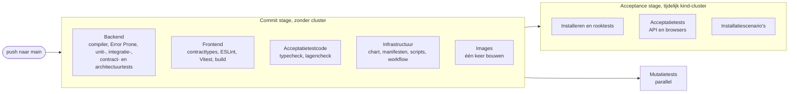

# Kwaliteitscontroles

Dit document beschrijft welke **soorten** tests en controles dit project heeft om de kwaliteit van de code hoog te houden. Per soort staat erin wat ze controleert, hoe ze dat doet, waar ze staat en wanneer ze draait.

## Leeswijzer

Dit is geen lijst van alle tests. Die lijst verandert bij bijna elke commit, de soorten veranderen zelden. Daarom noemt dit document geen aantallen, versies, drempels of namen van losse testklassen. Voorbeelden staan er alleen in als er een ADR achter zit.

De actuele lijst staat op de plekken die al worden bijgehouden:

| Wat | Waar |
| --- | --- |
| Alle vangrails, met hun test en of ze rood gezien zijn | de tabel "Vangrails" in [`CLAUDE.md`](../CLAUDE.md) |
| Welke controles lokaal draaien | `make help` en de [`Makefile`](../Makefile) |
| Welke controles in de pipeline draaien, en in welke stage | [`.github/workflows/ci.yml`](../.github/workflows/ci.yml) |
| Waarom een controle bestaat | de sectie "Bewaking" van elke ADR in [`doc/adr/`](adr) |
| De werkwijze erachter | [`werkwijze-mse.md`](werkwijze-mse.md): de double loop (hoofdstuk 4), de acceptatietests (hoofdstuk 5), de infrastructuur (hoofdstuk 9) en de controle door de mens (§10.1) |

Verschillen dit document en die bronnen, dan wint de bron.

## 1. Uitgangspunten

- **De pipeline is de scheidsrechter** (ADR 0002). Wat niet automatisch gecontroleerd wordt, is niet geborgd. Vertrouw niet op mensen die code lezen, maar op controles die bij elke commit draaien.
- **Snel eerst.** De commit stage geeft binnen minuten feedback, zonder cluster. De acceptance stage test daarna het geïnstalleerde systeem. Een fout hoort zo vroeg mogelijk te vallen: liever in de compiler dan in een unittest, liever in een unittest dan in een acceptatietest.
- **Lokaal en in CI hetzelfde.** Elke controle heeft een `make`-target. De tools voor de infrastructuur draaien in containers die op digest zijn vastgepind (ADR 0006).
- **Een beslissing heeft een bewaking.** Elke ADR zegt hoe de beslissing automatisch bewaakt wordt.
- **Eén keer rood gezien.** Een nieuwe vangrail is pas af als hij één keer gefaald heeft op een bewuste overtreding (een sabotage). Een test die nooit rood is geweest, kan ook altijd groen zijn.
- **Testen worden zelf getest.** De mutatietests controleren of de tests een fout in de code ook echt opmerken.

## 2. Overzicht

"Commit stage" is de naam van de eerste stage van de pipeline (Farley), niet een controle bij `git commit`. Er zijn geen git-hooks: lokaal committen controleert niets. De pipeline (`.github/workflows/ci.yml`) start bij een push naar `main` en bij een pull request. Wil je de controles vóór het pushen draaien, gebruik dan `make commit-stage` en `make acceptance`.

| Soort | Wat het controleert | Hoe | Pipeline-stage |
| --- | --- | --- | --- |
| Compiler en typecontrole | Dat de code klopt met zijn eigen types | `javac`, TypeScript in strenge modus | commit stage |
| Statische analyse en linters | Bekende foutpatronen en projectregels | Error Prone, ESLint, shellcheck, actionlint | commit stage |
| Unittests | Het gedrag van één eenheid, snel en geïsoleerd | JUnit, jqwik, Vitest, bats | commit stage |
| Integratietests | De samenwerking met een echte afhankelijkheid | Testcontainers, MockMvc, nep-servers | commit stage |
| Contracttests | Dat de API en zijn gebruikers dezelfde afspraak volgen | OpenAPI-specificatie, validator, gegenereerde types | commit stage |
| Architectuurvangrails | Ontwerpregels: lagen, grenzen, verboden constructies | ArchUnit, bronscans, scripts, Maven-modules | commit stage |
| Regels in de database | Invarianten die nooit geschonden mogen worden | Constraints en triggers in de Flyway-migraties | commit stage (via de repositorytests), en daarna bij elke schrijfactie in de draaiende database |
| Mutatietests | Of de tests fouten in de code opmerken | PIT | commit stage (parallel aan de acceptance stage) |
| Infrastructuur als code | Chart, scripts en pipeline, zonder cluster | helm lint, helm-unittest, kubeconform, yq, bats, shellcheck, actionlint | commit stage |
| Acceptatietests | Het gedrag van het geïnstalleerde systeem, vanuit de gebruiker | Playwright met een interne DSL, via de API en in browsers | acceptance stage |
| Installatiescenario's | Installeren, opnieuw installeren, upgraden en verwijderen | Playwright met de shell-driver | acceptance stage |
| Rooktests | Dat de installatie antwoordt | `install.sh` | bij elke installatie, ook in de acceptance stage |
| Controle door de mens | Wat een machine niet kan beoordelen | Scenario, ADR, rapport, diff van de specs, verkennend testen | buiten de pipeline, per slice |

## 3. De soorten

### 3.1 Compiler en typecontrole

**Wat.** Dat de code consistent is met haar eigen types: geen verkeerd type, geen vergeten `null`, geen veld dat niet bestaat.

**Hoe.**
- **Java:** de compiler, waarbij elke waarschuwing de build breekt.
- **Frontend:** TypeScript in strenge modus, ook voor de Angular-templates (`strict` en `strictTemplates` in `frontend/tsconfig.json`). Zo valt een fout in een template al bij het bouwen op, niet pas in de browser.
- **Acceptatietests:** een aparte typecheck (`npm --prefix e2e run typecheck`), omdat Playwright de types zelf niet controleert.

**Wat het niet vangt.** Code die goed getypeerd is, maar het verkeerde doet.

### 3.2 Statische analyse en linters

**Wat.** Bekende foutpatronen die de compiler toelaat, en regels die specifiek zijn voor dit project.

**Hoe.**
- **Java:** Error Prone draait als plugin van de compiler, in elke module (ADR 0033). Het vindt bijvoorbeeld een `toLowerCase()` zonder `Locale` of een genegeerde returnwaarde. Een melding breekt de build.
- **Frontend:** ESLint, met de aanbevolen regels voor TypeScript en Angular plus eigen regels. Een voorbeeld is dat bedragen nooit naar een getal worden omgezet (ADR 0010).
- **Scripts en pipeline:** shellcheck controleert de shellscripts, actionlint de workflow van GitHub Actions.

**Waar.** De configuratie staat bij de build: de compilerinstellingen in `backend/pom.xml` en `frontend/eslint.config.js`. Shellcheck en actionlint draaien in `scripts/iac-check.sh`.

**Wat het niet vangt.** Fouten in de logica van het domein.

### 3.3 Unittests

**Wat.** Het gedrag van één eenheid, zoals een domeinregel, een service, een component of een script, los van de rest.

**Hoe.**
- **Domein:** het domein (`backend/bank-domain`) heeft geen framework, en wordt getest met gewone JUnit-tests.
- **Property-based tests:** invarianten die voor elke invoer moeten gelden, worden met jqwik getest. jqwik bedenkt zelf honderden voorbeelden en zoekt het kleinste voorbeeld dat faalt. Een voorbeeld is dat een overboeking het totaal van het grootboek behoudt.
- **Frontend:** Vitest test de componenten en hulpfuncties.
- **Shellscripts:** bats test de scripts van de installatie en de controles.

Unittests ontstaan in de binnenste lus van de double loop: rood, groen, refactor, van buiten naar binnen (werkwijze hoofdstuk 4).

**Waar.** Naast de code: `src/test` per Maven-module, `*.spec.ts` naast de Angular-code, `test/*.bats` naast de scripts.

**Wat het niet vangt.** Fouten in de samenwerking met de database, de netwerkgrenzen of de configuratie.

### 3.4 Integratietests met echte afhankelijkheden

**Wat.** Dat de code goed samenwerkt met wat eromheen zit: de database, het webframework, de beveiliging of een andere service.

**Hoe.**
- **Database:** de repositorytests draaien tegen een echte PostgreSQL via Testcontainers, met het echte Flyway-schema. Zo zijn de SQL, de constraints en de migraties samen getest, zonder een nagebootste database.
- **Controllers:** de controllertests gebruiken een slice van Spring met MockMvc. Ze testen de HTTP-kant: statuscodes, JSON, validatie en rechten per endpoint.
- **Andere services:** een grens met een andere service krijgt een nepversie op die grens, en nergens anders. De BFF draait tegen een nep-`bank-api`, en de admin-API van Keycloak wordt nagebootst.
- **Gelijktijdigheid:** concurrencytests laten veel boekingen tegelijk lopen tegen een echte database. Ze controleren dat er geen deadlock ontstaat, dat het totaal behouden blijft en dat geen rekening onder nul komt (ADR 0026).

**Waar.** In de testmap van de module. Welke soort test bij welke module hoort, staat in de tabel "Waar komt wat" in `CLAUDE.md`.

**Wat het niet vangt.** Of de nepversie zich gedraagt als het echte systeem; dat doen de contracttests en de acceptatietests. En of het geheel werkt na de installatie.

### 3.5 Contracttests

**Wat.** Dat de twee kanten van een grens, de aanbieder en de gebruiker, dezelfde afspraak volgen. Zonder contracttest test elke kant tegen zijn eigen aanname van de andere kant, en ziet pas de acceptance stage een breuk.

**Hoe.** Er is één OpenAPI-specificatie van `bank-api`, met de hand geschreven: contract-first (ADR 0034). Drie controles houden beide kanten eraan vast:
- **Aanbieder:** de controllertests van `bank-api` controleren elk antwoord tegen de specificatie, naast hun eigen beweringen.
- **Dekking:** een test controleert dat elk endpoint van `bank-api` in de specificatie staat.
- **Gebruiker:** de frontend krijgt zijn types uit de specificatie, door generatie. De pipeline faalt als de gegenereerde types niet bij de specificatie passen. Een veld dat anders heet, wordt dan een compileerfout in de frontend.

**Waar.** De specificatie staat in `api/`, de gegenereerde types in de frontend. Hoe de backend en de frontend het contract gebruiken, en hoe je de API wijzigt, staat in [`api/README.md`](../api/README.md).

**Wat het niet vangt.** Gedrag dat niet in een schema past, zoals welke rekening je mag zien. Dat testen de integratie- en acceptatietests.

### 3.6 Architectuurvangrails

**Wat.** Ontwerpregels die de code leesbaar en veranderbaar houden. Ze voorkomen dat de code ongemerkt slechter wordt, door een mens of door AI. Bij Farley heten ze fitness functions. Voorbeelden:
- alleen het grootboek boekt (ADR 0024);
- het domein kent geen framework;
- geen drijvende komma voor bedragen (ADR 0010);
- geen systeemtijd buiten de klok (ADR 0013);
- elk endpoint heeft een recht (ADR 0022);
- een acceptatiescenario spreekt alleen de DSL (ADR 0031).

**Hoe.** Vier mechanismen, van zwaar naar licht:
- **ArchUnit:** gewone JUnit-tests die de gecompileerde klassen analyseren. Ze controleren wie wie aanroept, welke packages van elkaar afhangen en welke annotaties er moeten staan.
- **Bronscans:** tests die de broncode doorzoeken op een verboden constructie, voor wat ArchUnit niet ziet (zoals `synchronized` als blok).
- **Scripts:** voor code buiten Java. Een voorbeeld is `scripts/lagen-check.sh`, dat controleert dat een spec alleen uit de DSL importeert. Zo'n script heeft zelf weer een bats-test.
- **Maven-modules:** een afhankelijkheid die niet in de pom staat, kan niet bestaan. Zo komt testcode nooit in de app, en kent het domein geen Spring.

Elke vangrail is één keer rood gezien. De tabel in `CLAUDE.md` vermeldt hoe.

**Waar.** De architectuurtests per module in een package `architectuur` of naast de code, de scripts in `scripts/`. De volledige lijst staat in `CLAUDE.md`.

**Wat het niet vangt.** Of een regel nog de goede regel is. Dat bepaalt de ADR.

### 3.7 Regels in de database

**Wat.** Invarianten die nooit geschonden mogen worden, ook niet door code die buiten de applicatie om schrijft, zoals de seed-tool of een bug. Het belangrijkste voorbeeld: een overboeking heeft twee kanten die samen nul zijn (ADR 0024).

**Hoe.** Constraints, sleutels en triggers in de Flyway-migraties. Een trigger die pas bij de commit controleert, ziet de hele transactie. De database weigert dan een boeking die niet in balans is.

**Waar.** In `backend/bank-api/src/main/resources/db/migration`. De regels worden getest via de repositorytests (3.4), die tegen dat schema draaien.

**Wat het niet vangt.** Regels die meer kennis vragen dan één transactie ziet. Die staan in het domein.

### 3.8 Mutatietests

**Wat.** Of de tests goed genoeg zijn. Een test die altijd groen is, beschermt niets.

**Hoe.** PIT brengt automatisch kleine fouten in de code aan (mutanten), zoals `<` in plaats van `<=`, een weggelaten aanroep of een omgekeerde voorwaarde. Daarna draait het de unittests. Elke mutant die geen test laat falen, overleeft, en dat betekent dat er een test ontbreekt. Onder een minimale score per module faalt de build (ADR 0018).

Zo doet PIT bij elke commit wat een mens anders met de hand zou doen: de code saboteren en kijken of een test het merkt. Voor gewone tests is "één keer rood gezien" dus geautomatiseerd. Alleen vangrails krijgen nog een eigen sabotage.

**Waar en wanneer.** `make mutatie`. In CI draait het als eigen job, parallel aan de acceptance stage, omdat het het traagst is van de commit stage (ADR 0032). Een rode PIT-job maakt de pipeline nog steeds rood. Het rapport komt als artifact.

**Wat het niet vangt.** Ontbrekende functionaliteit: PIT muteert alleen code die er al is.

### 3.9 Infrastructuur als code

**Wat.** Dat de Helm-chart, de installatiescripts en de pipeline doen wat ze moeten, nog vóór er een cluster bij komt kijken (werkwijze hoofdstuk 9).

**Hoe.** Eén script, `scripts/iac-check.sh`, draait alle controles in vastgepinde containers (ADR 0006):
- **helm lint en helm-unittest:** controleren de chart en wat zijn templates opleveren, met snapshots;
- **kubeconform:** controleert dat de gerenderde manifesten geldige Kubernetes zijn, voor de versie van het cluster;
- **beleid met yq** over de gerenderde manifesten: alles in de eigen namespace, geen cluster-brede resources en geen geheimen in de chart (ADR 0004, 0009);
- **bats en shellcheck:** testen en controleren de scripts;
- **actionlint:** controleert de workflow.

**Waar.** De chart-tests in `deploy/banksim-mse/tests/`, de bats-tests naast de scripts. Lokaal draait alles met `make iac`.

**Wat het niet vangt.** Of de installatie in een echt cluster werkt. Dat doen de installatiescenario's en de rooktests.

### 3.10 Acceptatietests

**Wat.** Dat het geïnstalleerde systeem doet wat de gebruiker verwacht. Elk scenario is een voorbeeld uit de story, in domeintaal: "Gegeven …, als …, dan …". Een slice is pas af als zijn scenario's slagen. Ze vormen de buitenste lus van de double loop.

**Hoe.** Playwright, in vier lagen (ADR 0005, 0031):
1. **Spec:** het scenario in domeintaal, zonder technische details.
2. **DSL:** vertaalt dat naar handelingen van een klant of beheerder en doet de beweringen.
3. **Drivers:** voeren een handeling uit via één protocol: REST, de browser of de shell. Ze wachten en controleren het protocol, maar beweren niets over het domein.
4. **Systeem:** de echte installatie in het cluster, met echte Keycloak en PostgreSQL.

Een paar eigenschappen volgen uit die opbouw:
- **Twee routes.** Hetzelfde scenario draait via de API en in de browser. Zo is het gedrag één keer beschreven en twee keer bewezen. Extra browsers draaien alleen de scenario's die over de UI gaan, en de rooktests (ADR 0019).
- **Isolatie.** Elk scenario maakt zijn eigen klanten aan via de seed-tool, met unieke aliassen (ADR 0003, 0020). Scenario's kunnen daardoor parallel draaien en hangen niet van elkaars data af.
- **Gedeelde toestand.** Scenario's die de simulatiedatum van de hele bank verzetten, draaien na de andere en één voor één (ADR 0014).
- **Tags** bepalen waar een scenario draait. `@wip` sluit een scenario uit dat nog niet af is.

**Waar en wanneer.** In `e2e/`. In CI draaien ze in de acceptance stage tegen een vers tijdelijk cluster, met de images uit de commit stage. Lokaal draaien ze met `make acceptance`.

**Wat het niet vangt.** Randgevallen in de details. Die horen in de snellere tests eronder; een acceptatietest beschrijft gedrag, geen implementatie.

### 3.11 Installatiescenario's

**Wat.** Dat de installatie zelf klopt:
- installeren maakt de bank bereikbaar;
- opnieuw installeren verandert niets;
- een upgrade behoudt de data;
- verwijderen laat niets achter;
- de installatie raakt alleen de eigen context en namespace, en het origineel blijft onaangeroerd.

**Hoe.** Dezelfde Playwright-opbouw als 3.10, met de shell-driver tegen `kubectl` en `helm`. Scenario's die installaties weghalen, hebben de tag `@destructief` en draaien alleen in het CI-cluster.

**Waar.** In `e2e/specs/infra/`, lokaal met `make e2e-infra`.

### 3.12 Rooktests

**Wat.** Alleen of de installatie antwoordt: de frontend, de API en Keycloak geven een geldig antwoord.

**Hoe.** `deploy/scripts/install.sh` doet na elke installatie een paar HTTP-aanvragen. Dit is een snelle eerste waarschuwing, geen vervanging voor de acceptatietests.

### 3.13 Controle door de mens

**Wat.** Wat een machine niet kan beoordelen:
- is dit het goede scenario?
- is dit een goede beslissing?
- voelt de applicatie goed aan?

**Hoe.** De mens controleert het scenario vóór de bouw, elke ADR en de diff van de specs. Per slice wordt er verkennend getest. Wat de controles hierboven al doen, controleert de mens niet meer met de hand. Zie [werkwijze §10.1](werkwijze-mse.md#101-controle-door-de-mens).

## 4. Hoe het samenkomt in de pipeline

- De acceptance stage gebruikt de images die de commit stage één keer heeft gebouwd. Getest wordt dus precies wat later draait.
- Elke stap die faalt, maakt de pipeline rood, ook de mutatietests die parallel lopen.
- Lokaal doet `make commit-stage` hetzelfde als de commit stage, en `make acceptance` hetzelfde als de acceptance stage, tegen het lokale cluster.

## 5. Een nieuwe controle toevoegen

Een nieuwe controle, of een nieuwe soort, krijgt:
1. **Een reden:** een ADR, met de controle in de sectie "Bewaking". Een nieuwe tool kan alleen met een ADR.
2. **Een plek in de pipeline**, zo vroeg mogelijk, en een `make`-target waarmee ze lokaal hetzelfde draait.
3. **Eén keer rood**, met een bewuste overtreding. Het commitbericht vermeldt hoe.
4. **Een rij in de vangrailtabel van `CLAUDE.md`**, als het een vangrail is.

Dit document hoeft alleen aangepast te worden als er een echt nieuwe **soort** bijkomt. Een nieuwe test of vangrail binnen een bestaande soort hoort alleen in de bronnen uit de leeswijzer.
