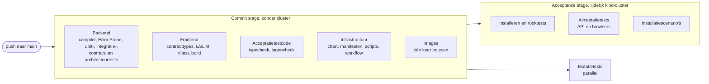

# Kwaliteitscontroles

Dit document beschrijft welke **soorten** tests en controles dit project heeft om de kwaliteit van de code hoog te houden. Per soort staat erin wat ze controleert, hoe ze dat doet, waar ze staat en wanneer ze draait.

**Inhoud**

- [Leeswijzer](#leeswijzer)
1. [Uitgangspunten](#1-uitgangspunten)
2. [Overzicht](#2-overzicht)
3. [De soorten](#3-de-soorten)
   - [3.1 Compiler en typecontrole](#31-compiler-en-typecontrole)
   - [3.2 Statische analyse en linters](#32-statische-analyse-en-linters)
   - [3.3 Unittests](#33-unittests)
   - [3.4 Integratietests met echte afhankelijkheden](#34-integratietests-met-echte-afhankelijkheden)
   - [3.5 Contracttests](#35-contracttests)
   - [3.6 Architectuurvangrails](#36-architectuurvangrails)
   - [3.7 Regels in de database](#37-regels-in-de-database)
   - [3.8 Mutatietests](#38-mutatietests)
   - [3.9 Infrastructuur als code](#39-infrastructuur-als-code)
   - [3.10 Acceptatietests](#310-acceptatietests)
   - [3.11 Installatiescenario's](#311-installatiescenarios)
   - [3.12 Rooktests](#312-rooktests)
   - [3.13 Controle door de mens](#313-controle-door-de-mens)
   - [3.14 Testen onder load](#314-testen-onder-load)
4. [Hoe het samenkomt in de pipeline](#4-hoe-het-samenkomt-in-de-pipeline)
   - [De uitkomst van de acceptance stage lezen](#de-uitkomst-van-de-acceptance-stage-lezen)
5. [Een nieuwe controle toevoegen](#5-een-nieuwe-controle-toevoegen)
6. [Testen onder load](#6-testen-onder-load)

## Leeswijzer

Dit is geen lijst van alle tests. Die lijst verandert bij bijna elke commit, de soorten veranderen zelden. Daarom noemt dit document geen aantallen, versies, drempels of namen van losse testklassen. Voorbeelden staan er alleen in als er een ADR achter zit. Hoofdstuk 6 is een handleiding, en noemt wel commando's en getallen, steeds met de ADR waar ze vandaan komen.

De actuele lijst staat op de plekken die al worden bijgehouden:

| Wat | Waar |
| --- | --- |
| Alle vangrails, met hun test en of ze rood gezien zijn | de tabel "Vangrails" in [`CLAUDE.md`](../CLAUDE.md) |
| Welke controles lokaal draaien | `make help` en de [`Makefile`](../Makefile) |
| Welke controles in de pipeline draaien, en in welke stage | [`.github/workflows/ci.yml`](../.github/workflows/ci.yml) |
| Waarom een controle bestaat | de sectie "Bewaking" van elke ADR in [`doc/adr/`](adr) |
| De uitkomst van de acceptatietests en installatiescenario's op `main`, met de geschiedenis | het [Allure-rapport op GitHub Pages](https://edwinbulter.github.io/banksim-mse/) (ADR 0053), zie hoofdstuk 4 |
| De werkwijze erachter | [`werkwijze-mse.md`](werkwijze-mse.md): de double loop (hoofdstuk 4), de acceptatietests (hoofdstuk 5), de infrastructuur (hoofdstuk 9) en de controle door de mens (§10.1) |

Verschillen dit document en die bronnen, dan wint de bron.

## 1. Uitgangspunten

- **De pipeline is de scheidsrechter** (ADR 0002). Wat niet automatisch gecontroleerd wordt, is niet geborgd. Vertrouw niet op mensen die code lezen, maar op controles die bij elke commit draaien.
- **Snel eerst.** De commit stage geeft binnen minuten feedback, zonder cluster. De acceptance stage test daarna het geïnstalleerde systeem. Een fout hoort zo vroeg mogelijk te vallen: liever in de compiler dan in een unittest, liever in een unittest dan in een acceptatietest.
- **Lokaal en in CI hetzelfde.** Elke controle heeft een `make`-target. De tools voor de infrastructuur draaien in containers die op digest zijn vastgepind (ADR 0006).
- **Een beslissing heeft een bewaking.** Elke ADR zegt hoe de beslissing automatisch bewaakt wordt.
- **Eén keer rood gezien.** Een nieuwe vangrail is pas af als hij één keer gefaald heeft op een bewuste overtreding (een sabotage). Een test die nooit rood is geweest, kan ook altijd groen zijn.
- **Testen worden zelf getest.** De mutatietests controleren of de tests een fout in de code ook echt opmerken.

## 2. Overzicht

"Commit stage" is de naam van de eerste stage van de pipeline (Farley), niet een controle bij `git commit`. Er zijn geen git-hooks: lokaal committen controleert niets. De pipeline (`.github/workflows/ci.yml`) start bij een push naar `main` en bij een pull request. Wil je de controles vóór het pushen draaien, gebruik dan `make commit-stage` en `make acceptance`.

| Soort | Wat het controleert | Hoe | Pipeline-stage |
| --- | --- | --- | --- |
| Compiler en typecontrole | Dat de code klopt met zijn eigen types | `javac`, TypeScript in strenge modus | commit stage |
| Statische analyse en linters | Bekende foutpatronen en projectregels | Error Prone, ESLint, shellcheck, actionlint | commit stage |
| Unittests | Het gedrag van één eenheid, snel en geïsoleerd | JUnit, jqwik, Vitest, bats | commit stage |
| Integratietests | De samenwerking met een echte afhankelijkheid | Testcontainers, MockMvc, nep-servers | commit stage |
| Contracttests | Dat de API en zijn gebruikers dezelfde afspraak volgen | OpenAPI-specificatie, validator, gegenereerde types | commit stage |
| Architectuurvangrails | Ontwerpregels: lagen, grenzen, verboden constructies | ArchUnit, bronscans, scripts, Maven-modules | commit stage |
| Regels in de database | Invarianten die nooit geschonden mogen worden | Constraints en triggers in de Flyway-migraties | commit stage (via de repositorytests), en daarna bij elke schrijfactie in de draaiende database |
| Mutatietests | Of de tests fouten in de code opmerken | PIT | commit stage (parallel aan de acceptance stage) |
| Infrastructuur als code | Chart, scripts en pipeline, zonder cluster | helm lint, helm-unittest, kubeconform, yq, bats, shellcheck, actionlint | commit stage |
| Acceptatietests | Het gedrag van het geïnstalleerde systeem, vanuit de gebruiker | Playwright met een interne DSL, via de API en in browsers | acceptance stage |
| Installatiescenario's | Installeren, opnieuw installeren, upgraden en verwijderen | Playwright met de shell-driver | acceptance stage |
| Rooktests | Dat de installatie antwoordt | `install.sh` | bij elke installatie, ook in de acceptance stage |
| Controle door de mens | Wat een machine niet kan beoordelen | Scenario, ADR, rapport, diff van de specs, verkennend testen | buiten de pipeline, per slice |
| Testen onder load | Wat de bank doet bij doorlopend verkeer van klanten | k6 vanaf de Mac, Grafana met traces, logs en metrics | lokaal met de hand; een korte run in de acceptance stage |

## 3. De soorten

### 3.1 Compiler en typecontrole

**Wat.** Dat de code consistent is met haar eigen types: geen verkeerd type, geen vergeten `null`, geen veld dat niet bestaat.

**Hoe.**
- **Java:** de compiler, waarbij elke waarschuwing de build breekt.
- **Frontend:** TypeScript in strenge modus, ook voor de Angular-templates (`strict` en `strictTemplates` in `frontend/tsconfig.json`). Zo valt een fout in een template al bij het bouwen op, niet pas in de browser.
- **Acceptatietests:** een aparte typecheck (`npm --prefix e2e run typecheck`), omdat Playwright de types zelf niet controleert.

**Wat het niet vangt.** Code die goed getypeerd is, maar het verkeerde doet.

### 3.2 Statische analyse en linters

**Wat.** Bekende foutpatronen die de compiler toelaat, en regels die specifiek zijn voor dit project.

**Hoe.**
- **Java:** Error Prone draait als plugin van de compiler, in elke module (ADR 0033). Het vindt bijvoorbeeld een `toLowerCase()` zonder `Locale` of een genegeerde returnwaarde. Een melding breekt de build.
- **Frontend:** ESLint, met de aanbevolen regels voor TypeScript en Angular plus eigen regels. Een voorbeeld is dat bedragen nooit naar een getal worden omgezet (ADR 0010).
- **Scripts en pipeline:** shellcheck controleert de shellscripts, actionlint de workflow van GitHub Actions.

**Waar.** De configuratie staat bij de build: de compilerinstellingen in `backend/pom.xml` en `frontend/eslint.config.js`. Shellcheck en actionlint draaien in `scripts/iac-check.sh`.

**Wat het niet vangt.** Fouten in de logica van het domein.

### 3.3 Unittests

**Wat.** Het gedrag van één eenheid, zoals een domeinregel, een service, een component of een script, los van de rest.

**Hoe.**
- **Domein:** het domein (`backend/bank-domain`) heeft geen framework, en wordt getest met gewone JUnit-tests.
- **Property-based tests:** invarianten die voor elke invoer moeten gelden, worden met jqwik getest. jqwik bedenkt zelf honderden voorbeelden en zoekt het kleinste voorbeeld dat faalt. Een voorbeeld is dat een overboeking het totaal van het grootboek behoudt.
- **Frontend:** Vitest test de componenten en hulpfuncties.
- **Shellscripts:** bats test de scripts van de installatie en de controles.

Unittests ontstaan in de binnenste lus van de double loop: rood, groen, refactor, van buiten naar binnen (werkwijze hoofdstuk 4).

**Waar.** Naast de code: `src/test` per Maven-module, `*.spec.ts` naast de Angular-code, `test/*.bats` naast de scripts.

**Wat het niet vangt.** Fouten in de samenwerking met de database, de netwerkgrenzen of de configuratie.

### 3.4 Integratietests met echte afhankelijkheden

**Wat.** Dat de code goed samenwerkt met wat eromheen zit: de database, het webframework, de beveiliging of een andere service.

**Hoe.**
- **Database:** de repositorytests draaien tegen een echte PostgreSQL via Testcontainers, met het echte Flyway-schema. Zo zijn de SQL, de constraints en de migraties samen getest, zonder een nagebootste database.
- **Controllers:** de controllertests gebruiken een slice van Spring met MockMvc. Ze testen de HTTP-kant: statuscodes, JSON, validatie en rechten per endpoint.
- **Andere services:** een grens met een andere service krijgt een nepversie op die grens, en nergens anders. De BFF draait tegen een nep-`bank-api`, en de admin-API van Keycloak wordt nagebootst.
- **Gelijktijdigheid:** concurrencytests laten veel boekingen tegelijk lopen tegen een echte database. Ze controleren dat er geen deadlock ontstaat, dat het totaal behouden blijft en dat geen rekening onder nul komt (ADR 0026).

**Waar.** In de testmap van de module. Welke soort test bij welke module hoort, staat in de tabel "Waar komt wat" in `CLAUDE.md`.

**Wat het niet vangt.** Of de nepversie zich gedraagt als het echte systeem; dat doen de contracttests en de acceptatietests. En of het geheel werkt na de installatie.

### 3.5 Contracttests

**Wat.** Dat de twee kanten van een grens, de aanbieder en de gebruiker, dezelfde afspraak volgen. Zonder contracttest test elke kant tegen zijn eigen aanname van de andere kant, en ziet pas de acceptance stage een breuk.

**Hoe.** Er is één OpenAPI-specificatie van `bank-api`, met de hand geschreven: contract-first (ADR 0034). Drie controles houden beide kanten eraan vast:
- **Aanbieder:** de controllertests van `bank-api` controleren elk antwoord tegen de specificatie, naast hun eigen beweringen.
- **Dekking:** een test controleert dat elk endpoint van `bank-api` in de specificatie staat.
- **Gebruiker:** de frontend krijgt zijn types uit de specificatie, door generatie. De pipeline faalt als de gegenereerde types niet bij de specificatie passen. Een veld dat anders heet, wordt dan een compileerfout in de frontend.

**Waar.** De specificatie staat in `api/`, de gegenereerde types in de frontend. Hoe de backend en de frontend het contract gebruiken, en hoe je de API wijzigt, staat in [`api/README.md`](../api/README.md).

**Wat het niet vangt.** Gedrag dat niet in een schema past, zoals welke rekening je mag zien. Dat testen de integratie- en acceptatietests.

### 3.6 Architectuurvangrails

**Wat.** Ontwerpregels die de code leesbaar en veranderbaar houden. Ze voorkomen dat de code ongemerkt slechter wordt, door een mens of door AI. Bij Farley heten ze fitness functions. Voorbeelden:
- alleen het grootboek boekt (ADR 0024);
- het domein kent geen framework;
- geen drijvende komma voor bedragen (ADR 0010);
- geen systeemtijd buiten de klok (ADR 0013);
- elk endpoint heeft een recht (ADR 0022);
- een acceptatiescenario spreekt alleen de DSL (ADR 0031).

**Hoe.** Vier mechanismen, van zwaar naar licht:
- **ArchUnit:** gewone JUnit-tests die de gecompileerde klassen analyseren. Ze controleren wie wie aanroept, welke packages van elkaar afhangen en welke annotaties er moeten staan.
- **Bronscans:** tests die de broncode doorzoeken op een verboden constructie, voor wat ArchUnit niet ziet (zoals `synchronized` als blok).
- **Scripts:** voor code buiten Java. Een voorbeeld is `scripts/lagen-check.sh`, dat controleert dat een spec alleen uit de DSL importeert. Zo'n script heeft zelf weer een bats-test.
- **Maven-modules:** een afhankelijkheid die niet in de pom staat, kan niet bestaan. Zo komt testcode nooit in de app, en kent het domein geen Spring.

Elke vangrail is één keer rood gezien. De tabel in `CLAUDE.md` vermeldt hoe.

**Waar.** De architectuurtests per module in een package `architectuur` of naast de code, de scripts in `scripts/`. De volledige lijst staat in `CLAUDE.md`.

**Wat het niet vangt.** Of een regel nog de goede regel is. Dat bepaalt de ADR.

### 3.7 Regels in de database

**Wat.** Invarianten die nooit geschonden mogen worden, ook niet door code die buiten de applicatie om schrijft, zoals de seed-tool of een bug. Het belangrijkste voorbeeld: een overboeking heeft twee kanten die samen nul zijn (ADR 0024).

**Hoe.** Constraints, sleutels en triggers in de Flyway-migraties. Een trigger die pas bij de commit controleert, ziet de hele transactie. De database weigert dan een boeking die niet in balans is.

**Waar.** In `backend/bank-api/src/main/resources/db/migration`. De regels worden getest via de repositorytests (3.4), die tegen dat schema draaien.

**Wat het niet vangt.** Regels die meer kennis vragen dan één transactie ziet. Die staan in het domein.

### 3.8 Mutatietests

**Wat.** Of de tests goed genoeg zijn. Een test die altijd groen is, beschermt niets.

**Hoe.** PIT brengt automatisch kleine fouten in de code aan (mutanten), zoals `<` in plaats van `<=`, een weggelaten aanroep of een omgekeerde voorwaarde. Daarna draait het de unittests. Elke mutant die geen test laat falen, overleeft, en dat betekent dat er een test ontbreekt. Onder een minimale score per module faalt de build (ADR 0018).

Zo doet PIT bij elke commit wat een mens anders met de hand zou doen: de code saboteren en kijken of een test het merkt. Voor gewone tests is "één keer rood gezien" dus geautomatiseerd. Alleen vangrails krijgen nog een eigen sabotage.

**Waar en wanneer.** `make mutatie`. In CI draait het als eigen job, parallel aan de acceptance stage, omdat het het traagst is van de commit stage (ADR 0032). Een rode PIT-job maakt de pipeline nog steeds rood. Het rapport komt als artifact.

**Wat het niet vangt.** Ontbrekende functionaliteit: PIT muteert alleen code die er al is.

### 3.9 Infrastructuur als code

**Wat.** Dat de Helm-chart, de installatiescripts en de pipeline doen wat ze moeten, nog vóór er een cluster bij komt kijken (werkwijze hoofdstuk 9).

**Hoe.** Eén script, `scripts/iac-check.sh`, draait alle controles in vastgepinde containers (ADR 0006):
- **helm lint en helm-unittest:** controleren de chart en wat zijn templates opleveren, met snapshots;
- **kubeconform:** controleert dat de gerenderde manifesten geldige Kubernetes zijn, voor de versie van het cluster;
- **beleid met yq** over de gerenderde manifesten: alles in de eigen namespace, geen cluster-brede resources en geen geheimen in de chart (ADR 0004, 0009);
- **bats en shellcheck:** testen en controleren de scripts;
- **actionlint:** controleert de workflow.

**Waar.** De chart-tests in `deploy/banksim-mse/tests/`, de bats-tests naast de scripts. Lokaal draait alles met `make iac`.

**Wat het niet vangt.** Of de installatie in een echt cluster werkt. Dat doen de installatiescenario's en de rooktests.

### 3.10 Acceptatietests

**Wat.** Dat het geïnstalleerde systeem doet wat de gebruiker verwacht. Elk scenario is een voorbeeld uit de story, in domeintaal: "Gegeven …, als …, dan …". Een slice is pas af als zijn scenario's slagen. Ze vormen de buitenste lus van de double loop.

**Hoe.** Playwright, in vier lagen (ADR 0005, 0031):
1. **Spec:** het scenario in domeintaal, zonder technische details.
2. **DSL:** vertaalt dat naar handelingen van een klant of beheerder en doet de beweringen.
3. **Drivers:** voeren een handeling uit via één protocol: REST, de browser of de shell. Ze wachten en controleren het protocol, maar beweren niets over het domein.
4. **Systeem:** de echte installatie in het cluster, met echte Keycloak en PostgreSQL.

Een paar eigenschappen volgen uit die opbouw:
- **Twee routes.** Hetzelfde scenario draait via de API en in de browser. Zo is het gedrag één keer beschreven en twee keer bewezen. Extra browsers draaien alleen de scenario's die over de UI gaan, en de rooktests (ADR 0019).
- **Isolatie.** Elk scenario maakt zijn eigen klanten aan via de seed-tool, met unieke aliassen (ADR 0003, 0020). Scenario's kunnen daardoor parallel draaien en hangen niet van elkaars data af.
- **Gedeelde toestand.** Scenario's die de simulatiedatum van de hele bank verzetten, draaien na de andere en één voor één (ADR 0014).
- **Tags** bepalen waar een scenario draait. `@wip` sluit een scenario uit dat nog niet af is.

**Waar en wanneer.** In `e2e/`. In CI draaien ze in de acceptance stage tegen een vers tijdelijk cluster, met de images uit de commit stage. Lokaal draaien ze met `make acceptance`.

**Wat het niet vangt.** Randgevallen in de details. Die horen in de snellere tests eronder; een acceptatietest beschrijft gedrag, geen implementatie.

### 3.11 Installatiescenario's

**Wat.** Dat de installatie zelf klopt:
- installeren maakt de bank bereikbaar;
- opnieuw installeren verandert niets;
- een upgrade behoudt de data;
- verwijderen laat niets achter;
- de installatie raakt alleen de eigen context en namespace, en het origineel blijft onaangeroerd.

**Hoe.** Dezelfde Playwright-opbouw als 3.10, met de shell-driver tegen `kubectl` en `helm`. Scenario's die installaties weghalen, hebben de tag `@destructief` en draaien alleen in het CI-cluster.

**Waar.** In `e2e/specs/infra/`, lokaal met `make e2e-infra`.

### 3.12 Rooktests

**Wat.** Alleen of de installatie antwoordt: de frontend, de API en Keycloak geven een geldig antwoord.

**Hoe.** `deploy/scripts/install.sh` doet na elke installatie een paar HTTP-aanvragen. Dit is een snelle eerste waarschuwing, geen vervanging voor de acceptatietests.

### 3.13 Controle door de mens

**Wat.** Wat een machine niet kan beoordelen:
- is dit het goede scenario?
- is dit een goede beslissing?
- voelt de applicatie goed aan?

**Hoe.** De mens controleert het scenario vóór de bouw, elke ADR en de diff van de specs. Per slice wordt er verkennend getest, en onder load zoals in hoofdstuk 6. Wat de controles hierboven al doen, controleert de mens niet meer met de hand. Zie [werkwijze §10.1](werkwijze-mse.md#101-controle-door-de-mens).

### 3.14 Testen onder load

**Wat.** Wat de bank doet bij doorlopend verkeer van klanten: worden verzoeken trager, stijgen CPU en geheugen, en gaan er dingen mis die bij één klant niet misgaan?

**Hoe.** k6 doet zich voor als vijf verkeersklanten die inloggen, rekeningen bekijken, soms betalen en uitloggen, door de voordeur (ADR 0055). Je kijkt in Grafana naar de traces, logs en metrics (ADR 0054). Het grootste deel is verkennend testen (3.13) met hulpmiddelen: er is geen grens die de bank rood maakt, behalve de thresholds van k6.

**Waar.** Het script staat in `deploy/verkeer/`. Lokaal met de hand met `make verkeer`; in de acceptance stage een korte run in `e2e/specs/infra/verkeer.spec.ts`. De handleiding staat in [hoofdstuk 6](#6-testen-onder-load).

## 4. Hoe het samenkomt in de pipeline



- De acceptance stage gebruikt de images die de commit stage één keer heeft gebouwd. Getest wordt dus precies wat later draait.
- Elke stap die faalt, maakt de pipeline rood, ook de mutatietests die parallel lopen.
- Lokaal doet `make commit-stage` hetzelfde als de commit stage, en `make acceptance` hetzelfde als de acceptance stage, tegen het lokale cluster.

### De uitkomst van de acceptance stage lezen

Na elke push naar `main` voegt de workflow `Allure-rapport` (`.github/workflows/allure.yml`) de resultaten van de vier Playwright-jobs samen tot één [Allure-rapport op GitHub Pages](https://edwinbulter.github.io/banksim-mse/) (ADR 0053). Dat rapport is geen extra controle: het controleert niets, en de pipeline wordt er niet rood of groen van. Het maakt de uitkomst van de acceptatietests (3.10) en de installatiescenario's (3.11) leesbaar.

Wat het laat zien, en welke vraag je ermee beantwoordt:

| In het rapport | Vraag die het beantwoordt |
| --- | --- |
| Overview: alle scenario's van de vier jobs samen | Is de acceptance stage als geheel groen, zonder vier losse Playwright-rapporten te openen? |
| Trend over de vorige runs (Overview en Graphs) | Wordt de suite stabieler of slechter, en langzamer of sneller? |
| Tabblad History van één scenario | Faalt dit scenario voor het eerst, of faalde het eerder ook? Allure markeert een scenario als "flaky" op grond van die geschiedenis. Er zijn geen herkansingen (`retries: 0`), dus de geschiedenis is de enige bron daarvoor. |
| Behaviors: epic, feature en story | Welke scenario's horen bij een slice, en is die slice in zijn geheel groen? De epic is de slice uit hoofdstuk 7 van de werkwijze, of een hoofdstuk over de infrastructuur of de beveiliging. |
| Severity en tags | Faalt er een rooktest (`@rook`, critical) of een destructief installatiescenario (`@destructief`, blocker), of alleen een gewoon scenario? |
| De parameter `driver` (`rest`, `ui`, `shell`) en het project | Faalt het gedrag (in elke driver rood), of alleen één route, zoals de browser? |
| Categories | Wat voor soort fout is het: de omgeving was niet bereikbaar, de installatie mislukte, een timeout, een fout in de testcode zelf, of een verkeerde waarde? Alleen die laatste wijst direct op gedrag van de bank. |
| Bij een fout: de stap Gegeven, Als of Dan die faalde, het verkeer met het systeem en, in de browser, een screenshot | Waar in het voorbeeld ging het mis, en wat antwoordde het systeem? Wachtwoorden en tokens zijn gemaskeerd, want het rapport is openbaar. |
| Timeline en de duur per scenario | Welke scenario's maken de acceptance stage traag, en hoe zijn ze over de workers verdeeld? |
| Links naar de spec en de ADR's die de spec noemt, op de commit van de run | Wat zegt het scenario precies, en welke beslissing bewaakt het? |
| Environment en Executor | Welke image-tag is getest, en bij welke CI-run hoort dit rapport? |

Wat het rapport niet laat zien:
- **De trace van Playwright.** Die bevat de ingevulde waarden, ook wachtwoorden, en hoort dus niet in een openbaar rapport. Hij staat in het HTML-rapport van Playwright, als artifact van de CI-run.
- **De commit stage.** De unittests, vangrails en mutatietests staan er niet in; hun uitkomst staat in de joblogs en de artifacts van de CI-run.
- **Pull requests.** Het rapport komt alleen van een push naar `main`.

Lokaal maakt `make allure` hetzelfde rapport van de laatste `make e2e` of `make acceptance`, zonder geschiedenis.

## 5. Een nieuwe controle toevoegen

Een nieuwe controle, of een nieuwe soort, krijgt:
1. **Een reden:** een ADR, met de controle in de sectie "Bewaking". Een nieuwe tool kan alleen met een ADR.
2. **Een plek in de pipeline**, zo vroeg mogelijk, en een `make`-target waarmee ze lokaal hetzelfde draait.
3. **Eén keer rood**, met een bewuste overtreding. Het commitbericht vermeldt hoe.
4. **Een rij in de vangrailtabel van `CLAUDE.md`**, als het een vangrail is.

Dit document hoeft alleen aangepast te worden als er een echt nieuwe **soort** bijkomt. Een nieuwe test of vangrail binnen een bestaande soort hoort alleen in de bronnen uit de leeswijzer.

## 6. Testen onder load

**Wat.** Wat de bank doet als er steeds klanten zijn: worden verzoeken trager, stijgen CPU en geheugen, en gaan er dingen mis die bij één klant niet misgaan? Dit is verkennend testen (3.13), met hulpmiddelen. Je kijkt zelf, en er is geen grens die de bank rood maakt, behalve de thresholds van k6.

**Hoe.** k6 doet zich voor als vijf klanten, de verkeersklanten `verkeer-1` tot en met `verkeer-5` (ADR 0055). Eén klantbezoek is:
1. inloggen via het formulier van Keycloak;
2. het overzicht en de transacties van de betaalrekening bekijken;
3. in 1 op de 20 bezoeken een betaling aan een andere verkeersklant, met een eigen Idempotency-Key, net als de app;
4. uitloggen, ook bij Keycloak.

Ongeveer 1 op de 10 betalingen is bewust groter dan het saldo, en de bank weigert die. Zo zie je ook weigeringen. Het verkeer gaat door de voordeur, net als bij Playwright: de ingress, Keycloak, de BFF, bank-api en de database. De bank stuurt haar traces, logs en metrics naar `otel-lgtm` (ADR 0054), en k6 stuurt zijn eigen cijfers daar ook naartoe. In Grafana zie je beide naast elkaar.

**Waar.** Het script staat in `deploy/verkeer/verkeer.js` en het startscript in `deploy/scripts/verkeer.sh`. In de acceptance stage draait k6 een halve minuut in het scenario `Bij doorlopend verkeer blijft het geld in de kring` (`e2e/specs/infra/verkeer.spec.ts`, job `telemetrie`). Dat is het geautomatiseerde deel. De rest van dit hoofdstuk is met de hand.

### Voorbereiden

- **Installeer eerst de versie die je wilt testen.** `make verkeer` bouwt niets: het installeert opnieuw met de images die er al staan, en zet daarbij de verkeersklanten aan. Na een codewijziging doe je dus eerst `make commit-stage` en `make install`. Controleer daarna de versie met `curl -sk https://bank-mse.localtest.me/api/versie`.
- **Draai geen tests tegelijk.** De simulatiedatum geldt voor de hele bank (ADR 0014). Een scenario met `@simulatiedatum` verzet hem, en dan ziet k6 andere saldi. Gebruik dus niet tegelijk `make e2e`, `make e2e-infra` of `make acceptance`.
- **Houd de Mac wakker.** Het verkeer komt van je eigen machine en stopt als de Mac slaapt. Gebruik `caffeinate -i make verkeer …` voor een lange run.
- **De Mac doet twee dingen tegelijk.** k6 draait op dezelfde machine als het kind-cluster, en gebruikt dus ook CPU. Bij een hoge snelheid meet je ook k6 zelf. Vergelijk daarom alleen runs op dezelfde machine, en met dezelfde snelheid.

### Starten

```bash
make verkeer SNELHEID=5 DUUR=30m   # terminal 1; Ctrl-C stopt k6 en de port-forward
make grafana                        # terminal 2; Grafana op http://localhost:3000
```

- **`SNELHEID`** is het aantal klantbezoeken dat per seconde begint; standaard is dat 2. Eén bezoek telt meerdere HTTP-verzoeken, want k6 telt elke redirect van het inloggen en uitloggen apart. k6 gebruikt een vaste aankomstsnelheid (`constant-arrival-rate`). Wordt de bank trager, dan komen de bezoeken toch in hetzelfde tempo binnen, en lopen er meer tegelijk. Zo zie je de vertraging, in plaats van dat de load vanzelf afneemt.
- **`DUUR`** is de duur van de run, zoals `30s`, `10m` of `2h`; standaard is dat 10 minuten.
- **Kies de snelheid** naar wat je wilt zien. Met 2 per seconde zie je normaal gedrag in het dashboard. Met 5 per seconde laat je een demo zien. Wil je weten waar de grens ligt, verhoog de snelheid dan per run, bijvoorbeeld 5, 10 en 20, en kijk wanneer de duur van een verzoek of de foutkans omhooggaat.

### De uitvoer van k6 lezen

Tijdens de run toont k6 niets, door `--quiet`. Aan het eind volgt een samenvatting:

| Regel | Wat ze zegt |
| --- | --- |
| `checks` | Het deel van de controles in `verkeer.js` dat slaagde, zoals "ingelogd, terug op BankSim" en "betaling geboekt of geweigerd zoals verwacht". Een mislukte controle staat er met haar naam bij. |
| `http_req_failed` | Het deel van de HTTP-verzoeken met een fout. Een geweigerde betaling (422) telt niet als fout: dat is een antwoord van de bank. |
| `http_req_duration` | De duur van een verzoek zoals k6 hem ziet, met gemiddelde, mediaan en p95. Dat is inclusief de ingress, Keycloak en het netwerk. |
| `iterations` | Het aantal klantbezoeken. Ligt dat duidelijk onder snelheid × duur, dan had k6 te weinig virtuele gebruikers, omdat de bank te traag werd (zie `dropped_iterations`). |
| De thresholds, met ✓ of ✗ | Mislukt meer dan 1% van de checks, of geeft meer dan 1% van de verzoeken een fout, dan krijgt de threshold een ✗ (ADR 0055). |

Mislukt een threshold, dan stopt `make verkeer` met een foutcode, en dan is de run rood. Dat is dezelfde grens als in het scenario in de pipeline.

### Kijken in Grafana

Open het dashboard "BankSim-MSE" (Dashboards). Het ververst elke 10 seconden, want zo vaak sturen de apps hun metrics.

| Paneel | Wat je bij een gewone run ziet | Waar je op let |
| --- | --- | --- |
| Verzoeken per seconde | Een vlakke lijn per dienst, die past bij de snelheid | Een lijn die zakt terwijl k6 doorloopt: de bank of de ingress antwoordt niet meer |
| Duur van een verzoek (p95) | Een vlakke lijn | Een stijgende lijn bij een gelijke snelheid: de bank wordt trager |
| CPU in cores | Per proces een fractie van één core | Een proces dat vastloopt op zijn limiet |
| Geheugen van de JVM | Een zaagtand: het geheugen loopt op, en de garbage collector ruimt op | Een bodem die steeds hoger komt te liggen: een mogelijk geheugenlek |
| Garbage collection (tijd per seconde) | Laag en gelijkmatig | Pieken die samenvallen met trage verzoeken |
| Boekingen en weigeringen per minuut | Betalingen, en weigeringen met de reden `saldo-ontoereikend` | Andere redenen, zoals `naam-past-niet`, of herhalingen met dezelfde Idempotency-Key: k6 maakt per betaling een nieuwe sleutel, dus die komen niet van k6 |
| Gemiddelde duur van de maandafsluiting (per uur) | Meestal leeg: de afsluiting draait 's nachts en na een wijziging van de simulatiedatum, en k6 verzet de datum niet | Zie hieronder |

**De cijfers van k6** staan in Prometheus onder `k6_…` (Explore, bron Prometheus). Het label `naam` geeft de stap van het bezoek, zoals `inloggen` of `betalen`. Vergelijk bijvoorbeeld:
- `histogram_quantile(0.95, sum by (le, naam) (rate(k6_http_req_duration_milliseconds_bucket[1m])))`: de duur per stap, zoals de klant hem ziet;
- het paneel "Duur van een verzoek (p95)": de duur zoals de BFF en bank-api hem zelf meten.

Is k6 veel trager dan de BFF, dan zit de vertraging vóór de BFF: in de ingress, bij Keycloak, of op de Mac zelf.

**Van een traag verzoek naar de oorzaak:**
1. Kies in Explore de bron Tempo. Zoek met `{ resource.service.name = "bank-bff" && duration > 500ms }`: de verzoeken aan de BFF die langer dan een halve seconde duurden.
2. Open de trace. Je ziet de spans van de BFF, van bank-api en de SQL-spans van de database, met hun duur. De langste span wijst de plek aan.
3. Ga naar de logregels van dezelfde trace. Gebruik de knop bij de span, of zoek in Loki met `{service_name="bank-api"} | trace_id="<trace-ID>"`.

Een trace is pas na ongeveer een halve minuut te vinden in Tempo.

**Een maandafsluiting** maakt k6 niet. Wil je haar onder load zien, verzet dan als beheerder de simulatiedatum: elke wijziging start de maandafsluiting (ADR 0028). Kies de laatste dag van een maand, dan wordt er ook rente bijgeschreven, op de spaarrekeningen waarvan die maand nog niet is afgesloten. De verkeersklanten hebben geen spaarrekening. De span heet `bank.maandafsluiting`, en het paneel "Gemiddelde duur van de maandafsluiting (per uur)" vult zich. Zet de datum daarna terug: k6 betaalt op de datum die de bank op dat moment heeft.

### Na de run

- **Het geld is in de kring gebleven.** De verkeersklanten betalen alleen elkaar, dus het totaal van hun saldi verandert niet. Bij een verse installatie is dat 5 × € 1.000,00. Een betaling is één overboeking met twee kanten (ADR 0024). Ook als je k6 halverwege stopt, klopt het totaal. Het scenario in de pipeline controleert dit. Met de hand log je in als verkeersklant, met het wachtwoord uit het Secret `bank-verkeer`:
  ```bash
  kubectl --context kind-single-node -n banksim-mse get secret bank-verkeer -o jsonpath='{.data.VERKEER_WACHTWOORD}' | base64 -d
  ```
- **De database groeit** met ongeveer 0,6 KB per betaling, en regels uit het grootboek gooi je niet weg (ADR 0024, 0055). De grootte zie je zo:
  ```bash
  kubectl --context kind-single-node -n banksim-mse exec postgres-0 -- sh -c 'psql -U "$POSTGRES_USER" -d bank -tAc "select pg_size_pretty(pg_database_size(current_database()))"'
  ```
  De PVC is 1 Gi. Wordt hij te vol, dan maakt `make uninstall` hem leeg, maar dat wist ook de demo-data.
- **Wat blijft staan:** de verkeersklanten en hun betalingen. De telemetrie in `otel-lgtm` staat in een `emptyDir`, en is weg na een herstart van die pod.
- **Resten van een afgebroken run.** Bij Ctrl-C of een normaal einde stopt `verkeer.sh` de port-forward en de k6-container zelf. Wordt het script hard gestopt (`kill -9`), dan kan het dat niet. Ruim de resten dan zo op:
  ```bash
  docker ps --filter name=banksim-verkeer -q | xargs docker stop
  pkill -f 'port-forward svc/otel-lgtm :4318'
  ```

### Wat dit niet laat zien

- **PostgreSQL zelf:** de metrics van de database komen nog niet binnen (stap 8 in [observability-keuzes.md](observability-keuzes.md)). Een trage query zie je wel als SQL-span in de trace.
- **Containers:** het geheugen van een container tegen zijn limiet, en een OOMKill. Daarvoor zijn metrics van het hele cluster nodig, en die verbiedt ADR 0004. Een herstart zie je met `kubectl --context kind-single-node -n banksim-mse get pods`, in de kolom RESTARTS.
- **Alarmen:** er zijn geen alerts en geen SLO's. Je moet zelf kijken.
- **Echte productie:** één node, één replica per dienst, en de load komt van dezelfde machine. De cijfers zeggen iets over verschillen tussen versies op deze machine, niet over de capaciteit van een echte bank.
