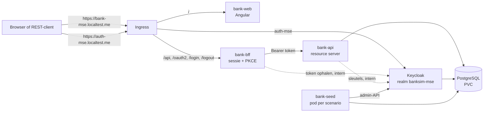

# Slice 1 controleren: overzicht met saldo

Met deze instructie controleer je zelf wat er in slice 1 is gebouwd. Je volgt dezelfde volgorde als in [stap 0](stap-0-controleren.md):

1. Je kijkt wat er staat.
2. Je draait elke test en ziet hem groen worden.
3. Je maakt bij elke test bewust iets kapot. Dan zie je dat de test die fout echt vangt.
4. Je installeert de app, logt in als klant en bekijkt het overzicht.
5. Je controleert de installatie: Secrets, data en upgrade.

Reken op anderhalf uur. Stap 0 moet al gecontroleerd zijn; wat daar staat, herhaalt deze instructie niet. De achtergrond staat in [werkwijze-mse.md](werkwijze-mse.md), hoofdstuk 7 (slice 1) en 9.4, en in de ADR's 0003 en 0007–0010 in [`adr/`](adr).

## 1. Wat is er gebouwd

Slice 1 levert story **S1.1**:

> Als klant wil ik na het inloggen mijn betaalrekening met saldo zien, zodat ik weet hoeveel geld ik heb.

Functioneel is het nog klein: één betaalrekening met het openingssaldo. Technisch is er veel bijgekomen: inloggen via Keycloak, een BFF, een database en een seed-tool voor testdata.



| Laag | Waar | Wat het doet | Test |
| --- | --- | --- | --- |
| Acceptatietest | `e2e/specs/overzicht.spec.ts` | "Klant ziet de betaalrekening met saldo in het overzicht", via de API en drie browsers | Is zelf de buitenste lus |
| Installatietest | `e2e/specs/infra/upgrade.spec.ts` | "Een upgrade behoudt de data" (`@destructief`, alleen in CI) | Is zelf de buitenste lus |
| Domein | `backend/bank-domain` | `Bedrag` (exact, 2 decimalen) en `Iban` (SIMB, mod-97) | `BedragTests`, `IbanTests` (JUnit + jqwik) |
| API | `backend/bank-api` | `GET /api/rekeningen` voor de ingelogde klant; controleert tokens van Keycloak | `RekeningControllerTests`, `TokenControleTests`, `JdbcRekeningRepositoryTests` (Testcontainers), `GeenDrijvendeKommaTests` (ArchUnit) |
| BFF | `backend/bank-bff` | Inloggen met PKCE, sessie in de BFF, `/api/**` naar `bank-api` met het token en zonder cookies | `BffTests` (met een nep-`bank-api`) |
| Seed | `backend/bank-seed` | Maakt een klant: login in Keycloak plus rekening in de database | `SeedCommandoTests`, `SeedKlantAanmakerTests`, `KeycloakLoginsTests`, `JdbcRekeninghoudersTests` |
| Schema | `backend/bank-api/src/main/resources/db/migration` | `rekeninghouder` en `rekening` (Flyway) | Via de repositorytests van `bank-api` en `bank-seed` |
| Frontend | `frontend/src/app` | Link "Inloggen", daarna "Welkom" en de betaalrekening met IBAN en saldo | `app.spec.ts`, `geld/bedrag.spec.ts` (Vitest), ESLint |
| Helm-chart | `deploy/banksim-mse` | PostgreSQL, Keycloak, `bank-bff`, Ingress voor `auth-mse` | helm-unittest, namespace- en geheimencheck |
| Scripts | `deploy/scripts` | `install.sh` maakt de Secrets één keer aan (ADR 0009) | bats |

**Leesvolgorde van de code**, van buiten naar binnen:

1. `e2e/specs/overzicht.spec.ts` en `e2e/specs/infra/upgrade.spec.ts`: de scenario's.
2. `e2e/dsl/klant.ts` en `e2e/dsl/omgeving.ts`: de DSL.
3. `e2e/drivers/shell/bank-seed.ts`, `e2e/drivers/rest/rest-driver.ts` en `e2e/drivers/ui/`: hoe de DSL testdata maakt, inlogt en het overzicht leest.
4. `backend/bank-bff`: `BeveiligingConfig`, `ApiRoute`, `KeycloakClientRegistration`.
5. `backend/bank-api`: `RekeningController`, `IngelogdeGebruiker`, `BeveiligingConfig`, `JdbcRekeningRepository`. Naast de code staan uitleggen: [`BeveiligingConfig.md`](../backend/bank-api/src/main/java/nl/banksim/api/beveiliging/BeveiligingConfig.md), [`TokenControleTests.md`](../backend/bank-api/src/test/java/nl/banksim/api/beveiliging/TokenControleTests.md) en [`RekeningControllerTests.md`](../backend/bank-api/src/test/java/nl/banksim/api/rekening/RekeningControllerTests.md).
6. `backend/bank-domain`: `Bedrag` en `Iban`.
7. `backend/bank-seed`: `SeedCommando` → `SeedKlantAanmaker` → `KeycloakLogins` en `JdbcRekeninghouders`.
8. `frontend/src/app`: `app.ts`, `overzicht.ts`, `geld/bedrag.ts`.
9. `deploy/banksim-mse/templates/` (`postgres.yaml`, `keycloak.yaml`, `bank-bff.yaml`, `ingress.yaml`) en `files/realm-banksim-mse.json`.
10. `deploy/scripts/install.sh` (`ensure_secret`) met `test/secrets.bats`.

> **Tip:** begin met een schone werkmap (`git status`). Zet na elke opzettelijke fout het bestand terug met `git checkout -- <bestand>`.

## 2. Voorbereiding

Dezelfde tools als in stap 0. Daarnaast:

```bash
docker info --format '{{.ServerVersion}}'   # Testcontainers start PostgreSQL in Docker
jq --version                                # voor het handmatig seeden in sectie 4.2
```

## 3. De commit stage

### 3.1 Domein

```bash
cd backend && ./mvnw -q -pl bank-domain test; cd ..
```

**Verwacht:** geen fouten. `BedragTests` en `IbanTests` bevatten ook jqwik-properties: die draaien elk 1000 willekeurige voorbeelden.

**Zie hem rood.**

1. **Bedrag rondt af.** Verander in `bank-domain/.../geld/Bedrag.java` het patroon `\\d{1,2}` in `\\d{1,3}`. Nu faalt `weigertMeerDanTweeDecimalenInPlaatsVanStilAfTeRonden`:
   ```
   Expecting actual throwable to be an instance of: java.lang.IllegalArgumentException
   but was: java.lang.ArithmeticException: Rounding necessary
   ```
   Een bedrag met 3 decimalen moet geweigerd worden met een duidelijke melding, niet stuklopen op een rekenfout.
2. **Fout controlegetal.** Verander in `bank-domain/.../rekening/Iban.java` `98 - rest(...)` in `97 - rest(...)`. Nu falen `berekentHetControlegetalVoorEenRekeningnummerBijSimBank` en de property `elkeIbanVanSimBankIsGeldig`, met `Geen geldige Nederlandse IBAN: NL…`. jqwik toont het kleinste voorbeeld dat faalt, `NL23SIMB0000000000`.

### 3.2 API

```bash
cd backend && ./mvnw -q -pl bank-api -am test; cd ..
```

**Verwacht:** geen fouten. `JdbcRekeningRepositoryTests` start een PostgreSQL-container; de eerste keer duurt dat langer.

**Zie hem rood.**

1. **Rekeningen van een ander.** Verander in `RekeningController.java` `gebruiker.gebruikersnaam()` in `"jan-a1-1"`. Nu faalt `geeftGeenRekeningenVanEenAndereGebruiker`: `[]: Expected 0 values but got 1`. De controller moet de naam uit het token gebruiken.
2. **Elke audience goed.** Zet in `bank-api/src/main/resources/application.yaml` een `#` voor `audiences: bank-api`. Nu faalt `TokenControleTests.weigertEenTokenVoorEenAndereAudience`: `Status expected:<401> but was:<200>`. Zonder die regel accepteert `bank-api` elk token van de realm, ook een dat voor een andere toepassing is bedoeld.
3. **Query zonder filter.** Verander in `JdbcRekeningRepository.java` `WHERE h.gebruikersnaam = :gebruikersnaam` in `WHERE h.gebruikersnaam = :gebruikersnaam OR true`. Nu falen beide `JdbcRekeningRepositoryTests`, onder andere met `Expecting empty but was: [Rekening[soort=BETAAL, …]]`.
4. **Een double voor geld.** Zet in `rekening/Rekening.java` binnen het record de methode `double saldoAlsGetal() { return saldo.waarde().doubleValue(); }`. Nu faalt ArchUnit:
   ```
   Rule 'classes should geen double of float als veld, parameter of returntype hebben' was violated (1 times):
   nl.banksim.api.rekening.Rekening.saldoAlsGetal() gebruikt double
   ```

### 3.3 BFF en seed

```bash
cd backend && ./mvnw -q -pl bank-bff,bank-seed -am test; cd ..
```

**Verwacht:** geen fouten.

**Zie hem rood.**

1. **Cookies naar `bank-api`.** Verwijder in `bank-bff/.../ApiRoute.java` de regel `.before(removeRequestHeader(HttpHeaders.COOKIE))`. Nu faalt `naInloggenStuurtDeBffHetAccessTokenDoorEnGeenCookies`: de nep-`bank-api` krijgt de sessiecookie van de browser mee.
2. **Verkeerde soort rekening.** Verander in `bank-seed/.../JdbcRekeninghouders.java` `'betaal'` in `'spaar'`. Nu faalt `slaatDeRekeninghouderEnDeBetaalrekeningMetOpeningssaldoOp`: `["soort"="spaar" (expected: "betaal")]`.

### 3.4 Frontend

```bash
make frontend-test
```

**Verwacht:** lint schoon, Vitest `10 passed`, de build lukt.

**Zie hem rood.**

1. **IBAN en saldo aan elkaar.** Vervang in `frontend/src/app/overzicht.ts` `</span>&ngsp;<span>` door `</span> <span>`. Nu faalt `toont na inloggen het overzicht met de betaalrekening, IBAN en saldo`:
   ```
   expected [ 'NL94SIMB0000000001€ 1.842,17' ] to deeply equal [ 'NL94SIMB0000000001 € 1.842,17' ]
   ```
   Angular haalt de spatie tussen elementen weg; `&ngsp;` houdt hem.
2. **Verkeerd minteken.** Verander in `geld/bedrag.ts` het minteken `'−'` (U+2212) in een gewoon streepje `'-'`. Nu falen de twee negatieve voorbeelden, bijvoorbeeld `expected '-€ 0,50' to be '−€ 0,50'`.
3. **Rekenen met een bedrag.** Verander in `overzicht.ts` `bedragVoorWeergave(rekening.saldo)` in `bedragVoorWeergave(parseFloat(rekening.saldo).toFixed(2))`. Nu faalt de lint:
   ```
   error  Unexpected use of 'parseFloat'. Bedragen blijven strings (ADR 0010)  no-restricted-globals
   ```

### 3.5 Infrastructuur

```bash
make iac
```

**Verwacht:** `✓ Alle infrastructuurchecks groen`. Er zijn nu 20 helm-unittests (bank-api, bank-bff, ingress, keycloak, namespace, postgres), 8 bats-tests (context, image-tag, Secrets) en kubeconform valideert 14 resources.

**Zie hem rood.** Probeer deze fouten één voor één en zet ze daarna terug.

1. **API van buiten bereikbaar.** Verander in `deploy/banksim-mse/templates/ingress.yaml` in de lus over `/api`, `/oauth2`, `/login` en `/logout` de service `bank-bff` in `bank-api`. Nu faalt helm-unittest `ingress_test.yaml`: `stuurt /api, /oauth2, /login en /logout naar bank-bff, niet naar bank-api (ADR 0008)`.
2. **Wachtwoord in de chart.** Zet in `templates/bank-api.yaml` onder `SPRING_DATASOURCE_USERNAME` een extra variabele:
   ```yaml
               - name: SPRING_DATASOURCE_PASSWORD
                 value: geheim
   ```
   Nu stopt de stap "Geen geheimen in de chart" met `Letterlijk geheim in de chart:` en de naam van de variabele. Die check bestaat naast de unittests, omdat hij elke template controleert, ook nieuwe.
3. **Secrets overschrijven.** Verander in `deploy/scripts/install.sh`, in `ensure_secret`, `&& return 0` in `&& true`. Nu faalt bats: `not ok … install.sh laat bestaande Secrets ongewijzigd`. Dit is de belangrijkste regel van ADR 0009: PostgreSQL zet zijn wachtwoorden alleen bij de eerste start. Een nieuw wachtwoord in het Secret sluit `bank-api` en Keycloak dus buiten.

### 3.6 Alles samen

```bash
make commit-stage
```

**Verwacht:** alles groen. Dit is ook de controle dat je alle opzettelijke fouten hebt teruggezet.

## 4. Installeren, inloggen en de acceptatietest

### 4.1 Installeren

```bash
make install
```

**Verwacht**, naast wat stap 0 al liet zien:
- vier images geladen: `bank-api`, `bank-bff`, `bank-seed` en `bank-web`;
- bij de eerste installatie vijf regels `Secret … aangemaakt` (`postgres`, `bank-api`, `bank-seed`, `bank-bff`, `keycloak`). Bij een volgende installatie staat er alleen `Secrets aanwezig`;
- drie rooktests, nu ook `https://auth-mse.localtest.me/realms/banksim-mse/.well-known/openid-configuration → 200`.

De eerste installatie duurt langer: Keycloak start en importeert de realm.

Controleer daarna:

```bash
kubectl --context kind-single-node -n banksim-mse get pods,statefulset,pvc,secret
```

**Verwacht:** de pods `bank-api`, `bank-bff`, `bank-web`, `keycloak` en `postgres-0` zijn `Running 1/1`; de PVC van PostgreSQL is `Bound`; er zijn vijf Secrets van het type `Opaque`, naast de `helm.sh/release.v1`-Secrets waarin Helm zijn revisies bewaart. Bekijk de inhoud van een Secret niet in een gedeelde terminal: er staan echte wachtwoorden in.

### 4.2 Zelf inloggen

Er bestaan geen vaste testgebruikers (ADR 0003): elk scenario maakt zijn eigen klant. Wil je zelf inloggen, maak dan een klant met de seed, op dezelfde manier als de DSL dat doet:

```bash
TAG=$(helm --kube-context kind-single-node -n banksim-mse get values banksim-mse -o json | jq -r .imageTag)
NAAM=demo-$(date +%s)
kubectl --context kind-single-node -n banksim-mse run "bank-seed-$NAAM" \
  --image="banksim-mse/bank-seed:$TAG" --restart=Never --rm --attach --quiet \
  --overrides="{\"spec\":{\"containers\":[{\"name\":\"bank-seed-$NAAM\",\"image\":\"banksim-mse/bank-seed:$TAG\",\"args\":[\"klant\",\"--alias\",\"$NAAM\",\"--betaalrekening\",\"1842.17\"],\"envFrom\":[{\"secretRef\":{\"name\":\"bank-seed\"}}]}]}}"
```

**Verwacht:** één JSON-regel, zoals `{"gebruikersnaam":"demo-1792526589","wachtwoord":"…","iban":"NL95SIMB0778227297"}`. De pod ruimt zichzelf op. De klant blijft bestaan tot `make uninstall`, net als de klanten die de scenario's maken.

Open <https://bank-mse.localtest.me> en accepteer de certificaatwaarschuwing.
1. Je ziet de link **Inloggen** en onderaan de versie.
2. Klik op Inloggen. Je komt op het inlogformulier van Keycloak, op `auth-mse.localtest.me`. Accepteer ook daar de certificaatwaarschuwing.
3. Log in met de gebruikersnaam en het wachtwoord uit de JSON.
4. Je bent terug op BankSim en ziet **Welkom** en de betaalrekening: de IBAN uit de JSON en **€ 1.842,17**.

Kijk in de ontwikkeltools van de browser, tabblad Netwerk of Opslag. De browser heeft alleen een sessiecookie van de BFF; er staat nergens een token (ADR 0008).

Zonder inloggen geeft de API een 401:

```bash
curl -sk -o /dev/null -w '%{http_code}\n' https://bank-mse.localtest.me/api/rekeningen   # 401
curl -sk https://bank-mse.localtest.me/api/versie; echo                                   # zonder login bereikbaar
```

### 4.3 De acceptatietests

```bash
make e2e
```

**Verwacht:** 8 geslaagd: de scenario's "De startpagina toont de versie" en "Klant ziet de betaalrekening met saldo in het overzicht", elk in `rest`, `chromium`, `firefox` en `webkit`. Het overzichtsscenario duurt per project enkele seconden: de seed start een pod, en daarna logt de driver in via Keycloak.

Bekijk het rapport met `npm --prefix e2e run report`. Je ziet de stappen **Gegeven** Jan heeft een betaalrekening met saldo € 1.842,17, **Als** Jan het overzicht opent, **Dan** ziet Jan de betaalrekening met saldo € 1.842,17.

### 4.4 Zie de acceptatietest rood

1. Verander in `frontend/src/app/overzicht.ts` `rekening.soort === 'betaal'` in `rekening.soort === 'spaar'`.
2. Installeer met `make install`. Dat bouwt de images zonder tests, dus de fout komt in het cluster.
3. Draai `make e2e`.

**Verwacht:**
- `[rest]` slaagt: de API levert de betaalrekening gewoon.
- `[chromium]`, `[firefox]` en `[webkit]` falen met:
  ```
  Error: rekeningen van Jan
  Expected value: {"iban": "NL…SIMB…", "saldo": "1842.17", "soort": "betaal"}
  Received array: []
  ```

Zet de regel terug en draai `make install` en `make e2e` opnieuw. Alles is weer groen.

## 5. De installatie: Secrets, data en upgrade

```bash
make e2e-infra
```

**Verwacht:** 3 geslaagd, 1 overgeslagen, net als in stap 0. Het verschil zit in wat "Opnieuw installeren verandert niets" nu controleert: ook de StatefulSet van PostgreSQL, de ConfigMaps en de Secrets. Krijgt een Secret bij een nieuwe installatie een ander wachtwoord, dan faalt dit scenario.

**Zie hem rood.** Zet in `templates/postgres.yaml` onder `spec` van de StatefulSet de regel `minReadySeconds: {{ now | unixEpoch }}` en draai `make install` en daarna `make e2e-infra`. Nu faalt "Opnieuw installeren verandert niets": de generation van `StatefulSet/postgres` gaat van 1 naar 2. Zet het terug en draai `make install`.

**De upgrade controleer je in CI.** "Een upgrade behoudt de data" is `@destructief`: het vervangt de installatie door een versie met tag `<tag>-upgrade`. Lokaal draait het daarom niet. Zoek in de log van de laatste acceptance stage:

```bash
gh run list --limit 1
gh run view <run-id> --log | grep 'upgrade.spec'
```

**Verwacht:** `✓ … specs/infra/upgrade.spec.ts … › Een upgrade behoudt de data @destructief`.

**Rood is al gezien.** Op een tijdelijke branch wiste een Flyway-callback (`afterMigrate.sql`) de data bij elke start van `bank-api`. De upgrade herstart `bank-api`, en het scenario faalde in CI met `rekeningen van Jan … Received array: []` (run `39479334432`). De branch is daarna verwijderd.

**Wat het niet controleert:** PostgreSQL en Keycloak herstarten bij deze upgrade niet, omdat hun images op digest staan. Of de data een herstart van de database overleeft, staat als backlogpunt in [werkwijze-mse.md](werkwijze-mse.md), hoofdstuk 9.4.

## 6. De pipeline

```bash
gh run list --limit 5
```

**Verwacht:** de laatste run op `main` is groen. In de log van de acceptance stage:
- de installatie met vijf aangemaakte Secrets en drie rooktests (ook Keycloak);
- `8 passed` voor de acceptatietests;
- `7 passed` voor de installatiescenario's, met `@destructief` en het nep-origineel in namespace `banksim`.

**Rood gezien in CI tijdens slice 1:**

| Run | Faalde in | Oorzaak | Opgelost |
| --- | --- | --- | --- |
| `39413082040` | Acceptance stage, overzichtsscenario in alle drivers | De stap "Acceptatietests" zette `BANKSIM_CONTEXT` niet; de seed zocht de installatie in `kind-single-node`, dat in CI niet bestaat | `BANKSIM_CONTEXT` op het niveau van de job (`21f5b98`) |
| `39479334432` | Acceptance stage, upgradescenario | Opzettelijke sabotage op een branch (sectie 5) | Branch verwijderd |

## Checklist

- [ ] `bank-domain` groen, en rood gezien bij 3 decimalen en een fout controlegetal
- [ ] `bank-api` groen, en rood gezien bij een vaste gebruiker, zonder audience, een query zonder filter en een `double`
- [ ] `bank-bff` en `bank-seed` groen, en rood gezien bij doorgestuurde cookies en een verkeerde soort rekening
- [ ] `make frontend-test` groen (10 tests), en rood gezien zonder `&ngsp;`, met een gewoon streepje en met `parseFloat`
- [ ] `make iac` groen, en rood gezien bij `/api` naar `bank-api`, een wachtwoord in de chart en overschreven Secrets
- [ ] `make commit-stage` groen, dus alle wijzigingen teruggezet
- [ ] `make install` geslaagd: vijf pods Running, PVC Bound, vijf Secrets, drie rooktests
- [ ] Zelf ingelogd met een geseede klant, en "Welkom" met IBAN en € 1.842,17 gezien; geen token in de browser
- [ ] `make e2e` geeft 8 geslaagd, en rood gezien in alleen de browsers bij een verkeerd filter in de UI
- [ ] `make e2e-infra` geeft 3 geslaagd, en rood gezien bij een wisselende `minReadySeconds`
- [ ] Laatste pipeline-run op `main` groen, met 8 acceptatietests en 7 installatiescenario's, waaronder de upgrade
