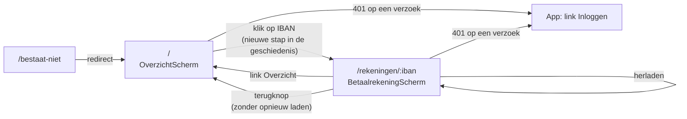

# Slice 2a controleren: navigatie

Met deze instructie controleer je zelf wat er in slice 2a is gebouwd. De volgorde is dezelfde als bij [slice 2](slice-2-controleren.md):

1. Je kijkt wat er staat.
2. Je draait elke test en ziet hem groen worden.
3. Je maakt bij elke test bewust iets kapot. Dan zie je dat de test die fout echt vangt.
4. Je installeert de app en loopt de navigatie zelf na in de browser.
5. Je controleert de pipeline.

Reken op drie kwartier. Slice 2 moet al gecontroleerd zijn; wat daar staat, herhaalt deze instructie niet. De achtergrond staat in [werkwijze-mse.md](werkwijze-mse.md), hoofdstuk 7 (slice 2a), en in [ADR 0012](adr/0012-navigatie-met-de-angular-router.md).

## 1. Wat is er gebouwd

Slice 2a is na slice 2 toegevoegd, omdat de betaalrekening een doodlopend scherm bleek. De slice levert één story:

> **S2a.1** Als klant wil ik vanaf mijn betaalrekening terug naar het overzicht, ook met de terugknop van de browser, zodat ik verder kan zonder opnieuw te beginnen.

Elk scherm heeft nu een eigen URL (Angular-router, ADR 0012):
- **Overzicht:** `/`. Een onbekend pad gaat ook hierheen.
- **Betaalrekening:** `/rekeningen/<IBAN>`. Bovenaan staat de link **Overzicht**, zoals "< Overzicht" in het origineel.
- **Terugknop:** een echte stap terug binnen de app. De app laadt niet opnieuw.
- **Herladen:** op de betaalrekening blijft de betaalrekening open.
- **Sessie verlopen:** geeft een verzoek 401, dan staat er de link **Inloggen** in plaats van het scherm. Dat geldt nu op elk scherm, niet alleen bij het openen van de app.

De API, de seed, de chart en de scripts zijn niet veranderd. Een diepe link als `/rekeningen/NL…` werkte al: de nginx van `bank-web` stuurt een onbekend pad naar `index.html` (`try_files`).



| Laag | Waar | Wat het doet | Test |
| --- | --- | --- | --- |
| Acceptatietest | `e2e/specs/navigatie.spec.ts` | Drie scenario's met de tag `@ui`, dus alleen in de drie browsers: "Terug naar het overzicht", "Terug met de terugknop van de browser" en "Herladen op de betaalrekening" | Is zelf de buitenste lus |
| DSL | `e2e/dsl/bank.ts`, `e2e/dsl/klant.ts` | Een alias is binnen een scenario steeds dezelfde klant, ook tussen `beforeEach` en de test. Nieuwe stappen: `gaatNaarOverzicht`, `gaatTerugInBrowser`, `verwachtDatDeAppNietOpnieuwLaadde` en `herlaadt` | Via de scenario's, en `npm --prefix e2e run typecheck` |
| Drivers | `e2e/drivers/ui/ui-driver.ts`, `betaalrekening-pagina.ts` | De link "Overzicht", `goBack` met een markering op `window`, en `reload`. De REST-driver weigert de terugknop en herladen met een duidelijke fout | Via de scenario's |
| Frontend, routes | `frontend/src/app/app.routes.ts`, `app.config.ts` | `/`, `/rekeningen/:iban` en `**` → `/`; het IBAN uit de URL wordt een input (`withComponentInputBinding`) | `app.spec.ts` (Vitest), met de echte `appConfig` |
| Frontend, schermen | `overzicht-scherm.ts`, `betaalrekening-scherm.ts` | Elk scherm laadt zijn eigen gegevens. `Overzicht` en `Betaalrekening` zelf zijn niet veranderd | `app.spec.ts` |
| Frontend, sessie | `sessie.ts`, `app.ts` | De interceptor `meldNietIngelogd` zet bij een 401 `Sessie.nietIngelogd`; `App` toont dan "Inloggen" in plaats van `<router-outlet>` | `app.spec.ts` |

**Leesvolgorde van de code**, van buiten naar binnen:

1. `e2e/specs/navigatie.spec.ts`: de scenario's, met `beforeEach`.
2. `e2e/dsl/klant.ts` en `e2e/dsl/bank.ts`: de nieuwe stappen, en het hergebruik van een alias.
3. `e2e/drivers/ui/ui-driver.ts`: `terugInBrowser` en `opnieuwGeladen`, de markering op `window`.
4. `frontend/src/app/app.routes.ts` en `app.config.ts`.
5. `frontend/src/app/overzicht-scherm.ts` en `betaalrekening-scherm.ts`.
6. `frontend/src/app/sessie.ts` en `app.ts`.
7. `frontend/src/app/app.spec.ts`: de app starten op een URL, zoals bij herladen.

> **Tip:** begin met een schone werkmap (`git status`). Zet na elke opzettelijke fout het bestand terug met `git checkout -- <bestand>`.

## 2. Voorbereiding

Geen nieuwe tools. Er is één nieuw npm-package: `@angular/router`. `make frontend-test` installeert het via `npm ci`. Het eist via zijn peer-dependencies precies dezelfde versie als `@angular/core`; een afwijkende versie weigert npm (ADR 0012).

## 3. De commit stage

Alleen de frontend is veranderd. De backend en de infrastructuur controleer je in 3.2 in één keer mee.

### 3.1 Frontend

```bash
make frontend-test
```

**Verwacht:** lint schoon, Vitest `31 passed`, de build lukt. Er zijn 4 tests bij gekomen in `app.spec.ts`; de bestaande tests van `App` starten de app nu op een URL.

**Zie hem rood.** Alle bestanden staan in `frontend/src/app/`.

1. **Geen route voor de betaalrekening.** Verwijder in `app.routes.ts` de regel met `path: 'rekeningen/:iban'`. Nu falen vijf tests, zoals `laadt de betaalrekening direct vanaf zijn URL, zoals na herladen (S2a.1)`:
   ```
   Error: Expected one matching request for criteria "Match URL: /api/rekeningen/NL94SIMB0000000001/transacties", found none. Requests received are: GET /api/rekeningen.
   ```
   De URL van de betaalrekening valt dan onder `**` en gaat naar het overzicht.
2. **Het IBAN niet uit de URL.** Verander in `app.config.ts` `provideRouter(routes, withComponentInputBinding())` in `provideRouter(routes)`. Nu falen dezelfde vijf tests:
   ```
   Error: NG0950: Input "iban" is required but no value is available yet.
   ```
   Daarom gebruikt `app.spec.ts` de echte `appConfig`. Een test met een eigen `provideRouter(routes)` zou deze fout missen.
3. **Geen link "Overzicht".** Verwijder in `betaalrekening-scherm.ts` de regel `<a routerLink="/">Overzicht</a>`. Nu faalt `gaat met de link "Overzicht" terug naar het overzicht en laadt de rekeningen opnieuw (S2a.1)`:
   ```
   Error: Expected one matching request for criteria "Match URL: /api/rekeningen", found none.
   ```
4. **Geen redirect voor een onbekend pad.** Verwijder in `app.routes.ts` de regel met `path: '**'`. Nu faalt `stuurt een onbekend pad naar het overzicht`:
   ```
   Error: NG04002: Cannot match any routes. URL Segment: 'bestaat-niet'
   ```
5. **Een 401 niet melden.** Verander in `sessie.ts` `sessie.nietIngelogd.set(true);` in `void sessie;`. Nu falen twee tests:
   - `toont zonder login een link "Inloggen" naar de BFF`, met `expected undefined to be '/oauth2/authorization/keycloak'`;
   - `toont de link "Inloggen" als de sessie op de betaalrekening verlopen is`, met `expected undefined to be defined`.

### 3.2 Alles samen

```bash
make commit-stage
```

**Verwacht:** alles groen, en ongewijzigd ten opzichte van slice 2 voor de backend en `make iac` (9 bats-tests). Daarmee controleer je ook dat je alle opzettelijke fouten hebt teruggezet.

## 4. Installeren, zelf kijken en de acceptatietest

### 4.1 Installeren

```bash
make install
curl -sk https://bank-mse.localtest.me/api/versie
```

**Verwacht:** `Secrets aanwezig`, de rooktests groen, en als versie de commit die je controleert, bijvoorbeeld `{"versie":"c15d816"}`.

### 4.2 Zelf kijken

Maak een klant met de seed, zoals in [slice 2, sectie 4.2](slice-2-controleren.md#42-zelf-kijken). Het eerste commando is genoeg; de 60 transacties mogen erbij. Log in op <https://bank-mse.localtest.me> met de gegevens uit `klant.json`. Daarna:

1. **Openen.** Klik op het IBAN. De adresbalk toont nu `https://bank-mse.localtest.me/rekeningen/<IBAN>`. Bovenaan staat de link **Overzicht**.
2. **Herladen.** Druk op F5 (of ⌘R). De betaalrekening blijft open, met dezelfde transacties. Vóór slice 2a stond je dan weer op het overzicht.
3. **Link Overzicht.** Klik erop. De adresbalk toont `/` en je ziet het overzicht met het saldo.
4. **Terugknop.** Open de rekening opnieuw en gebruik de terugknop van de browser. Je ziet het overzicht. Open de ontwikkelaarstools, tabblad Netwerk, filter "Doc": bij de terugknop komt er geen nieuw documentverzoek. De app is dus niet opnieuw geladen. Met de vooruitknop ben je weer op de betaalrekening.
5. **Onbekend pad.** Open `https://bank-mse.localtest.me/bestaat-niet`. De adresbalk springt naar `/` en je ziet het overzicht.
6. **Sessie kwijt.** Open de betaalrekening. Verwijder in de ontwikkelaarstools (Application of Opslag → Cookies → `https://bank-mse.localtest.me`) het cookie `JSESSIONID`; dat is de sessie van de BFF. Herlaad de pagina. Je ziet nu alleen de link **Inloggen**, zonder scherm eronder. Na inloggen kom je op het overzicht uit.

Ruim `klant.json` daarna op. Er staat een wachtwoord in.

### 4.3 De acceptatietests

```bash
make e2e
```

**Verwacht:** 29 geslaagd. Dat zijn de 20 van slice 2, plus de drie navigatie-scenario's in `chromium`, `firefox` en `webkit`. In `rest` draaien ze niet: navigeren is gedrag van de browser, en via de API zou "terug naar het overzicht" vanaf het begin groen zijn.

### 4.4 Zie de acceptatietest rood

Dit is de sabotage die ADR 0012 als bewaking noemt.

1. Verander in `frontend/src/app/overzicht-scherm.ts` `void this.router.navigate(['/rekeningen', iban]);` in `void this.router.navigate(['/rekeningen', iban], { replaceUrl: true });`. Het openen van de rekening vervangt dan de stap in de geschiedenis, in plaats van er een toe te voegen.
2. Installeer met `make install`. Dat bouwt de images zonder tests, dus de fout komt in het cluster. De Vitest-tests vangen deze fout niet.
3. Draai alleen de navigatie in één browser:
   ```bash
   cd e2e && npx playwright test --project=chromium specs/navigatie.spec.ts; cd ..
   ```

**Verwacht:** 2 geslaagd en 1 gefaald. "Terug met de terugknop van de browser" faalt bij de stap **Dan** ziet Jan de betaalrekening met saldo € 187,60, zonder dat de app opnieuw laadt:
```
Error: app opnieuw geladen bij Jan
Expected: false
Received: true
```

Het overzicht staat er wel. De terugknop gaat dan naar de startpagina van vóór het inloggen, en de app start opnieuw op het overzicht. Daarom heeft het scenario de toevoeging "zonder dat de app opnieuw laadt". Zonder die toevoeging bleef deze sabotage groen, en het scenario was zelfs vóór de router al groen. Zie de werkwijze, slice 2a.

Zet de regel terug, en draai opnieuw `make install` en `make e2e`. Alles is weer groen.

## 5. De installatie

```bash
make e2e-infra
```

**Verwacht:** 3 geslaagd en 1 overgeslagen, net als in slice 2. Deze slice verandert niets aan de installatie.

## 6. De pipeline

```bash
gh run list --limit 5
```

**Verwacht:** de laatste run op `main` is groen. Voor slice 2a was dat run `39672198606` op `c15d816`. In de log van de acceptance stage zie je:
- `29 passed` voor de acceptatietests;
- `7 passed` voor de installatiescenario's, met de upgrade.

Tijdens slice 2a is de pipeline niet rood geweest. Wel was het terugknop-scenario lokaal eerst vals groen; zie 4.4.

## Checklist

- [ ] `make frontend-test` groen (31 tests), en rood gezien bij:
  - geen route voor de betaalrekening;
  - geen `withComponentInputBinding`;
  - geen link "Overzicht";
  - geen redirect voor een onbekend pad;
  - een 401 die niet gemeld wordt.
- [ ] `make commit-stage` groen, dus alle wijzigingen teruggezet.
- [ ] `make install` geslaagd, met de versie die je controleert.
- [ ] Zelf gekeken:
  - de URL `/rekeningen/<IBAN>`;
  - herladen houdt de betaalrekening open;
  - de link "Overzicht";
  - de terugknop zonder nieuw documentverzoek;
  - `/bestaat-niet` gaat naar `/`;
  - zonder `JSESSIONID` alleen "Inloggen".
- [ ] `make e2e` geeft 29 geslaagd, en rood gezien bij het terugknop-scenario met `replaceUrl`.
- [ ] `make e2e-infra` geeft 3 geslaagd.
- [ ] Laatste pipeline-run op `main` groen, met 29 acceptatietests en 7 installatiescenario's.
