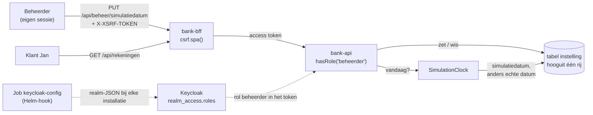

# Slice 3 controleren: simulatiedatum

Met deze instructie controleer je zelf wat er in slice 3 is gebouwd. De volgorde is dezelfde als bij [slice 2a](slice-2a-controleren.md):

1. Je kijkt wat er staat.
2. Je draait elke test en ziet hem groen worden.
3. Je maakt bij elke test bewust iets kapot. Dan zie je dat de test die fout echt vangt.
4. Je installeert de app en zet zelf de simulatiedatum.
5. Je controleert de pipeline.

Reken op anderhalf uur. Deze slice raakt alle lagen: de API, de BFF, de seed, de chart en de acceptatietests. Slice 2a moet al gecontroleerd zijn. De achtergrond staat in [werkwijze-mse.md](werkwijze-mse.md), hoofdstuk 7 (slice 3), en in de ADR's 0013 tot en met 0017.

> **Stand.** Deze instructie gaat over het eerste deel van slice 3: commit `a89eb9a`, met twee scenario's. Het scenario "Vooruitzetten maakt transacties weer zichtbaar" volgt nog. Daarna wordt deze instructie aangevuld.

## 1. Wat is er gebouwd

> **S3.1** Als beheerder wil ik de bank op een gekozen datum laten draaien, zodat ik een situatie in het verleden of de toekomst kan laten zien.

Dit is een *enabling slice*: de beheerder krijgt pas in slice 10 een scherm (S10.2). Tot dan zet hij de datum via de API, en zie je het effect bij de klant:
- **Simulatiedatum.** Staat er een simulatiedatum, dan is dat "vandaag" voor de hele bank. Het saldo en de transactielijst tellen alleen transacties tot en met die datum. Zonder simulatiedatum is vandaag de echte datum in Europe/Amsterdam ([ADR 0013](adr/0013-simulationclock-vervangt-de-systeemtijd.md)).
- **Alleen de beheerder.** `PUT` en `DELETE /api/beheer/simulatiedatum` vragen de realm-rol `beheerder` in het token. Een klant krijgt 403 ([ADR 0015](adr/0015-rol-beheerder-in-het-token.md)).
- **CSRF.** Dit is het eerste verzoek dat iets verandert. De BFF eist het token uit cookie `XSRF-TOKEN` terug als header `X-XSRF-TOKEN` ([ADR 0016](adr/0016-csrf-in-de-bff-met-een-cookie.md)).
- **De realm bij elke installatie.** Keycloak importeert de realm niet meer zelf. Een Helm-hook-Job `keycloak-config` (keycloak-config-cli) past `realm-banksim-mse.json` toe na elke installatie en upgrade. Dat werkt ook op een bestaande realm, zodat die de rol `beheerder` en de scope `roles` krijgt ([ADR 0017](adr/0017-realm-wijzigingen-met-keycloak-config-cli.md)).
- **Serieel.** De simulatiedatum geldt voor iedereen. Daarom draaien de scenario's met `@simulatiedatum` na alle andere, één voor één, en wist de DSL de datum na elk scenario ([ADR 0014](adr/0014-scenarios-met-simulatiedatum-serieel.md)).

De frontend is niet veranderd.



| Laag | Waar | Wat het doet | Test |
| --- | --- | --- | --- |
| Acceptatietest | `e2e/specs/simulatiedatum.spec.ts` | "Transacties na de simulatiedatum zijn onzichtbaar" en "Een klant kan de simulatiedatum niet zetten", met de tag `@simulatiedatum` | Is zelf de buitenste lus |
| Playwright-configuratie | `e2e/playwright.config.ts` | De keten `simulatiedatum-rest` → `-chromium` → `-firefox` → `-webkit`, met `workers: 1`, na de gewone projecten. Die sluiten `@simulatiedatum` uit | Via `make e2e` |
| DSL | `e2e/dsl/beheerder.ts`, `bank.ts`, `klant.ts`, `fixtures.ts` | De beheerder met een eigen verzoekcontext. Jan probeert het met zijn eigen sessie. Na elk `@simulatiedatum`-scenario wist de beheerder de datum, ook als het scenario faalde | Via de scenario's, en `npm --prefix e2e run typecheck` |
| Drivers | `e2e/drivers/simulatiedatum.ts`, `rest-driver.ts`, `ui-driver.ts`, `shell/bank-seed.ts` | PUT of DELETE met het CSRF-token uit het cookie. De UI-driver gebruikt de cookies van de browser. De shell-driver maakt een beheerder | Via de scenario's |
| API, klok | `backend/bank-api/.../simulatie/` | `SimulationClock`, `SimulatiedatumController`, `JdbcSimulatiedatumRepository` (upsert), `KlokConfig` | `SimulationClockTests`, `SimulatiedatumControllerTests`, `JdbcSimulatiedatumRepositoryTests` (Testcontainers) |
| API, schema | `db/migration/V3__instelling.sql` | Tabel `instelling` met hooguit één rij (`id boolean PRIMARY KEY DEFAULT true CHECK (id)`) | `JdbcSimulatiedatumRepositoryTests` |
| API, filters | `JdbcRekeningRepository`, `JdbcTransactieRepository`, de controllers | `datum <= :vandaag` in de saldo-query en de transactie-query; de controllers vragen "vandaag" aan de `SimulationClock` | `hetSaldoTeltAlleenDeTransactiesTotEnMetVandaag`, `geeftAlleenDeTransactiesTotEnMetVandaag`, `vraagtHetSaldoOpDeDatumVanDeSimulationClock` |
| API, beveiliging | `beveiliging/BeveiligingConfig.java` | `/api/beheer/**` alleen met `hasRole("beheerder")`; `realmRollen()` zet `realm_access.roles` om in `ROLE_…` | `TokenControleTests` (echt ondertekend token), `SimulatiedatumControllerTests` |
| API, fitness function | `architectuur/GeenSysteemtijdTests.java` | ArchUnit: nergens `now()` of `now(ZoneId)` op de tijdklassen, en geen `Instant.now()` | Is zelf de test |
| BFF | `backend/bank-bff/.../BeveiligingConfig.java` | `.csrf(csrf -> csrf.spa())` | `BffTests`: het cookie, PUT zonder token 403, PUT met token door naar bank-api |
| Seed | `backend/bank-seed/.../KeycloakLogins.java`, `Beheerders.java`, `SeedCommando.java` | Commando `beheerder`: maakt de gebruiker en kent de realm-rol toe | `KeycloakLoginsTests` (`MockRestServiceServer`), `SeedCommandoTests` |
| Chart | `templates/keycloak-config.yaml`, `templates/keycloak.yaml`, `files/realm-banksim-mse.json`, `values.yaml` | De Job als hook, het image op digest, de geheimen uit Secrets. Keycloak start zonder `--import-realm`. De realm krijgt de rol `beheerder`, de BFF de scope `roles`, en de seed ook `view-realm` | `tests/keycloak-config_test.yaml`, `tests/keycloak_test.yaml` |

**Leesvolgorde van de code**, van buiten naar binnen:

1. `e2e/specs/simulatiedatum.spec.ts`: de scenario's.
2. `e2e/dsl/beheerder.ts` en `e2e/dsl/fixtures.ts`: de eigen sessie van de beheerder, en het wissen na afloop.
3. `e2e/drivers/simulatiedatum.ts`: het CSRF-token.
4. `e2e/playwright.config.ts`: de keten van projecten.
5. `backend/bank-bff/.../BeveiligingConfig.java`.
6. `backend/bank-api/.../beveiliging/BeveiligingConfig.java`: de rolcontrole en `realmRollen()`.
7. `backend/bank-api/.../simulatie/`: controller, klok, repository.
8. `JdbcRekeningRepository` en `JdbcTransactieRepository`: het filter `datum <= :vandaag`.
9. `backend/bank-seed/.../KeycloakLogins.java`: `maakBeheerder`.
10. `deploy/banksim-mse/templates/keycloak-config.yaml` en `files/realm-banksim-mse.json`.

> **Tip:** begin met een schone werkmap (`git status`). Zet na elke opzettelijke fout het bestand terug met `git checkout -- <bestand>`.

## 2. Voorbereiding

Er is één nieuw image: `adorsys/keycloak-config-cli`, op digest in `values.yaml` (ADR 0017). kind haalt het zelf op uit de registry, ook in CI. Verder zijn er geen nieuwe tools of packages.

De eerste installatie na deze slice duurt iets langer. Na Keycloak draait de Job `keycloak-config`, en `helm` wacht daarop.

## 3. De commit stage

De frontend is niet veranderd. Je controleert de backend en de chart; in 3.4 draai je alles samen.

### 3.1 Backend

```bash
make backend-test
```

**Verwacht:** `BUILD SUCCESS`. In de uitvoer zonder `-q` zie je per module: `bank-domain` 10 tests, `bank-api` 53, `bank-bff` 9 en `bank-seed` 15.

Een enkele testklasse draai je zo, bijvoorbeeld:

```bash
cd backend && ./mvnw -B -ntp -pl bank-domain,bank-api test -Dtest='SimulatiedatumControllerTests' -Dsurefire.failIfNoSpecifiedTests=false; cd ..
```

Gebruik `-pl bank-domain,bank-seed` voor de seed en `-pl bank-bff` voor de BFF.

**Zie hem rood in `bank-api`.** De paden beginnen met `backend/bank-api/src/main/java/nl/banksim/api/`.

1. **Geen rolcontrole.** Verwijder in `beveiliging/BeveiligingConfig.java` de regel `.requestMatchers("/api/beheer/**").hasRole("beheerder")`. Nu falen drie tests:
   ```
   TokenControleTests.zonderDeRealmRolBeheerderIsBeheer403:98 Status expected:<403> but was:<200>
   SimulatiedatumControllerTests.eenKlantKanDeSimulatiedatumOokNietWissen:100 Status expected:<403> but was:<204>
   SimulatiedatumControllerTests.eenKlantZonderDeRolBeheerderKrijgt403EnVerandertNiets:92 Status expected:<403> but was:<204>
   ```
2. **De rollen met het verkeerde voorvoegsel.** Verander in dezelfde klasse `"ROLE_" + rol` in `"SCOPE_" + rol`. Nu faalt alleen:
   ```
   TokenControleTests.deRealmRolBeheerderUitHetTokenGeeftToegangTotBeheer:91 Status expected:<200> but was:<403>
   ```
   `SimulatiedatumControllerTests` blijft groen. Die test geeft het recht `ROLE_beheerder` zelf mee met `jwt().authorities(...)`, en slaat de converter dus over. Daarom test `TokenControleTests` met een echt ondertekend token tegen de `JwtDecoder` uit de configuratie.
3. **Het saldo zonder datumfilter.** Verwijder in `rekening/JdbcRekeningRepository.java` het stuk ` AND t.datum <= :vandaag`. Nu faalt `hetSaldoTeltAlleenDeTransactiesTotEnMetVandaag`:
   ```
   Expecting actual:
     [Rekening[soort=BETAAL, iban=NL08SIMB2010265342, saldo=3402.60]]
   to contain exactly (and in same order):
     [Rekening[soort=BETAAL, iban=NL08SIMB2010265342, saldo=187.60]]
   ```
4. **De transacties zonder datumfilter.** Verwijder in `transactie/JdbcTransactieRepository.java` de regel `AND datum <= :vandaag`. Nu faalt `geeftAlleenDeTransactiesTotEnMetVandaag`:
   ```
   Expecting actual:
     ["Bakkerij De Korst"]
   to contain exactly (and in same order):
     ["Woningstichting Thuis"]
   ```
   Bakkerij De Korst is van 2 oktober, één dag na "vandaag" in de test.
5. **De systeemtijd in plaats van de klok.** Verander in `simulatie/SimulationClock.java` `LocalDate.now(klok.withZone(BANK))` in `LocalDate.now(BANK)`. Nu falen vier tests. De ArchUnit-regel `GeenSysteemtijdTests.geenNowZonderClock` meldt:
   ```
   Method <nl.banksim.api.simulatie.SimulationClock.vandaag()> calls method <java.time.LocalDate.now(java.time.ZoneId)> in (SimulationClock.java:24)
   ```
   Drie tests in `SimulationClockTests` krijgen de echte datum in plaats van de vaste datum van de testklok. `now(ZoneId)` leest net zo goed de systeemtijd als `now()`, daarom verbiedt de regel ze allebei.

**Zie hem rood in `bank-bff`.** Verander in `backend/bank-bff/src/main/java/nl/banksim/bff/BeveiligingConfig.java` `csrf.spa()` in `csrf.disable()`. Nu falen drie tests:
```
BffTests.eenPutZonderCsrfTokenGeeft403:148 Status expected:<403> but was:<200>
BffTests.zetHetCsrfTokenInEenCookieDatJavaScriptKanLezen:137
BffTests.eenPutMetHetCsrfTokenUitHetCookieGaatDoorNaarBankApi:160 NullPointer Cannot invoke "jakarta.servlet.http.Cookie.getValue()" because "token" is null
```

**Zie hem rood in `bank-seed`.** Verwijder in `backend/bank-seed/src/main/java/nl/banksim/seed/KeycloakLogins.java`, in `maakBeheerder`, de aanroep `keycloak.post()` naar `…/role-mappings/realm` (zeven regels). De beheerder bestaat dan wel, maar zonder rol. Nu faalt `maaktEenBeheerderEnKentDeRealmRolBeheerderToe`:
```
Further request(s) expected leaving 1 unsatisfied expectation(s).
3 request(s) executed:
POST http://keycloak:8080/realms/banksim-mse/protocol/openid-connect/token, …
POST http://keycloak:8080/admin/realms/banksim-mse/users, …
GET http://keycloak:8080/admin/realms/banksim-mse/roles/beheerder, …
```

### 3.2 De chart

```bash
make iac
```

**Verwacht:** helm-unittest `25 passed`, de namespacecheck, kubeconform en conftest schoon, en 9 bats-tests groen.

**Zie hem rood.** Haal in `deploy/banksim-mse/files/realm-banksim-mse.json` `"roles"` weg uit `"defaultClientScopes": ["basic", "profile", "acr", "roles"]`. Zonder die scope zet Keycloak `realm_access.roles` niet in het token van de BFF, en krijgt ook de beheerder 403. Nu faalt in `keycloak_test.yaml` "heeft de realm-rol beheerder, en de BFF krijgt de rollen in het token (ADR 0015)":
```
- asserts[1] `matchRegex` fail
    Path:	data["realm-banksim-mse.json"]
    Expected to match:
        "defaultClientScopes": \[\s*"basic",\s*"profile",\s*"acr",\s*"roles"\s*\]
```

Kijk ook naar `tests/keycloak-config_test.yaml`. Die controleert dat de Job een hook is na installatie en upgrade, dat het image op digest staat, en dat het admin-wachtwoord en de client secrets uit Secrets komen.

### 3.3 De specs

```bash
npm --prefix e2e run typecheck
```

**Verwacht:** geen uitvoer. Dit zit ook in `make commit-stage`.

### 3.4 Alles samen

```bash
make commit-stage
```

**Verwacht:** alles groen. De frontend is ongewijzigd: Vitest `31 passed`. Daarmee controleer je ook dat je alle opzettelijke fouten hebt teruggezet.

## 4. Installeren, zelf kijken en de acceptatietest

### 4.1 Installeren

```bash
make install
curl -sk https://bank-mse.localtest.me/api/versie
```

**Verwacht:** `Secrets aanwezig`, de rooktests groen, en als versie de commit die je controleert, bijvoorbeeld `{"versie":"a89eb9a"}`.

De Job `keycloak-config` zie je daarna niet meer: Helm ruimt hem op als hij geslaagd is (`hook-succeeded`). Faalt hij, dan faalt `make install`, en blijft de Job staan voor de log:

```bash
kubectl --context kind-single-node -n banksim-mse logs job/keycloak-config
```

**Had je al een installatie van vóór slice 3?** Dan is dit de belangrijkste controle van ADR 0017. De bestaande realm krijgt de rol `beheerder` en de scope `roles` via de Job. Met de oude `--import-realm` zou hij ze nooit krijgen. De beheerder in 4.2 kan de datum dan alleen zetten als de Job zijn werk gedaan heeft.

### 4.2 Zelf kijken

Maak met de seed een klant met € 100,00, twee bijschrijvingen en een beheerder. Dat zijn de waarden van het eerste scenario.

```bash
TAG=$(helm --kube-context kind-single-node -n banksim-mse get values banksim-mse -o json | jq -r .imageTag)
seed() { # seed <podnaam> <argumenten als JSON-array>
  kubectl --context kind-single-node -n banksim-mse run "bank-seed-$1" \
    --image="banksim-mse/bank-seed:$TAG" --restart=Never --rm --attach --quiet \
    --overrides="{\"spec\":{\"containers\":[{\"name\":\"bank-seed-$1\",\"image\":\"banksim-mse/bank-seed:$TAG\",\"args\":$2,\"envFrom\":[{\"secretRef\":{\"name\":\"bank-seed\"}}]}]}}" \
    | tail -1
}
NAAM=demo-$(date +%s)
seed "$NAAM" "[\"klant\",\"--alias\",\"$NAAM\",\"--betaalrekening\",\"100.00\"]" > klant.json
IBAN=$(jq -r .iban klant.json)
seed "$NAAM-t" "[\"transacties\",\"--iban\",\"$IBAN\",\"--transactie\",\"2026-10-01,50.00,Werkgever B.V.\",\"--transactie\",\"2026-10-10,25.00,Werkgever B.V.\"]"
seed "$NAAM-b" "[\"beheerder\",\"--alias\",\"beheerder-$NAAM\"]" > beheerder.json
```

**Verwacht:** de uitvoer van het tweede commando is `{"iban":"NL…SIMB…","aantal":2}`. `beheerder.json` bevat een gebruikersnaam en een wachtwoord.

Gebruik twee browsersessies: een gewoon venster voor Jan en een privévenster voor de beheerder. In hetzelfde venster zou de single sign-on van Keycloak je als de eerste gebruiker inloggen.

1. **Zonder simulatiedatum.** Log in het gewone venster in met `klant.json`. Het overzicht toont **€ 175,00**. Op de betaalrekening staan **Zaterdag 10 oktober 2026** en **Donderdag 1 oktober 2026**, met Werkgever B.V. +25,00 en +50,00.
2. **De beheerder zet de datum.** Log in het privévenster in met `beheerder.json`. Open de ontwikkelaarstools, tabblad Console, en voer uit:
   ```js
   const token = decodeURIComponent(document.cookie.match(/XSRF-TOKEN=([^;]+)/)[1]);
   const zet = (methode, body) => fetch('/api/beheer/simulatiedatum', { method: methode, body,
     headers: { 'Content-Type': 'application/json', 'X-XSRF-TOKEN': token } }).then((r) => r.status);
   await zet('PUT', JSON.stringify({ datum: '2026-10-05' }));
   ```
   **Verwacht:** `204`. Zo stuurt Angular het token ook mee, en zo doet de driver het.
3. **Jan op 5 oktober.** Herlaad het gewone venster. Het overzicht toont **€ 150,00**. Op de betaalrekening staat alleen 1 oktober.
4. **Jan probeert het zelf.** Voer dezelfde drie regels uit in de console van het gewone venster. **Verwacht:** `403`. Jan heeft de rol `beheerder` niet.
5. **Zonder CSRF-token.** Voer in het privévenster uit:
   ```js
   await fetch('/api/beheer/simulatiedatum', { method: 'DELETE' }).then((r) => r.status);
   ```
   **Verwacht:** `403`, ook voor de beheerder. Het verzoek komt niet bij bank-api.
6. **Wissen.** Voer in het privévenster `await zet('DELETE');` uit. **Verwacht:** `204`. Herlaad het gewone venster: weer € 175,00 en twee datums.
7. **De database.** Na het wissen is tabel `instelling` leeg:
   ```bash
   kubectl --context kind-single-node -n banksim-mse exec postgres-0 -- \
     sh -c 'psql -U "$POSTGRES_USER" -d bank -c "select * from instelling"'
   ```
   **Verwacht:** `(0 rows)`.

> **Vergeet stap 6 niet.** De simulatiedatum geldt voor de hele bank. Blijft hij staan, dan falen in 4.3 de scenario's van slice 2 op het saldo of de datum.

Ruim `klant.json` en `beheerder.json` daarna op. Er staat een wachtwoord in.

### 4.3 De acceptatietests

```bash
make e2e
```

**Verwacht:** 37 geslaagd. Dat zijn de 29 van slice 2a, plus de twee scenario's in de keten van vier projecten. In de uitvoer staan de `@simulatiedatum`-scenario's als laatste, met `[simulatiedatum-rest]`, `[simulatiedatum-chromium]`, enzovoort. Na elk scenario zie je de stap "Na afloop wist de beheerder de simulatiedatum" in het rapport (`npx playwright show-report e2e/playwright-report`).

Eén `@simulatiedatum`-scenario los draai je met `--no-deps`. Anders draaien eerst alle gewone projecten:

```bash
cd e2e && npx playwright test --project=simulatiedatum-rest --no-deps specs/simulatiedatum.spec.ts; cd ..
```

Controleer daarna tabel `instelling` zoals in 4.2 stap 7. Hij is leeg.

### 4.4 Zie de acceptatietest rood

Dit is de sabotage die de werkwijze als fitness function noemt: zonder rolcontrole wordt het tweede scenario rood.

1. Verwijder in `backend/bank-api/src/main/java/nl/banksim/api/beveiliging/BeveiligingConfig.java` de regel `.requestMatchers("/api/beheer/**").hasRole("beheerder")`.
2. Installeer met `make install`. Dat bouwt de images zonder tests, dus de fout komt in het cluster.
3. Draai alleen de simulatiedatum, via de API:
   ```bash
   cd e2e && npx playwright test --project=simulatiedatum-rest --no-deps specs/simulatiedatum.spec.ts; cd ..
   ```

**Verwacht:** 1 geslaagd en 1 gefaald. "Een klant kan de simulatiedatum niet zetten" faalt bij de stap **Dan** wordt dat geweigerd:
```
Error: uitkomst voor Jan
Expected: "geweigerd"
Received: "gelukt"
```

Het eerste scenario blijft groen: de beheerder mag de datum nog steeds zetten. Let op: Jan heeft de datum in dit gefaalde scenario wél gezet. De fixture wist hem na afloop toch, ook al faalde het scenario.

Tijdens het bouwen was dit scenario eerst om de verkeerde reden groen. De BFF had toen de standaard CSRF-bescherming van Spring, zonder cookie. Elke PUT kreeg 403, ook die van de beheerder, en dus ook die van Jan, nog vóór er een rolcontrole was. Daarom staat CSRF met een cookie in deze slice, en niet later.

Zet de regel terug, en draai opnieuw `make install` en `make e2e`. Alles is weer groen.

## 5. De installatie

```bash
make e2e-infra
```

**Verwacht:** 3 geslaagd en 1 overgeslagen, net als in slice 2a. `installatie.spec.ts` installeert opnieuw; de Job `keycloak-config` draait dan opnieuw, en dat verandert niets aan de werking.

Wat hier níet getest wordt: de upgrade in CI (`upgrade.spec.ts`) installeert twee keer dezelfde chart. Een realm van vóór een wijziging komt daar dus nooit voor. Dat staat zo in de Bewaking van ADR 0017. Een bestaande realm controleer je lokaal, zoals in 4.1.

## 6. De pipeline

```bash
gh run list --limit 5
```

**Verwacht:** de laatste run op `main` is groen. Voor slice 3 deel 1 was dat run `39915063676` op `a89eb9a`. In de log van de acceptance stage zie je:
- `37 passed` voor de acceptatietests;
- `7 passed` voor de installatiescenario's, met de upgrade.

Dit was de eerste installatie van de Job `keycloak-config` op een leeg cluster in kind. Lokaal was dat pad alleen in Docker gecontroleerd, met Keycloak 26.8.0 en de gerenderde realm.

## Checklist

- [ ] `make backend-test` groen (10 + 53 + 9 + 15 tests), en rood gezien bij:
  - geen rolcontrole op `/api/beheer/**`;
  - `SCOPE_` in plaats van `ROLE_` (alleen `TokenControleTests`);
  - geen datumfilter in het saldo;
  - geen datumfilter in de transacties;
  - `LocalDate.now(BANK)` in de klok (ArchUnit en `SimulationClockTests`);
  - `csrf.disable()` in de BFF;
  - geen rol voor de beheerder in de seed.
- [ ] `make iac` groen (25 helm-unittests, 9 bats-tests), en rood gezien zonder de scope `roles`.
- [ ] `make commit-stage` groen, dus alle wijzigingen teruggezet.
- [ ] `make install` geslaagd, met de versie die je controleert.
- [ ] Zelf gekeken:
  - € 175,00 zonder simulatiedatum;
  - de beheerder zet 5 oktober 2026 (204), en Jan ziet € 150,00 en alleen 1 oktober;
  - Jan krijgt 403;
  - zonder CSRF-token krijgt ook de beheerder 403;
  - na wissen weer € 175,00, en tabel `instelling` leeg.
- [ ] `make e2e` geeft 37 geslaagd, en rood gezien zonder rolcontrole.
- [ ] `make e2e-infra` geeft 3 geslaagd.
- [ ] Laatste pipeline-run op `main` groen, met 37 acceptatietests en 7 installatiescenario's.
