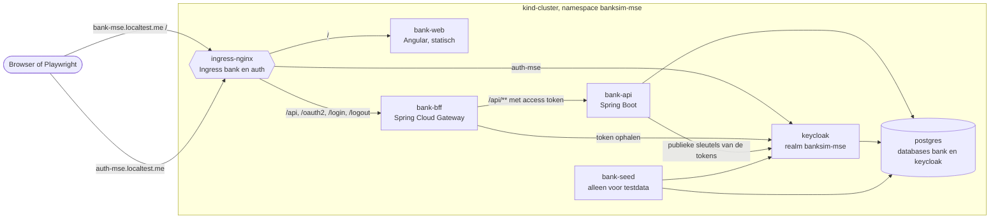
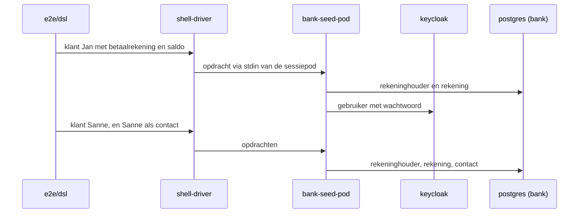
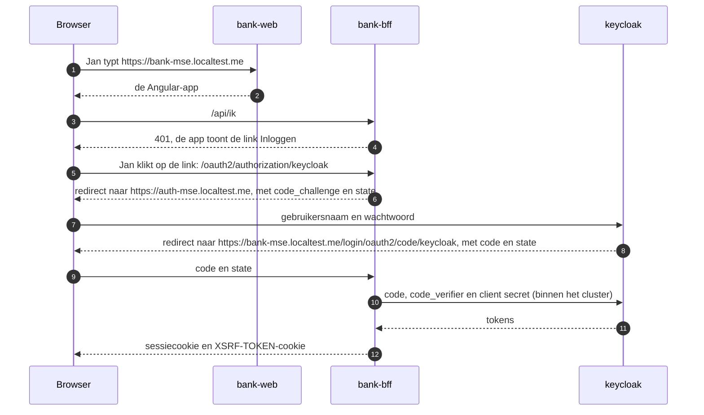
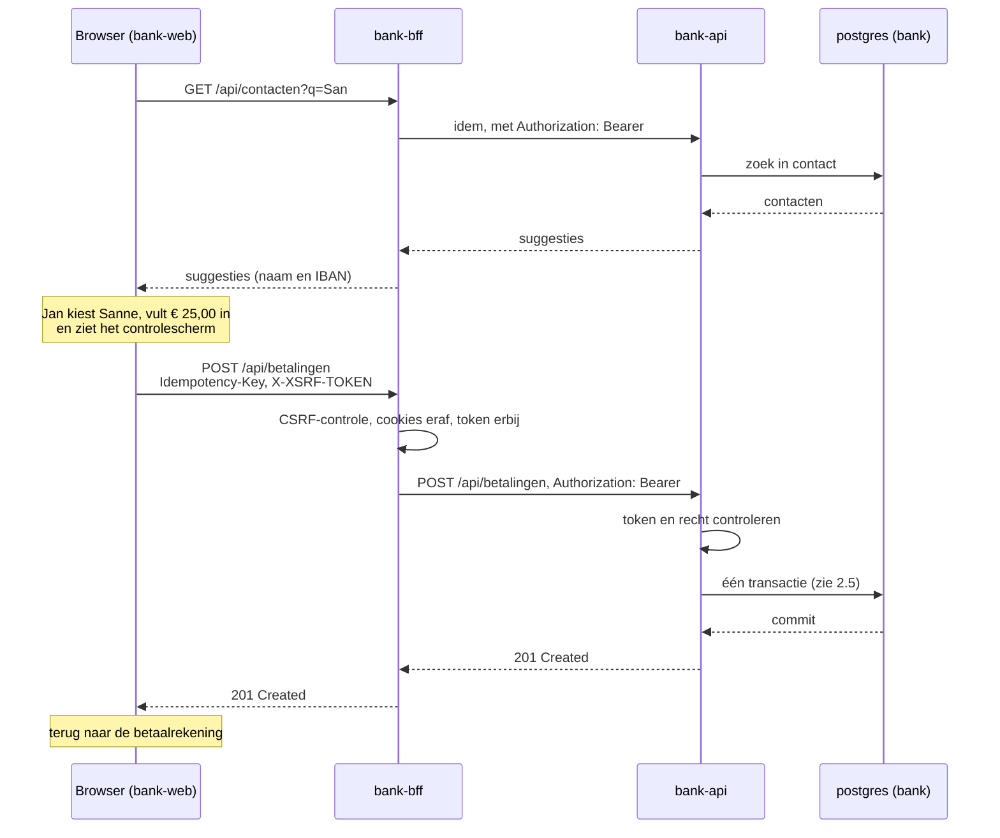
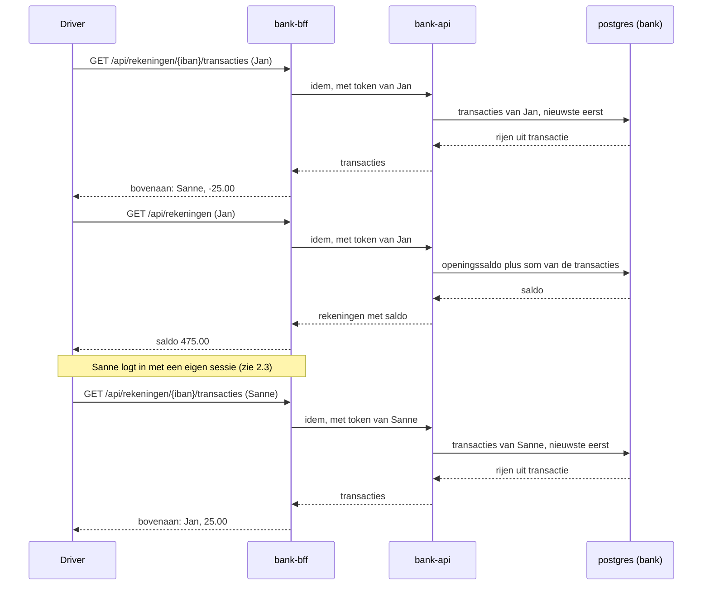

# Een story door de stack

Dit document laat zien hoe één user-story door de hele stack loopt: van het scenario, via de browser of de API, tot een rij in de database en weer terug. Eerst beschrijft het waar de stack uit bestaat. Daarna volgt het de happy flow van story S7.1, **Betalen naar een contact**.

## Leeswijzer

Dit document beschrijft de vorm van het systeem, niet de details. Het noemt alleen namen die zelden veranderen:
- de deploybare onderdelen en Kubernetes-resources;
- de modules en de packages;
- de URL-paden en headers van de API;
- de tabellen en de ADR's.

Klassen, versies, poorten, aantallen en regelnummers staan er bewust niet in. Die vind je in de bron waar het document naar verwijst.

Verschillen het document en de code, dan wint de code. Het scenario, de ADR en de Helm-chart zijn de bron van de waarheid; voor de vorm van de API is dat het contract `api/bank-api.yaml` (ADR 0034). Wil je de route tot op de klasse kennen, gebruik dan de skill `uitleg` (`/uitleg betalen`), die alles uit de actuele code haalt.

## 1. De stack

### 1.1 Overzicht

De browser praat alleen met `bank-web`, `bank-bff` en Keycloak. `bank-api` is van buiten het cluster niet bereikbaar, en de browser krijgt nooit een token te zien (ADR 0008).

### 1.2 De onderdelen

| Onderdeel | Verantwoordelijkheid | Bron | ADR |
| --- | --- | --- | --- |
| `bank-web` | Levert de Angular-app als statische bestanden. Elk scherm heeft een eigen URL. | `frontend/` | 0012 |
| `bank-bff` | Backend for frontend. Doet het inloggen bij Keycloak, houdt de sessie en het token bij, beschermt tegen CSRF en stuurt `/api/**` door naar `bank-api` met het token. | `backend/bank-bff` | 0008, 0016, 0021 |
| `bank-api` | De bank: rekeningen, transacties, betalen, rente, simulatiedatum. Controleert het token bij elke aanvraag en het recht per endpoint. | `backend/bank-api` | 0022, 0023 |
| API-contract | Beschrijft elk endpoint van `bank-api`: paden, parameters, de JSON van verzoeken en antwoorden, en de probleemberichten. `bank-api` wordt ertegen getest; de frontend haalt er zijn types uit. Geen onderdeel dat draait. | `api/bank-api.yaml` | 0034 |
| `bank-domain` | De regels van de bank zonder framework, zoals bedrag, IBAN, overboeking en "nooit rood". `bank-api` gebruikt het als library. | `backend/bank-domain` | 0010, 0024, 0025 |
| `keycloak` | Identiteitsprovider: gebruikers, wachtwoorden, rollen en tokens, in de realm `banksim-mse`. | chart, `deploy/banksim-mse/files/` | 0007, 0015 |
| `postgres` | Eén PostgreSQL met twee databases: `bank` voor de bank en `keycloak` voor Keycloak. Het schema van `bank` komt uit Flyway-migraties in `bank-api`. | chart, `backend/bank-api/src/main/resources/db/migration` | 0009 |
| `bank-seed` | Command-line tool die testdata zet: klanten met rekeningen, contacten, transacties. Draait alleen tijdens een testrun, als pod per Playwright-worker. | `backend/bank-seed` | 0003, 0020 |

### 1.3 Kubernetes-resources

Alles staat in namespace `banksim-mse`, en er zijn geen cluster-brede resources (ADR 0004). De chart staat in `deploy/banksim-mse`, en `deploy/scripts/install.sh` installeert hem.

| Soort | Resources | Opmerking |
| --- | --- | --- |
| Deployment met Service | `bank-web`, `bank-bff`, `bank-api`, `keycloak` | Images van `bank-web`, `bank-bff` en `bank-api` worden zelf gebouwd. Keycloak en PostgreSQL zijn vastgepind op digest (`values.yaml`). |
| StatefulSet met Service | `postgres` | Met een PVC voor de data. Bij de eerste start maakt de ConfigMap `postgres-init` de databases en de databaserollen aan. |
| Job | `keycloak-config` | Past bij elke installatie de realm toe uit `files/realm-banksim-mse.json`, ook op een bestaande realm (ADR 0017). |
| Ingress | `bank` (host `bank-mse.localtest.me`), `auth` (host `auth-mse.localtest.me`) | Bepaalt welke paden naar `bank-web` en welke naar `bank-bff` gaan. |
| ConfigMap | `postgres-init`, `keycloak-realm` | |
| Secret | één per onderdeel dat een geheim nodig heeft | `install.sh` maakt ze één keer aan, met willekeurige waarden. Ze staan nooit in Git of in `values.yaml` (ADR 0009). |

### 1.4 Rondom de draaiende applicatie

- **De acceptatietests** staan in `e2e/` en zijn opgebouwd uit vier lagen (ADR 0005, 0031):
  - de **specs** (`e2e/specs/`) zijn de scenario's in domeintaal;
  - de **DSL** (`e2e/dsl/`) vertaalt die naar handelingen van een klant of beheerder, en doet de beweringen;
  - de **drivers** (`e2e/drivers/`) voeren een handeling uit via één protocol: REST tegen de BFF, de browser, of de shell voor `bank-seed`;
  - het **systeem** is de installatie in het cluster.
  
  Hetzelfde scenario draait zo via de API en in de browser.
- **De pipeline** (`.github/workflows/ci.yml`, ADR 0002) heeft twee stages:
  - de commit stage bouwt de code, voert de unittests, de mutatietests en de infrastructuurchecks uit, en bouwt de images één keer. Daarbij hoort het contract: de controllertests controleren elk antwoord van `bank-api` ertegen, en de types van de frontend moeten erbij passen;
  - de acceptance stage installeert die images in een tijdelijk kind-cluster en draait daar de scenario's.

## 2. De story: Betalen naar een contact

### 2.1 Het scenario

Het scenario staat in `e2e/specs/betalen.spec.ts`:

> **Gegeven** Jan heeft een betaalrekening met saldo € 500,00
> **En** Sanne is een contact met een betaalrekening
> **Als** Jan € 25,00 aan Sanne betaalt en bevestigt
> **Dan** staat de betaling bovenaan de transacties van Jan als -25,00 aan Sanne
> **En** is het saldo van Jan € 475,00
> **En** ziet Sanne bovenaan een bijschrijving van +25,00 van Jan

De rest van dit hoofdstuk volgt deze stappen door de stack. Het scenario draait in Playwright-project `rest` (via de API) en in `chromium` (via de browser). De DSL-zinnen zijn in beide gelijk, alleen de driver verschilt.

### 2.2 Gegeven: de testdata

- De DSL maakt de klanten niet via de schermen aan, maar via `bank-seed` (ADR 0003). Elke Playwright-worker heeft één sessiepod `bank-seed-sessie-*`, die opdrachten regel voor regel ontvangt (ADR 0020).
- `bank-seed` schrijft rechtstreeks in de database `bank`, met een eigen databaserol, en maakt de login aan in Keycloak.
- Het beginsaldo is een openingssaldo van de rekening, geen transactie.
- De contactenlijst geldt voor de hele bank: Sanne als contact betekent één rij in de tabel `contact`.
- **Waar kijk je:** `e2e/dsl/`, `e2e/drivers/shell/`, `backend/bank-seed`.

### 2.3 Als: Jan logt in

Dit is de OAuth2 authorization code flow met PKCE; die begint bij pijl 5. De nummers horen bij de pijlen in het diagram:

1. Jan typt alleen het adres van de bank. De ingress stuurt die aanvraag naar `bank-web`.
2. `bank-web` levert de Angular-app.
3. De app vraagt bij de BFF op wie er is ingelogd (`frontend/src/app/ik.ts`).
4. Er is nog geen sessie, dus de BFF antwoordt met een 401. Dat is geen redirect: de app vangt de 401 op en toont de link "Inloggen" (`frontend/src/app/sessie.ts`, `app.ts`).
5. Jan klikt op die link, en de browser opent `/oauth2/authorization/keycloak` op de host van de bank. De ingress stuurt `/oauth2` door naar de BFF. Het woord `keycloak` aan het eind is alleen de naam van de client-registratie in de BFF: deze aanvraag gaat nog niet naar Keycloak.
6. De BFF bedenkt een geheim, de `code_verifier`, en bewaart dat in de sessie. De BFF antwoordt met een redirect naar Keycloak. In die URL staan de hash van het geheim (`code_challenge`) en een willekeurige waarde `state`.
7. De browser volgt de redirect en toont het inlogscherm van Keycloak. Jan voert daar de gegevens in, dus de BFF ziet het wachtwoord nooit. Keycloak maakt een code aan en onthoudt bij welke login, client en `code_challenge` die hoort.
8. Keycloak antwoordt met een redirect terug naar de BFF, met de code en `state` in de URL.
9. De browser volgt ook deze redirect, en de code en `state` komen zo bij de BFF aan. De BFF controleert of `state` klopt, zodat een aanvaller geen eigen login in de sessie van Jan kan schuiven.
10. De BFF wisselt de code in. Daarvoor stuurt de BFF de code, de `code_verifier` en het client secret rechtstreeks naar Keycloak, binnen het cluster.
11. Keycloak controleert ze en geeft de tokens terug. De BFF bewaart de tokens in de sessie.
12. De browser krijgt alleen een sessiecookie en nooit de tokens (ADR 0008).

De code is een eenmalig, kortlevend bonnetje en geeft zelf geen toegang tot `bank-api`. Hij loopt via de browser en staat in een URL, en kan dus in de browsergeschiedenis of in logs terechtkomen. Daarom gaan de tokens niet via die weg, maar via de directe verbinding tussen de BFF en Keycloak. In `KeycloakClientRegistration` zie je dat terug: `authorizationUri` is de publieke host, `tokenUri` het interne adres.

**PKCE** (Proof Key for Code Exchange, spreek uit als "pixie") bewijst dat degene die de code inwisselt, ook degene is die de login heeft gestart. Bij het inwisselen rekent Keycloak de hash van de `code_verifier` uit en vergelijkt die met de `code_challenge` uit stap 6. Wie de code onderschept, kent de `code_verifier` niet: die is nooit door de browser gegaan, en uit de hash is hij niet terug te rekenen. De BFF heeft ook een client secret, en PKCE beschermt daarnaast tegen het injecteren van een onderschepte code in een andere sessie.

- De BFF zet ook een cookie `XSRF-TOKEN`. Bij elke aanvraag die iets wijzigt, stuurt de browser die waarde terug in de header `X-XSRF-TOKEN` (ADR 0016).
- De UI-driver logt in via de echte schermen. De REST-driver doet dezelfde redirects zonder browser.
- **Waar kijk je:** `backend/bank-bff`, `deploy/banksim-mse/files/realm-banksim-mse.json`.

### 2.4 Als: Jan kiest Sanne en betaalt

Na het inloggen opent Jan zijn betaalrekening en kiest "Betalen". Het betaalscherm heeft een eigen URL onder die van de rekening (ADR 0012).

- **Suggesties.** Bij het typen vraagt het scherm suggesties op uit de contactenlijst. Kiezen vult naam en IBAN in. De REST-driver slaat deze stap over en stuurt naam en IBAN direct mee.
- **Controlescherm.** Het controlescherm maakt één Idempotency-Key aan. Wordt dezelfde betaling twee keer verstuurd, bijvoorbeeld door twee keer klikken of een herhaalde aanvraag, dan boekt `bank-api` haar maar één keer (ADR 0027).
- **Bedragen** gaan als tekst over de lijn, nooit als drijvende komma (ADR 0010).
- **De BFF** controleert de CSRF-header, haalt de cookies van de browser van de aanvraag af en zet het access token uit de sessie erop.
- **`bank-api`** controleert het token tegen de publieke sleutels van Keycloak, inclusief de audience `bank-api`. Daarna controleert het het recht van het endpoint met `@PreAuthorize` (ADR 0022).
- **Waar kijk je:**
  - de vorm van `POST /api/betalingen` en zijn antwoorden in `api/bank-api.yaml`;
  - de schermen in `frontend/src/app`;
  - de route naar `bank-api` in `backend/bank-bff`;
  - het package `betaling` in `bank-api`;
  - `e2e/drivers/rest/` en `e2e/drivers/ui/`.

### 2.5 Binnen bank-api: de betaling boeken

Alles hieronder gebeurt in één databasetransactie. Faalt een stap, dan wordt er niets geboekt.

1. **Idempotentie.** De Idempotency-Key wordt vastgelegd in `idempotency_sleutel`. De sleutel geldt per gebruiker. Is hij al gebruikt voor dezelfde betaling, dan stopt de verwerking zonder nieuwe boeking (ADR 0027).
2. **Eigenaarschap.** De rekening waarvan betaald wordt, moet van de ingelogde klant zijn. Zo niet, dan bestaat ze voor de klant niet: 404 (ADR 0023).
3. **Contact.** Het IBAN van de ontvanger moet in de contactenlijst staan, en de naam moet erbij passen.
4. **Vergrendelen.** De twee rekeningen worden vergrendeld in IBAN-volgorde. Zo lopen gelijktijdige boekingen niet in een deadlock (ADR 0026).
5. **Nooit rood.** Het laagste lopende saldo vanaf de uitvoerdatum moet de betaling kunnen dragen, ook als er al latere boekingen zijn (ADR 0025). De uitvoerdatum komt van de klok van de bank, die de simulatiedatum volgt (ADR 0013).
6. **Boeken.** De betaling wordt één overboeking met twee kanten: een rij in `overboeking` en twee rijen in `transactie`, −25,00 bij Jan en +25,00 bij Sanne. Alleen `LedgerService` boekt (ADR 0024). Een trigger in de database controleert bij de commit dat de twee kanten samen nul zijn.
7. **Event.** Het grootboek meldt de boeking met het event `OverboekingGeboekt`. De rente-code luistert daarnaar in dezelfde transactie, om de rente van een spaarrekening te corrigeren. Bij twee betaalrekeningen doet ze niets (ADR 0030).

Een geweigerde betaling, zoals een onbekend contact, een naam die niet past of een te laag saldo, komt terug als `ProblemDetail` met een eigen probleemcode. Die vallen buiten de happy flow; zie de andere scenario's in `betalen.spec.ts`.

**Waar kijk je:**
- in `bank-api` de packages `betaling` en `grootboek`;
- in `bank-domain` het package `grootboek`;
- de tabellen in `db/migration`.

### 2.6 Dan: Jan en Sanne zien de betaling

- **Saldo.** Het saldo is het openingssaldo plus de som van de transacties. Er is geen apart saldoveld dat moet worden bijgewerkt.
- **Beweringen.** De DSL doet de beweringen. De driver levert alleen wat hij ziet: in de browser de transactielijst en het overzicht, via REST de JSON van dezelfde endpoints (ADR 0031).
- **Sanne** krijgt een eigen sessie, met een eigen login. Zo blijkt dat zij de bijschrijving ziet, en niet alleen Jan.
- **Waar kijk je:** de packages `transactie` en `rekening` in `bank-api`, en `e2e/dsl/`.

## 3. Een andere story volgen

Dezelfde route geldt voor elke story:
1. Begin bij de spec in `e2e/specs/`.
2. Volg de DSL-methode naar de driver.
3. Kijk welk endpoint de driver aanroept: de schermen in `frontend/src/app` roepen dezelfde endpoints aan.
4. Zoek dat endpoint op in het contract `api/bank-api.yaml`: daar staat wat het verwacht en wat het teruggeeft.
5. Zoek het endpoint in `bank-api` en volg het naar het domein en de database.

De tabel "Waar komt wat" in `CLAUDE.md` geeft per soort wijziging de plek en de test. De ADR's in `doc/adr/` geven het waarom.
