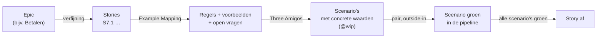

# BankSim – ATDD in een team

Oct 21, 2026 · @Edwin

[De werkwijze](werkwijze-mse.md) beschrijft hoe je één scenario bouwt: van voorbeeld tot groene pipeline, met de double loop en het vierlaagse model. Dit document gaat over wat er gebeurt als een **team** dat doet:

- hoe een epic stories en scenario's wordt;
- hoe het team het werk verdeelt;
- op welke momenten het team samenwerkt.

Het voorbeeld is weer BankSim-MSE. De werkwijze zelf staat hier niet nog een keer: dit document verwijst ernaar.

Wat Farley zelf zegt, staat erbij met een bron (zie [Bronnen](#9-bronnen)). Technieken die van anderen komen, staan erbij met hun maker. Waar dit document Farleys principes zelf doortrekt naar het verdelen van taken, staat **interpretatie**.

## 1. Het probleem met taken per developer

De gebruikelijke manier is:

1. een epic opdelen in stories;
2. elke story opdelen in taken per laag, zoals "API-endpoint", "databasetabel", "Angular-component" en "testen";
3. die taken verdelen over de developers.

Elke developer heeft het druk, maar de story is pas af als alle taken af zijn.

Farley zou dit om drie redenen afraden:

- **Een taak levert geen waarde en geen feedback.** Een endpoint zonder scherm, of een scherm zonder endpoint, kan niemand gebruiken. Ook kan geen acceptatietest bewijzen dat het klopt. Farley stuurt op leren door snelle feedback in kleine stappen (*Modern Software Engineering*, deel II). Een taak per laag geeft die feedback pas als de laatste taak klaar is.
- **Integreren gebeurt aan het eind.** Taken die los van elkaar worden gebouwd, komen pas samen als alles af is. Daar ontstaan de verrassingen. Continuous integration bestaat juist om dat te voorkomen (*Continuous Delivery*, hoofdstuk 3).
- **Testen wordt een aparte fase.** Er staat een taak "testen" aan het eind, vaak van iemand anders. Farley: de developers zijn eigenaar van de acceptatietests en moeten ze werkend houden, omdat zij ze ook breken (*Acceptance Testing for Continuous Delivery*).

## 2. Uitgangspunten

| # | Uitgangspunt | Bron |
| --- | --- | --- |
| 1 | **Snij verticaal.** Een story beschrijft waarde voor een gebruiker en loopt door alle lagen. Een grote story splits je in kleinere stories of scenario's, niet in lagen. | *Modern Software Engineering*, hoofdstuk 4–6 (iteratief, feedback, incrementeel); zie ook [werkwijze, hoofdstuk 2](werkwijze-mse.md#2-uitgangspunten-uit-modern-software-engineering) |
| 2 | **Minstens één acceptatietest per acceptatiecriterium.** De scenario's zijn de acceptatiecriteria. Een story is af als ze in de pipeline groen zijn. | *Acceptance Testing for Continuous Delivery*; *Continuous Delivery*, hoofdstuk 8 |
| 3 | **De developers zijn eigenaar van de acceptatietests.** Iedereen mag een testcase schrijven: PO, analist, tester of developer. De developers bouwen de DSL en de protocoldrivers en houden de tests groen. | *Acceptance Testing for Continuous Delivery* |
| 4 | **Integreer minstens dagelijks op `main`.** Geen feature branches die langer dan een dag leven. Wat nog niet af is, blijft onzichtbaar achter `@wip`, een feature toggle of branch-by-abstraction. | *Continuous Delivery*, hoofdstuk 3, 13 en 14; Farley, "Continuous Integration and Feature Branching"; *Accelerate* |
| 5 | **Een rode pipeline stopt het team.** Repareer hem direct. Check niet in op een rode build. | *Continuous Delivery*, hoofdstuk 3 ("Essential Practices") |
| 6 | **Werk samen in plaats van over te dragen.** Pair programming is de standaard. Ensemble programming kan bij werk dat iedereen raakt. | Pair programming: Farley beveelt het op zijn kanaal en in *The Engineering Room* vaak aan. Ensemble/mob: Woody Zuill. De keuze per moment is **interpretatie** |
| 7 | **De eenheid van werk is één falend scenario, niet een taak.** Een pair neemt een scenario en loopt het outside-in door alle lagen. Taken zijn hooguit het kladblok van het pair. | **Interpretatie** van 1–6 en van de regel "één falend scenario tegelijk" ([werkwijze, hoofdstuk 4](werkwijze-mse.md#4-de-double-loop)) |
| 8 | **Beperk het onderhanden werk.** Maak liever één story samen af dan drie stories half. De voortgang meet je in groene scenario's in de pipeline. | **Interpretatie**, in lijn met de nadruk op kleine batches en flow in *Continuous Delivery* en *Accelerate* |

## 3. Van epic naar scenario

**De begrippen.** Een epic is een groot gebruikersdoel dat niet in één slice past. De slice, story en scenario staan beschreven in [werkwijze, hoofdstuk 2](werkwijze-mse.md#2-uitgangspunten-uit-modern-software-engineering). In BankSim-MSE valt een epic ongeveer samen met een slice. In een groter product heeft een epic meerdere slices.

**Splitsen.** Een story is klein genoeg als het team hem in een paar dagen groen kan krijgen. Is hij groter, dan splits je langs gebruikersgedrag, niet langs de techniek. Bruikbare splitsingen, naar de patronen van Richard Lawrence:

- **Per regel:** eerst betalen aan een contact, daarna de weigering als iemand geen contact is.
- **Per variatie in data:** eerst de betaalrekening, later de spaarrekening (S1.1 en S8.2).
- **Eenvoudig eerst:** eerst de lijst (S2.1), daarna pas "Toon meer" (S2.2) en de uitklapdetails (S2.3).
- **Uitstellen van een kwaliteitseis:** een eis als idempotentie wordt een eigen CFR-scenario (slice 7).

Een splitsing per laag ("eerst de API, dan de UI") staat niet in dit lijstje. Zo'n splitsing levert geen story op die een gebruiker kan gebruiken. Ook INVEST (Bill Wake) wijst hem af: de stukken zijn niet *Valuable* en niet *Independent*.

**Voorbeeld: epic "Betalen".** De epic wordt story S7.1, "Als klant wil ik geld overmaken naar een van mijn contacten …". Het team vindt de regels en voorbeelden met Example Mapping (Matt Wynne):

| Regel | Voorbeeld (wordt scenario in `betalen.spec.ts`) |
| --- | --- |
| Je betaalt aan een contact | Jan betaalt € 25,00 aan Sanne → saldo € 475,00 |
| Alleen aan contacten | Jan betaalt aan Piet, die geen contact is → geweigerd, saldo blijft € 500,00 |
| Nooit rood | Jan betaalt € 500,01 → "Saldo ontoereikend" |
| Nooit rood, ook later niet | Er staat een incasso van € 450,00 op 10 oktober → een betaling van € 100,00 op 5 oktober wordt geweigerd |
| *(CFR)* Dubbel verzonden betaling | Twee keer dezelfde sleutel → één boeking |
| ❓ Open vraag | Wat als de naam niet bij het IBAN past? Dit gaat terug naar de PO en wordt later een eigen scenario |

Elke regel is een scenario. Elk scenario is een stuk werk dat een pair kan oppakken. Zo wordt S7.1 verdeeld: per scenario, niet per laag.

## 4. Het werk verdelen

**Eén pair, één scenario.** Een pair kiest het volgende `@wip`-scenario, laat het rood zien om de goede reden, en loopt het outside-in door:

1. protocoldriver;
2. controller;
3. service;
4. domein;
5. database;
6. component.

Dat is de iteratie uit de [werkwijze, hoofdstuk 8](werkwijze-mse.md#8-één-iteratie-in-de-praktijk). Het pair is pas klaar als het scenario groen is in de pipeline. Daarna kiest het het volgende scenario.

**Parallel werken.** Bij twee of drie pairs kan dat zo:

| Situatie | Verdeling | Let op |
| --- | --- | --- |
| Stories die van elkaar onafhankelijk zijn | Elk pair een eigen story, bijvoorbeeld S5.1 zoeken en S6.2 uitloggen | De gedeelde DSL en protocoldrivers: integreer vaak |
| Eén story met meerdere scenario's | Pair A doet het eerste scenario, en pas daarna pakken andere pairs de volgende scenario's | Het eerste scenario legt de DSL, de API-vorm en het component neer. Parallel daaraan werken geeft conflicten. **Interpretatie:** begin met één pair of een ensemble. Splits pas als het eerste scenario groen is |
| Een architectuurkeuze die iedereen raakt (een ADR) | Het hele team, eventueel als ensemble | De ADR komt in dezelfde commit als de code die hem nodig heeft ([werkwijze, hoofdstuk 6](werkwijze-mse.md#6-architecture-decision-records)) |
| Een rode pipeline | Wie hem brak, repareert hem direct. Lukt dat niet binnen ongeveer tien minuten, dan draai je de commit terug | Niemand commit op rood (uitgangspunt 5) |

**Gedeelde code: de DSL, de protocoldrivers en de Helm-chart.** Alle pairs gebruiken dezelfde DSL (`e2e/dsl/`) en protocoldrivers (`e2e/drivers/`). Ze delen ook de Helm-chart in `deploy/banksim-mse/`: de beschrijving van de installatie in Kubernetes (deployments, Ingress, Secrets, probes en `values.yaml`). Heeft een scenario van pair A een nieuwe instelling voor `bank-api` nodig, terwijl pair B een probe toevoegt? Dan wijzigen ze dezelfde templates. Conflicten voorkom je zo:

- Voeg een DSL-methode toe in een kleine commit, zodra het scenario hem nodig heeft. Integreer die direct.
- Hernoem of verander je een bestaande DSL-methode? Dat is een refactorstap op groen, met alle scenario's die hem gebruiken. Doe het niet terwijl een ander pair er net op bouwt: zeg het eerst in de standup of in de chat.
- Voor de Helm-chart en de pipeline geldt hetzelfde. Een kleine wijziging met een eigen template- of scripttest ([werkwijze, hoofdstuk 9](werkwijze-mse.md#9-infrastructuur-als-code-in-de-double-loop)).

**Wanneer is een taak wel nuttig?**

- **Enabling werk zonder gebruikerswaarde:** het walking skeleton, een CFR, de infrastructuur van een nieuwe slice. Ook hier is het werk af als er een uitvoerbare bewering groen is: een installatiescenario of een fitness function. Een vinkje volstaat niet.
- **Het kladblok van het pair:** "nog de foutmelding in het component" of "nog een slicetest voor `ProblemAdvice`". Zo'n lijstje is van het pair. Het is geen planningseenheid voor het team en hoeft niet op het bord.
- **Een spike:** een experiment met een tijdslimiet, om een ADR te kunnen kiezen. De uitkomst is een ADR-concept. De code van de spike gooi je weg.

**Interpretatie:** het teambord heeft stories en scenario's als kaarten, niet taken. De kolommen zijn bijvoorbeeld:

1. *Verfijnd*;
2. *Scenario's vastgesteld (`@wip`)*;
3. *In uitvoering (pair)*;
4. *Groen in pipeline*;
5. *Geaccepteerd*.

## 5. De samenwerkingsmomenten

| Moment | Wanneer | Wie | Input | Uitkomst | Stoppunt in de skill `atdd` |
| --- | --- | --- | --- | --- | --- |
| **1. Verfijning** (Example Mapping) | Per story, een paar dagen voordat het werk begint; 25 minuten per story | PO, twee of drie devs, het testperspectief | Epic of story, het FO | Regels, voorbeelden, open vragen; de story klein genoeg of gesplitst | – |
| **2. Scenario vaststellen** (Three Amigos, George Dinwiddie) | Vlak voordat het pair begint | PO, het pair, het testperspectief | Een regel en een voorbeeld van moment 1 | Een scenario in domeintaal met concrete waarden, als `@wip` op `main` | ⛔ 1: de mens is eigenaar van het voorbeeld |
| **3. Pair of ensemble aan het werk** | Doorlopend | Het pair, met Claude Code als derde (zie [Pairen met Claude Code](#71-pairen-met-claude-code)) | Eén `@wip`-scenario | Rood → groen → refactor; kleine commits, minstens dagelijks op `main`. Beide mensen kunnen elke diff uitleggen | – |
| **4. Architectuurkeuze** | Zodra een scenario erom vraagt | Het team, of een afvaardiging plus de architect | Een ADR-concept met opties en gevolgen | ADR met de status Geaccepteerd, in de commit bij de code | ⛔ 5: de mens beslist |
| **5. Integratie** | Bij elke push | Iedereen | Commit | Groene pipeline; bij rood stopt het team | ⛔ 7: committen en pushen met toestemming |
| **6. Standup** | Dagelijks, kort | Het team | Het bord | Welke scenario's zijn groen, wie loopt vast, wie komt in de gedeelde DSL | – |
| **7. Story-acceptatie en demo** | Als alle scenario's van een story groen zijn | PO en het team | De echte installatie (`bank-mse.localtest.me`) en de pipeline | De story is geaccepteerd. Een nieuw inzicht wordt een nieuwe story of een nieuw scenario, geen heropening | DoD ([werkwijze, hoofdstuk 12](werkwijze-mse.md#12-definition-of-done-per-slice)) |
| **8. Retrospectief** | Per slice of per twee weken | Het team | Pipelinegeschiedenis, valkuilen, flaky tests | Aanpassingen aan het profiel in `CLAUDE.md`, de stack-referenties of de werkwijze | – |

**Het testperspectief.** Bij de Three Amigos kijkt de PO naar wat de klant wil, en het pair naar hoe het gebouwd wordt. De derde stelt de vraag "wat kan er misgaan?": randgevallen en grenswaarden, falen om de goede of de verkeerde reden, en wat je bewust niet test. Daarvoor is geen aparte tester nodig. Het is een **rol**, die een developer van een ander pair kan vervullen. Daarmee blijft de blik onafhankelijk van de aannames van het pair. Zo past het bij Farley: kwaliteit is van iedereen, en testen is geen aparte fase.

Claude Code helpt die rol, maar vervult hem niet:

- **Claude stelt voor:** randgevallen, grenswaarden, welk geval een scenario wordt en welk een unittest of property-based test, en met mutation testing waar de tests te weinig vangen.
- **De mens kiest:** welk risico er voor de bank toe doet. Claude kan twintig randgevallen noemen; de rol kiest de paar die een scenario worden, en de PO keurt de waarden goed (⛔ 1).
- **Een onafhankelijke blik:** Claude werkt binnen het pair, met dezelfde context en aannames. Daardoor deelt Claude vaak de blinde vlekken van het pair. Een developer van buiten het pair heeft die aannames niet.
- **Met de hand verkennen** op de echte installatie blijft mensenwerk.

**Interpretatie:** het testperspectief als rol in plaats van als functie, en de taakverdeling met Claude, volgen uit Farleys principes. Hij schrijft er niet letterlijk zo over.

**Wat bij elk moment niet gebeurt:**

- Bij **verfijning** schat je geen uren per taak. Is de story te groot om in een paar dagen groen te krijgen, dan splits je hem. Zie [Schatten en voorspellen](#schatten-en-voorspellen).
- Bij **scenario vaststellen** schrijft de PO geen Playwright-code, en de developers bepalen niet zelf de verwachte bedragen. Het scenario staat in domeintaal. De PO keurt de waarden goed. De developers maken het uitvoerbaar.
- Bij **story-acceptatie** controleert niemand meer met de hand of de acceptatiecriteria kloppen. Dat hebben de scenario's in de pipeline al bewezen. De demo is daarom geen keuring: de PO ziet op de echte installatie wat er gebouwd is. Wat wel waardevol blijft, is **verkennend testen** (exploratory testing): met de hand zoeken naar wat níet in de scenario's staat, zoals een smal scherm, twee keer snel klikken of een heel lange omschrijving. Vind je iets, dan repareer je het niet direct. Je legt het eerst vast als nieuw scenario of unittest, ziet het rood, en maakt het dan groen.

### Schatten en voorspellen

In deze werkwijze schat je geen uren. Je stelt twee andere vragen.

**1. Bij verfijning: "past dit in een paar dagen?"**
- Dat is een grove ja-of-nee-vraag, geen getal.
- Is het antwoord nee, dan splits je de story.
- Is het "geen idee" omdat er iets technisch onbekend is, dan doe je eerst een spike met een vaste tijdslimiet.
- Kleine stories maken een schatting overbodig: ze zijn allemaal ongeveer even groot. Daarom besteedt het team de tijd liever aan kleiner maken dan aan nauwkeuriger schatten.

**2. Als iemand een datum wil weten: tel en meet, schat niet.**
- Tel hoeveel stories of scenario's er nog openstaan, en vermenigvuldig met de gemeten doorvoer.
- Voorbeeld: het team maakt gemiddeld acht scenario's per week groen. Slice 7 heeft er vijf en slice 8 ongeveer zes. Dan zijn ze over ongeveer anderhalve week klaar.
- De marge haal je uit de spreiding van eerdere weken.
- Zo'n voorspelling is gebaseerd op gemeten werk, niet op gevoel, en wordt elke week beter.

**Toch uren schatten?** Alleen als een contract of budget erom vraagt, bijvoorbeeld bij een vaste prijs. Doe het dan per epic, met een bandbreedte. Doe het niet per taak, en gebruik de schatting niet om het team mee op te sturen.

**Bronnen:**
- *Van Farley:* de nadruk op empirisme, dus meten in plaats van voorspellen, en kleine stappen (*Modern Software Engineering*, deel II). Daarnaast doorlooptijd en frequentie als maat voor hoe een team presteert (*Accelerate*).
- *Van anderen:* tellen in plaats van schatten komt uit de #NoEstimates-beweging (Vasco Duarte, Woody Zuill).
- *Interpretatie:* de concrete regels hierboven. Farley schrijft ze niet letterlijk zo voor.

## 6. Een week in het team: slice 2

**Het team:**
- Paula, product owner;
- vijf developers: Ali en Bo (pair A), Cas en Dewi (pair B), en Eva;
- Eva zit deze week niet in pair A of B. Bij de amigos-sessies neemt zij het testperspectief in.

**Maandag, verfijning.**
- Story S2.1 (transacties per datum) en story S2.2 ("Toon meer") gaan door Example Mapping.
- Regels voor S2.1: nieuw naar oud, per datum gegroepeerd, met een teken, bedragen in Nederlands formaat.
- Eva laat Claude randgevallen voorstellen. Uit een lange lijst kiest ze er twee: een klant zonder transacties, en precies 50 transacties (de grens van "Toon meer").
- Open vraag: wat ziet een klant zonder transacties? Paula neemt die mee. Het wordt later een eigen scenario. De grens van 50 wordt een scenario van S2.2.

**Maandag, scenario vaststellen.**
- Pair A, Paula en Eva stellen het eerste scenario van S2.1 vast: Jan met twee transacties, op 1 en 2 oktober 2026. Het komt als `@wip` op `main`.
- Pair B pakt S2.2 nog niet op. Die bouwt op dezelfde lijst, endpoint en DSL. Pair B neemt een onafhankelijk punt uit de backlog: het installatiescenario "een herstart van PostgreSQL en Keycloak behoudt de data" ([werkwijze, hoofdstuk 9.4](werkwijze-mse.md#94-hoe-de-infrastructuur-meegroeit-met-de-slices)).

**Dinsdag.**
- Pair A draait het scenario lokaal zonder `@wip`, ziet het rood (404 op het transactie-endpoint) en voegt `jan.heeftBetaald(...)` en `jan.opentBetaalrekening()` toe aan de DSL. Die DSL-methodes gaan direct als eigen commit naar `main`; het scenario staat daar nog op `@wip`. Pair B ziet ze bij de volgende pull.
- Daarna loopt pair A outside-in:
  1. controller;
  2. repository met Testcontainers;
  3. het Angular-component.
- Bo bestuurt Claude Code, Ali navigeert. Bij de controllertest keurt Bo de falende test goed; daarna stuurt Ali de implementatie aan. Na elke refactor wisselen ze.
- Claude stelt voor de controllertest aan te passen, zodat hij groen wordt. Ali zegt "stop": de test blijft staan en de code moet anders.
- De ADR over de keyset-paginering komt op tafel. Ali schrijft het concept en het team besluit in tien minuten na de standup.

**Woensdag.**
- Het eerste scenario van S2.1 is groen in de pipeline.
- Nu kan pair B het S2.2-scenario "Toon meer per 50" oppakken. Het bouwt voort op de lijst en het endpoint van pair A.
- Pair A neemt het scenario "klant zonder transacties", dat Paula intussen heeft beantwoord.
- De pairs roteren. Ali gaat naar pair B en neemt de kennis van de lijst en het endpoint mee naar S2.2. Dewi komt bij Bo. Claude onthoudt niets van dinsdag: Dewi leest het scenario en de commits van pair A, en Bo legt uit wat er staat.

**Donderdag.**
- Een commit van pair B maakt de pipeline rood: een repositorytest faalt op de cursor.
- Cas en Ali zien het als eersten en draaien hun commit terug. De pipeline is binnen vijf minuten weer groen.
- Daarna repareren ze het lokaal, test-first.
- Pair A heeft intussen niet gepusht: niemand commit op rood.

**Vrijdag.**
- Alle scenario's van S2.1 en S2.2 zijn groen in de pipeline.
- Demo voor Paula op `bank-mse.localtest.me`. Ze accepteert beide stories.
- In de retro komt de valkuil van de cursor in de stack-referentie.

Wat er niet in voorkomt:
- een taak "frontend transactielijst" voor één persoon;
- een tester die op vrijdag begint;
- een branch die een week openstaat.

## 7. AI in het team

AI werkt als derde in een pair, met de rol en de grenzen uit [werkwijze, hoofdstuk 10](werkwijze-mse.md#10-werken-met-ai-in-deze-lus). Hoe een pair praktisch met Claude Code werkt, staat in [7.1](#71-pairen-met-claude-code). Daarnaast komen er in een team drie dingen bij:

- **De stoppunten van de skill `atdd` horen bij de samenwerkingsmomenten.** ⛔ 1 (het scenario) is moment 2 met de PO, niet alleen de developer achter het toetsenbord. ⛔ 5 (een ADR) is moment 4 met het team.
- **AI vervangt het testperspectief niet.** Claude stelt randgevallen voor. Een developer van buiten het pair kiest welke ertoe doen (zie [Het testperspectief](#5-de-samenwerkingsmomenten)).
- **Eén profiel voor het hele team.** `CLAUDE.md` en `.claude/skills/atdd/` staan in Git. Een valkuil die een pair vindt, komt daar te staan en geldt dan voor iedereen.

### 7.1 Pairen met Claude Code

Bij klassiek pair programming typt de *driver* en denkt de *navigator* vooruit. Met Claude Code typt Claude. Dan lijkt de tweede mens overbodig. Dat is hij niet: hij is wat Claude niet is, een onafhankelijke blik die beslist.

**De rollen.**

| Rol | Wie | Doet | Doet niet |
| --- | --- | --- | --- |
| **Bestuurder** | Mens 1 | Zit achter het toetsenbord en typt de opdrachten (prompts) aan Claude. Elke opdracht is één stap, bijvoorbeeld "schrijf een falende unittest voor de controller" of "maak deze test groen met zo min mogelijk code". Beantwoordt de vragen van Claude Code om een bestand te wijzigen of een commando uit te voeren: ja of nee | Eén grote opdracht geven, zoals "bouw de transactielijst" |
| **Navigator** | Mens 2 | Leest elke wijziging die Claude voorstelt, voordat de bestuurder "ja" zegt. Let daarbij op vier dingen: <ul><li>faalt een nieuwe test om de goede reden, bijvoorbeeld een 404 en geen typefout?</li><li>verandert Claude niet tegelijk de test en de code?</li><li>komt er geen nieuwe library of tool bij zonder ADR?</li><li>verandert Claude niet ongemerkt iets in de DSL die ook andere pairs gebruiken?</li></ul>Schrijft op wat nog moet (het kladblok van het pair) en denkt na over het volgende scenario | Meelezen op een tweede scherm terwijl hij iets anders doet |
| **Claude** | – | Stelt voor en typt: scenario, test, code, ADR-concept | Beslissen. De stoppunten (⛔) zijn van de mensen |

Dit lijkt op *strong-style pairing* van Llewellyn Falco: "een idee gaat de computer in via de handen van een ander". Hier zijn dat de handen van Claude. De bestuurder moet de opdracht dus zo goed onder woorden brengen dat de navigator hem ook begrijpt. Zo blijft het denken hardop en gedeeld.

**Het ritme: wisselen op de lus.** De iteratie van de skill `atdd` geeft het ritme:

- **⛔ 1, het scenario:** het hele pair keurt het scenario goed, samen met de PO bij moment 2.
- **De binnenste lus, als ping-pong:** de ene mens keurt de falende unittest en de foutmelding goed. De ander stuurt daarna Claude aan voor de implementatie. Zo is "nooit test en implementatie tegelijk veranderen" ([werkwijze, hoofdstuk 10](werkwijze-mse.md#10-werken-met-ai-in-deze-lus)) een afspraak tussen twee mensen, en niet alleen een instructie aan Claude.
- **Na elke refactor:** de rollen wisselen. Bestuurder wordt navigator, en andersom.
- **⛔ 5, een ADR, en ⛔ 7, commit en push:** beide mensen stemmen in.

**Eén scherm, één sessie.** Het pair werkt in één Claude Code-sessie die ze allebei zien: naast elkaar, of op afstand met schermdeling of een gedeelde terminal. Twee developers die elk met een eigen Claude naast elkaar werken, zijn twee solo's en geen pair.

**Het tempo van de mens is leidend.** Claude schrijft sneller dan je kunt lezen. Daarom:

- kleine opdrachten, en één diff tegelijk beoordelen;
- de navigator mag altijd "stop" zeggen;
- niets gaat naar `main` wat niet *beide* mensen kunnen uitleggen.

**Review zit in het pairen.** Elke diff is al door twee mensen gelezen voordat hij wordt gecommit. Daarom is er geen aparte review van een pull request nodig, en kan het pair minstens dagelijks op `main` integreren (uitgangspunt 4). De pipeline blijft de scheidsrechter.

**Kennis delen blijft het doel.** Het risico is dat beide mensen toeschouwer worden en de code niet leren kennen. Daartegen helpt:

- de pairs regelmatig roteren, per scenario of per dag;
- de mensen kiezen zelf de namen in de DSL en het domein; Claude doet hooguit een voorstel;
- bij een stuk dat de navigator niet kent: laat Claude uitleggen *waarom*, niet alleen *wat*.

**Context bij een wissel van pair.** Claude onthoudt niets tussen sessies, en een nieuwe pairpartner was er niet bij. Wat over moet, staat daarom in Git: het `@wip`-scenario, kleine commits met een duidelijke boodschap, en een valkuil in `CLAUDE.md`. Het kladblok van het pair (een paar regels "wat nog moet") gaat mee naar de nieuwe partner.

**Solo met Claude is geen pair.** Claude deelt de context en de aannames van wie hem bestuurt, en dus vaak ook de blinde vlekken (zie [Het testperspectief](#5-de-samenwerkingsmomenten)). Solo werken met Claude kan bij klein werk met weinig risico, zoals documentatie of een kleine refactor op groen. Laat dan een tweede mens de diff zien vóór de push.

**Bronnen en interpretatie:** driver en navigator, ping-pong en strong-style pairing staan beschreven in Birgitta Böckeler en Nina Siessegger, "On Pair Programming" (martinfowler.com, 2020). De toepassing op een pair met Claude Code, en de regels hierboven, zijn **interpretatie**.

## 8. Antipatronen

| Antipatroon | Waarom het misgaat | In plaats daarvan |
| --- | --- | --- |
| Taken per laag verdelen over developers | Geen feedback tot de laatste taak klaar is; integreren aan het eind | Eén pair per scenario, door alle lagen |
| Een tester schrijft de acceptatietests achteraf | De tests lopen achter en breken zonder eigenaar | De amigos stellen het scenario vooraf samen vast; de developers maken het uitvoerbaar en houden het groen |
| Een feature branch per story | Integratie is uitgesteld; merge-conflicten in de DSL | Dagelijks op `main`, met `@wip` voor wat nog niet af is |
| Een story is "af" maar de pipeline is rood of er staat nog een scenario op `@wip` | Er is niets bewezen | Af = alle scenario's groen in de pipeline (DoD) |
| Story points of uren als doel | Het team stuurt op schatten in plaats van op leveren | Kleine stories; meet de doorlooptijd en het aantal groene scenario's |
| Drie stories tegelijk half af | Veel onderhanden werk, niets bruikbaars | Samen één story afmaken, dan de volgende |
| Gedeelde DSL in één grote commit omgooien | Andere pairs breken | Kleine refactorstappen op groen, eerst aankondigen |
| Twee developers, elk met een eigen Claude-sessie, noemen zich een pair | Twee solo's; niemand leest de code van de ander | Eén sessie op één scherm, met bestuurder en navigator ([7.1](#71-pairen-met-claude-code)) |
| Diffs van Claude goedkeuren zonder ze te lezen | Code die niemand begrijpt, en blinde vlekken die blijven | De navigator leest elke diff; niets naar `main` wat niet beide mensen kunnen uitleggen |
| Claude past de test aan tot hij groen is | De test bewijst niets meer | Ping-pong: de een keurt de falende test goed, de ander stuurt de implementatie; test en code nooit in één stap |

## 9. Bronnen

**Van Farley:**
- Jez Humble en David Farley, *Continuous Delivery* (Addison-Wesley, 2010):
  - hoofdstuk 3 (Continuous Integration);
  - hoofdstuk 8 (Automated Acceptance Testing);
  - hoofdstuk 13 (Managing Components and Dependencies; branch by abstraction, nieuwe functionaliteit verbergen);
  - hoofdstuk 14 (Advanced Version Control).
- David Farley, *Modern Software Engineering* (Addison-Wesley, 2021), deel II, "Optimize for Learning".
- Dave Farley, *Acceptance Testing for Continuous Delivery* (talk). Aantekeningen: [thinkinglabs.io](https://thinkinglabs.io/notes/2021/07/18/acceptance-testing-for-continuous-delivery-dave-farley.html).
- Dave Farley, *Continuous Integration and Feature Branching*, blog davefarley.net (2018). Besproken op [InfoQ](https://www.infoq.com/news/2018/04/trunk-based-development).
- Dave Farley, *ATDD How-To Guide*, [continuous-delivery.co.uk](https://continuous-delivery.co.uk/downloads/ATDD%20Guide%2026-03-21.pdf).
- YouTube-kanaal *Continuous Delivery* en podcast *The Engineering Room*.

**Van anderen:**
- Nicole Forsgren, Jez Humble en Gene Kim, *Accelerate* (IT Revolution, 2018): trunk-based development en kleine batches.
- George Dinwiddie: Three Amigos.
- Matt Wynne: Example Mapping (2015).
- Richard Lawrence: Patterns for Splitting User Stories.
- Bill Wake: INVEST (2003).
- Woody Zuill: mob/ensemble programming.
- Birgitta Böckeler en Nina Siessegger, "On Pair Programming", [martinfowler.com](https://martinfowler.com/articles/on-pair-programming.html) (2020): driver en navigator, ping-pong, strong-style.
- Llewellyn Falco: strong-style pairing.
- Vasco Duarte, *NoEstimates* (2016), en Woody Zuill: #NoEstimates.
