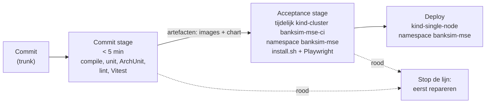
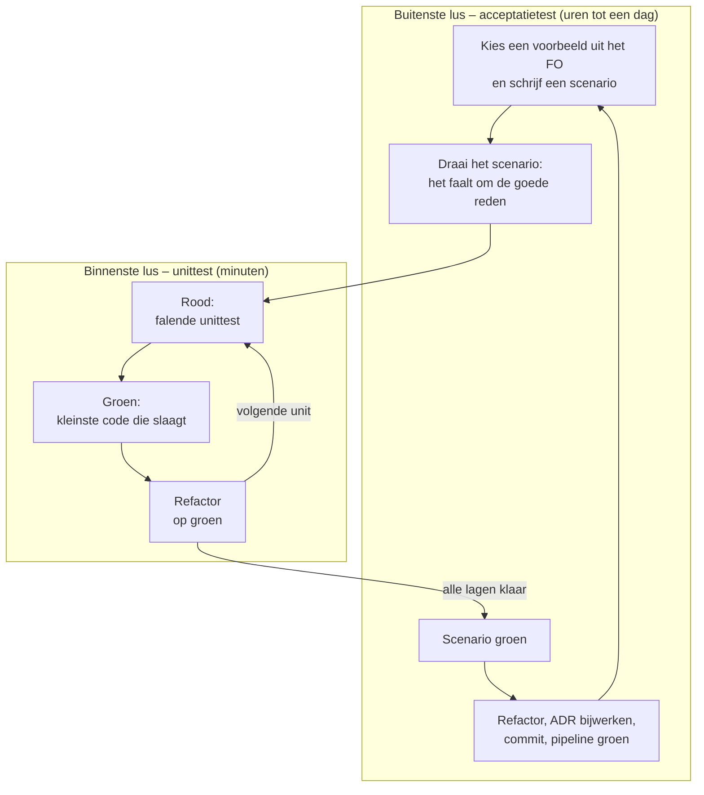
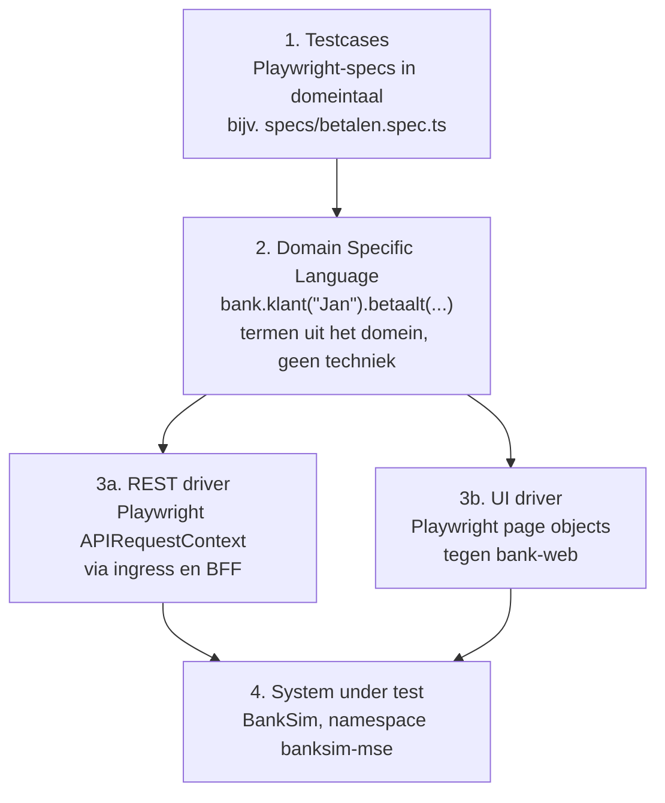

# BankSim – Werkwijze volgens Modern Software Engineering

Oct 17, 2026 · @Edwin

Dit document beschrijft hoe je [BankSim](https://github.com/edwinbulter/banksim) opnieuw bouwt volgens de werkwijze uit *Modern Software Engineering* van Dave Farley: in kleine, deploybare stappen, gestuurd door uitvoerbare voorbeelden (BDD), met double-loop outside-in TDD en met architectuurbeslissingen die pas worden vastgelegd (ADR) op het moment dat een stap erom vraagt.

Het eindpunt is dezelfde applicatie als in de originele repo: dezelfde schermen, dezelfde regels en dezelfde techstack. Het verschil zit in de weg ernaartoe.

**Techstack (gelijk aan het origineel, TO §1.1 en §16)**

| Laag | Keuze |
| --- | --- |
| Backend | Java 21, Spring Boot 4.0.x, Spring Security, Spring JDBC (`JdbcClient`), Spring Modulith, Resilience4j, Bucket4j, Spring Session JDBC |
| BFF | Spring Cloud Gateway (Server WebMVC) + Spring Security OAuth2 Client |
| Identiteit en opslag | Keycloak, PostgreSQL met Flyway |
| Frontend | Angular (standalone components, signals), TypeScript strict, `big.js`, ESLint, Vitest, OpenAPI-generator voor de client |
| Backend-tests | JUnit 5, AssertJ, Testcontainers, jqwik, ArchUnit, Toxiproxy, PIT, openapi-diff |
| Acceptatietests | **Playwright Test (TypeScript)** in `e2e/`, net als het origineel |
| Build en deploy | Maven, npm, Jib, Helm, kind (OrbStack), ingress-nginx, GitHub Actions |
| Supply chain | CycloneDX, OWASP Dependency-Check, `npm audit`, Trivy, Renovate |

Er is één bewuste uitbreiding: voor het test-first bouwen van de infrastructuur komen er testtools bij die het origineel niet had (helm-unittest, kubeconform, conftest, bats, shellcheck, hadolint en actionlint; zie hoofdstuk 9). Daar hoort een ADR bij. Verder komt er geen nieuwe taal, framework of testtool bij; ook geen Gherkin of Cucumber.

## 1. Waarom een andere aanpak

De originele BankSim is in één keer gegenereerd uit een vooraf geschreven [functioneel ontwerp](https://github.com/edwinbulter/banksim/blob/main/doc/functioneel-ontwerp.md) (FO) en [technisch ontwerp](https://github.com/edwinbulter/banksim/blob/main/doc/technisch-ontwerp.md) (TO). Alle beslissingen zijn genomen voordat er één regel code draaide. Dat werkt, maar je leert niets onderweg: of een keuze goed was, blijkt pas als alles af is, en de tests zijn achteraf gemaakt bij code die al bestond.

| Onderwerp | FO/TO vooraf (origineel) | MSE-werkwijze (dit project) |
| --- | --- | --- |
| Specificatie | FO met schermen en regels, vooraf compleet | Uitvoerbare voorbeelden in domeintaal (Playwright-specs met Gegeven/Als/Dan), per slice geschreven; het FO is een bron van voorbeelden |
| Architectuur | TO met 17 hoofdstukken, vooraf compleet | ADR's, geschreven op het moment dat een slice de beslissing afdwingt |
| Tests | Teststrategie in het TO, tests naast de code gegenereerd | Test eerst: acceptatietest stuurt de slice, unittest stuurt elke klasse |
| Oplevering | Alles in fases, aan het eind werkend | Na elke slice een werkende, gedeployde app |
| Feedback | Na afronding van een fase | Binnen minuten (commit stage) en binnen een kwartier (acceptance stage) |
| Documentatie | Documenten die kunnen verouderen | Specs en ADR-log die door de pipeline actueel blijven |

Het FO en TO van het origineel zijn niet weggegooid: ze zijn de **voorraad kennis** waaruit je voorbeelden en kandidaat-beslissingen haalt. Je neemt ze alleen niet als blauwdruk over, maar laat elke keuze opnieuw verdienen door een falende test.

## 2. Uitgangspunten uit Modern Software Engineering

Farley verdeelt engineering in twee pijlers. Beide vertalen zich direct naar hoe je BankSim bouwt.

**Optimaliseren voor leren** – iteratief, incrementeel, met snelle feedback, empirisch en experimenteel.

- Werk in dunne verticale slices die van browser tot database lopen en elk iets zichtbaars opleveren.
- Elke stap is een experiment met een hypothese ("dit scenario wordt groen met deze wijziging") en een meetbare uitkomst (de pipeline).
- Commit vaak, direct op `main` (trunk-based), achter een groene pipeline. Geen langlevende branches.
- De deployment pipeline is je belangrijkste feedbackinstrument: als die traag of onbetrouwbaar is, is dat het eerste wat je repareert.

**Complexiteit beheersen** – modulariteit, cohesie, separation of concerns, information hiding en lage koppeling.

- Testbaarheid is ontwerpdruk: als iets moeilijk te testen is, is het ontwerp verkeerd. Dat dwingt vanzelf `bank-domain` zonder Spring, een `SimulationClock` in plaats van `LocalDate.now()`, en één `LedgerService` voor alle geldbewegingen.
- Package-by-feature (`account`, `transaction`, `payment`, `savings`, …); modulegrenzen worden bewaakt door tests, niet door afspraken.
- Deploybaarheid is ook ontwerpdruk: de app moet vanaf dag 1 in kind draaien, dus configuratie, migraties en opstartgedrag ontwerp je mee.

**Slices, stories en scenario's.** Volgens Farley is een goede user story een verticale slice. Hij beschrijft waarde voor een gebruiker, niet een technische taak. Hij is af als zijn acceptatietests in de pipeline slagen. In BankSim-MSE hangen de begrippen zo samen:

| Begrip | Wat het is | Waar het staat |
| --- | --- | --- |
| **Slice** | Een leverstap: na afloop gedeployed en bruikbaar | Hoofdstuk 7 |
| **User story** | Wie wil wat, en waarom: "Als *rol* wil ik *iets*, zodat *waarde*". Een slice heeft er één of meer | Hoofdstuk 7, onder de slice, met een ID `S<slice>.<n>` |
| **Scenario** | Een concreet voorbeeld (Gegeven, Als, Dan). Samen zijn de scenario's de acceptatiecriteria van de story | De spec in `e2e/specs/` |

- De storytekst staat alleen in hoofdstuk 7. De specs kopiëren hem niet. Anders ontstaat een tweede beschrijving die kan verouderen (hoofdstuk 12).
- De rollen komen uit het FO van het origineel: **klant** en **beheerder**.
- Niet alles is een story. Het walking skeleton (stap 0) en de cross-functional requirements leveren geen gebruikerswaarde. Ze krijgen een uitvoerbare bewering, geen "Als ontwikkelaar wil ik …".
- Een korte toets voor een story is INVEST (Bill Wake): Independent, Negotiable, Valuable, Estimable, Small en Testable. "Testable" betekent hier: er is minstens één scenario dat rood kan zijn.

## 3. Stap 0 – Walking skeleton en deployment pipeline

> Geen user story. Het walking skeleton levert geen gebruikerswaarde. Het bewijst dat bouwen, testen en installeren werken, zodat elke story daarna meteen naar productie kan (zie hoofdstuk 2).

Voordat er één bankfunctie bestaat, bouw je het dunste mogelijke systeem dat van begin tot eind werkt én automatisch wordt getest en gedeployed. Alles wat daarna komt, wordt in dit skelet ingeschoven.

**Inhoud van het skelet**

- Maven multi-module met alleen `bank-domain` (leeg) en `bank-api` (één endpoint `GET /api/versie`).
- Angular-app `bank-web` die de versie toont.
- Een Helm-chart met `bank-api`, `bank-web` en een Ingress, installeerbaar met `deploy/scripts/install.sh` in namespace `banksim-mse` van het bestaande cluster `kind-single-node` (zie "Doelomgeving" hieronder).
- Het acceptatietest-project `e2e/` (Playwright Test, TypeScript; zie hoofdstuk 5) met één scenario:

```ts
// e2e/specs/skelet.spec.ts
import { test } from '../dsl/fixtures';

test('De startpagina toont de versie', async ({ bank }) => {
  const bezoeker = bank.bezoeker();
  await bank.als('een bezoeker BankSim opent', () => bezoeker.opentBankSim());
  await bank.dan('wordt de versie van BankSim getoond', () => bezoeker.verwachtVersie());
});
```

**Doelomgeving: bestaand cluster, eigen namespace**

BankSim-MSE draait in het **bestaande** kind-cluster `single-node` (OrbStack, kubectl-context `kind-single-node`). Alles komt in **één namespace: `banksim-mse`**. Er wordt geen nieuw cluster gemaakt en niets buiten die namespace geïnstalleerd of gewijzigd. Het origineel draait in namespace `banksim` in hetzelfde cluster; beide installaties moeten naast elkaar kunnen bestaan.

| Onderwerp | Afspraak |
| --- | --- |
| Context | `install.sh`, `uninstall.sh` en `reset-data.sh` weigeren elke andere context dan `kind-single-node`, tenzij je expliciet `--context` meegeeft. Dat laatste doet alleen de CI. |
| Namespace | Alle resources staan in `banksim-mse`: apps, Jobs, Keycloak, PostgreSQL (met PVC), Secrets, ConfigMaps, Ingresses, NetworkPolicies en PodDisruptionBudgets. |
| Cluster-brede resources | Geen. Dus geen CRD's, ClusterRoles, IngressClasses, operators of service mesh, en geen wijzigingen in namespace `ingress-nginx`. Alleen de bestaande ingress-nginx en storage class `standard` worden gebruikt. |
| Hostnamen | Eigen hosts, omdat ingress-nginx per host maar één Ingress kan bedienen en het origineel `bank.localtest.me` en `auth.localtest.me` al gebruikt: **`bank-mse.localtest.me`** en **`auth-mse.localtest.me`**. `*.localtest.me` wijst naar 127.0.0.1, dus `/etc/hosts` hoeft niet te worden aangepast. |
| Helm-release | `banksim-mse`, in namespace `banksim-mse`. |
| Images | Eigen namen, zoals `banksim-mse/bank-api:<git-sha>`, geladen met `kind load docker-image --name single-node`, zodat ze niet botsen met de images van het origineel op dezelfde node. |
| Certificaten | Een eigen CA voor BankSim-MSE. Die staat los van de BankSim-CA van het origineel, en de sleutel blijft lokaal in `deploy/.secrets/` (in `.gitignore`). |
| Verwijderen | `uninstall.sh` doet `helm uninstall` en verwijdert namespace `banksim-mse` met alle data. Het origineel en de rest van het cluster blijven onaangeroerd. |
| Capaciteit | Het origineel vraagt ongeveer 3 GB geheugen. Houd BankSim-MSE in dezelfde orde, zodat beide passen binnen de ongeveer 12 GB van de node. |

De CI kan vanaf een GitHub-runner niet bij je lokale cluster. Daarom maakt de acceptance stage een **tijdelijk kind-cluster** `banksim-mse-ci` dat `single-node` nabootst: zelfde kind-versie, zelfde ingress-nginx-versie, poort 80/443. Daarin installeert hij met hetzelfde `install.sh --context kind-banksim-mse-ci`, in dezelfde namespace `banksim-mse` en met dezelfde hostnamen. Het enige verschil met lokaal is dus de context.

De afspraken hierboven worden net als andere architectuurbeslissingen bewaakt door uitvoerbare checks (fitness functions). Hoofdstuk 9 beschrijft hoe je die infrastructuur test-first opbouwt.

- Een check in de commit stage op `helm template`: elke gerenderde resource heeft namespace `banksim-mse`, en de output bevat geen cluster-brede resources.
- `install.sh` met een andere context dan `kind-single-node` en zonder `--context` faalt (test met `bats`).
- Een installatiescenario in de acceptance stage: na `uninstall.sh` is namespace `banksim-mse` weg en staan er nergens in het cluster nog resources met het label `app.kubernetes.io/instance=banksim-mse`.

**De pipeline**



- **Commit stage** (GitHub Actions, elke push): `mvnw verify` (unit, slice, ArchUnit), `ng lint`, Vitest, en de chart- en scripttests uit hoofdstuk 9. Doel: binnen 5 minuten weten of de commit deugt. Bouwt de images één keer met Jib; latere stages hergebruiken exact die artefacten.
- **Acceptance stage**: maakt het tijdelijke kind-cluster `banksim-mse-ci`, installeert met hetzelfde `install.sh` in namespace `banksim-mse` en draait de Playwright-acceptatietests tegen die installatie. De installatiescenario's (9.2) draaien in een tweede job, parallel, met een eigen runner en een eigen cluster; ze installeren en verwijderen zelf. De opzet van het cluster delen de twee jobs via de composite action `.github/actions/kind-banksim-mse`.
- **Deploy**: lokaal `install.sh` op het bestaande cluster `kind-single-node`, in namespace `banksim-mse`; dezelfde scripts, dezelfde chart. Je kunt de acceptatietests ook lokaal tegen deze installatie draaien. Ze maken hun eigen data via aliassen (hoofdstuk 5), dus de bestaande data blijft heel.
- Regel: een rode pipeline heeft voorrang op alles. Niemand bouwt verder op rood.

**Acceptatietests lokaal en in CI**

De acceptatietests draaien nooit ín het cluster, maar ernaast. Ze spreken de app aan zoals een gebruiker dat doet: via `https://bank-mse.localtest.me`. Die publieke DNS-naam wijst altijd naar `127.0.0.1`, waar ingress-nginx van het kind-cluster luistert op poort 80 en 443.

| | Lokaal | CI (GitHub Actions) |
| --- | --- | --- |
| Waar de app draait | Bestaand cluster `kind-single-node`, namespace `banksim-mse` | Tijdelijk cluster `kind-banksim-mse-ci`, namespace `banksim-mse` |
| Waar Playwright draait | Op je eigen machine | Op de runner |
| Hoe de tests de app bereiken | `bank-mse.localtest.me` → 127.0.0.1 → ingress-nginx | Idem |
| Welke versie getest wordt | Wat het laatst met `make install` is geïnstalleerd | Precies de images uit de commit stage |
| Cluster na afloop | Blijft staan | Wordt weggegooid |

Er is één valkuil: `make e2e` test lokaal wat er op dat moment geïnstalleerd is. Na een codewijziging zonder nieuwe `make install` test je dus een oude versie. Gebruik daarom `make acceptance`. Dat doet net als de acceptance stage eerst `make install` en daarna `make e2e` en `make e2e-infra`. Welke build er draait, zie je aan de versie in de voettekst of in `GET /api/versie`. Die versie is de image-tag: de korte commit-hash, met `-dirty-<tijdstempel>` als er niet-gecommitte wijzigingen in `backend/` of `frontend/` zijn.

**Het skelet test-first bouwen**

Ook het skelet doorloopt de double loop uit hoofdstuk 4. Het is alleen dun: één scenario, en per onderdeel een paar unittests.

1. **Buitenste lus: het scenario.** Schrijf `skelet.spec.ts` en draai het tegen `https://bank-mse.localtest.me`. Het faalt omdat er niets draait. In deze fase is dat de goede reden: er ís nog niets gedeployed.
2. **Binnenste lussen: elk onderdeel eerst een falende test.**
   - `install.sh` weigert een andere context dan `kind-single-node`: een `bats`-test.
   - De chart rendert een Ingress op `bank-mse.localtest.me`, alles in namespace `banksim-mse`, zonder cluster-brede resources: helm-unittest en de check op `helm template`.
   - `GET /api/versie` geeft de versie terug: een JUnit/MockMvc-test.
   - `bank-web` toont de versie: een Vitest-test voor het component.
3. **Buitenste lus groen.** Installeer lokaal met `install.sh`; de spec slaagt.
4. **De pipeline inrichten en controleren.** Zet de commit stage en de acceptance stage op in GitHub Actions.

De pipeline zelf is geen gewone TDD-lus. Hij is het testharnas, en kan zichzelf niet test-first testen. Je controleert hem daarom empirisch: laat opzettelijk een test falen, eerst een unittest en daarna het scenario. Kijk of de juiste stage rood wordt en of er dan niet wordt gedeployed. Maak hem daarna weer groen.

Een pipeline die je nooit rood hebt gezien, bewijst niets. Dat geldt in het klein voor elke test: eerst zien falen, dan pas vertrouwen.

"Groen door de pipeline" betekent dus: de commit staat op `main`, de commit stage en de acceptance stage zijn groen, en de app draait in namespace `banksim-mse` op `kind-single-node`. Pas dan heb je het vangnet waar elke volgende slice op leunt. Begin je eerder aan het Overzicht, dan bouw je zonder snelle feedback.

**Eerste ADR's**

- `0001-architectuurbeslissingen-vastleggen.md` – we gebruiken ADR's (dit proces).
- `0002-deployment-pipeline-en-kind.md` – één pipeline, artefacten één keer bouwen, kind als doelomgeving in CI en lokaal.
- `0003-testdata-via-seed-cli.md` – hoe scenario's hun data opzetten zonder test-only endpoints (zie hoofdstuk 5). Je kunt deze ook pas in slice 1 schrijven, als het eerste scenario data nodig heeft.
- `0004-installatie-in-namespace-banksim-mse.md` – het bestaande cluster `kind-single-node`, alles in namespace `banksim-mse`, eigen hostnamen, geen cluster-brede resources, naast het origineel in `banksim`.
- `0005-acceptatietests-in-playwright-met-interne-dsl.md` – BDD-scenario's als Playwright-specs in TypeScript met een interne DSL, binnen de stack van het origineel; geen Gherkin.
- `0006-infrastructuurtests-in-containers.md` – helm-unittest, kubeconform, bats, shellcheck en actionlint als uitbreiding op de stack, in vastgepinde container-images (hoofdstuk 9).

Pas als dit skelet groen door de pipeline gaat (zie "Het skelet test-first bouwen" hierboven), begin je aan de eerste functionaliteit.

## 4. De double loop

Elke slice doorloopt twee geneste TDD-lussen. De buitenste lus beschrijft **wat** het systeem moet doen, vanuit de gebruiker; de binnenste lus bepaalt **hoe**, klasse voor klasse.



**Outside-in**

1. Begin aan de buitenkant: het scenario faalt, bijvoorbeeld omdat `GET /api/me/accounts` nog niet bestaat.
2. Schrijf een test voor de buitenste klasse die je nodig hebt (controller in JUnit, of component in Vitest). Collaborators die nog niet bestaan (service, repository) vervang je in die test door een test double; zo ontdek je hun interface vanuit het gebruik.
3. Ga een laag naar binnen en implementeer de collaborator met zijn eigen test, tot je bij de domeinlogica en de database bent.
4. Het scenario wordt groen zodra alle lagen echt bestaan. Test doubles blijven alleen staan waar ze een echte grens afschermen (tijd, Keycloak, netwerk).

**Regels**

- Nooit meer dan één falend acceptatiescenario tegelijk waar je aan werkt. Scenario's voor later krijgen de Playwright-tag `@wip`; de pipeline draait met `--grep-invert @wip`, dus ze tellen niet mee.
- Schrijf een unittest pas als er een falende unittest nodig is om verder te komen; schrijf productiecode alleen om een falende test groen te maken.
- Refactor alleen op groen, en refactor ook de tests.
- Commit na elke groene stap van de binnenste lus als die zinvol is; het scenario hoeft daarvoor nog niet groen te zijn (`@wip`).
- Een domeinregel die je in de binnenste lus ontdekt maar die niet in het scenario staat ("bedrag mag niet meer dan 2 decimalen hebben") krijgt óf een extra scenario, óf een expliciete unittest. Nooit ongetest gedrag.

## 5. Acceptatietests: het vierlaagse model

Acceptatietests zijn het duurste onderdeel om te onderhouden. Farley lost dat op met vier lagen, zodat een wijziging in de UI of de API maar één laag raakt. Alle vier de lagen zitten in `e2e/`, in TypeScript met Playwright Test, net als de e2e-suite van het origineel. Zie https://continuous-delivery.co.uk/downloads/ATDD%20Guide%2026-03-21.pdf



| Laag | Wat erin staat | Wat er níet in mag |
| --- | --- | --- |
| Testcases | Het voorbeeld in domeintaal, als stappen Gegeven / Als / Dan | URL's, selectors, JSON, SQL |
| DSL | Methodes als `heeftBetaalrekening`, `betaalt`, `verwachtSaldo`; aliassen voor testdata; bedragen als string en vergeleken met `big.js` | Hoe het systeem wordt aangestuurd |
| Protocol drivers | HTTP-calls via `APIRequestContext`, Playwright page objects, inloggen bij Keycloak | Beweringen over gedrag (die zitten in de DSL) |
| System under test | De echte, gedeployde applicatie | Test-only endpoints of testcode |

**Hoe een scenario eruitziet**

Een scenario is een gewone Playwright-test. De DSL biedt `gegeven`, `als`, `dan`, `en` en `maar`; die wikkelen elke stap in `test.step`, zodat het Playwright-rapport het scenario leest als een BDD-specificatie. De tekst van de stap is voor mensen, de code erin roept alleen de DSL aan.

```ts
// e2e/dsl/fixtures.ts
import { test as basis } from '@playwright/test';
import { Bank } from './bank';
import { RestDriver } from '../drivers/rest/rest-driver';
import { UiDriver } from '../drivers/ui/ui-driver';

export type Opties = { driver: 'rest' | 'ui' };

export const test = basis.extend<Opties & { bank: Bank }>({
  driver: ['rest', { option: true }],
  bank: async ({ driver, page, request }, use) => {
    const bankDriver = driver === 'ui' ? new UiDriver(page) : new RestDriver(request);
    await use(new Bank(bankDriver, basis.step));
  },
});
export { expect } from '@playwright/test';
```

```ts
// e2e/dsl/bank.ts (fragment)
async gegeven(tekst: string, stap: () => Promise<unknown>) {
  await this.step(`Gegeven ${tekst}`, stap);
}
// als, dan, en en maar werken hetzelfde
```

**Keuzes**

- **Spec-taal:** Playwright Test in TypeScript met een interne DSL, binnen de stack van het origineel (ADR 0005). Er is geen Gherkin: de specs zelf zijn het leesbare voorbeeld. Wil je later toch `.feature`-bestanden, dan kan dat met één extra dev-dependency (`playwright-bdd`) op dezelfde DSL; dat is dan een nieuwe ADR.
- **Twee drivers, één scenario:** `playwright.config.ts` heeft een project `rest` (optie `driver: 'rest'`, snel, geen browser) en de projecten `chromium`, `firefox` en `webkit` (optie `driver: 'ui'`). Hetzelfde scenario draait dus via de API en via de browser. Scenario's die alleen over de UI gaan ("De knop heet nu Verberg zoeken") krijgen de tag `@ui`; het project `rest` sluit die uit met `grepInvert: /@ui/`. `firefox` en `webkit` draaien alleen de scenario's met `@ui` of `@rook` (ADR 0019): het domeingedrag bewijzen `rest` en `chromium` al. Voegt een scenario iets aan het scherm toe, dan hoort er een `@ui`-scenario bij.
- **Waar de REST driver op aanspreekt:** altijd via de ingress en de publieke API-paden, net als de browser. Zodra er in slice 6 een BFF en Keycloak zijn, logt een setup-project één keer per gebruiker in via het echte Keycloak-scherm en bewaart de sessie als `storageState`, zoals het origineel in `e2e/tests/auth.setup.ts` doet. De REST driver gebruikt die sessiecookie en het CSRF-token van de BFF. De driver roept `bank-api` nooit rechtstreeks aan; na de CFR-slices voor mTLS en NetworkPolicies zou dat ook niet meer kunnen.
- **Isolatie:** elk scenario maakt zijn eigen rekeninghouders en rekeningen via de DSL. De DSL vertaalt een alias ("Jan") naar een unieke naam en IBAN per testrun. Zo zitten scenario's elkaars data niet in de weg en is de gedeelde datagen-seed niet nodig.
- **Testdata opzetten:** het FO heeft geen scherm om rekeninghouders, rekeningen of willekeurige historische boekingen (incasso, betaalautomaat) aan te maken; dat doet in het origineel alleen de datagenerator. Kies daarom in stap 0 of slice 1 één expliciet mechanisme en leg het vast in een ADR (`0003-testdata-via-seed-cli.md`). Voorstel: een kleine **seed-CLI** in Java, in een eigen Maven-module, die met de regels van `bank-domain` rekeninghouders, rekeningen en overboekingen in de database zet (en later ook Keycloak-gebruikers). De DSL start die als pod in `banksim-mse` via een kleine shell-driver (`kubectl run` vanuit Node; ADR 0003). Sinds ADR 0020 is dat één pod per Playwright-worker, die de opdrachten van stdin leest: alleen de eerste opdracht betaalt de opstart van pod en JVM. Er komt dus geen test-only endpoint in de applicatie zelf. In slice 11 groeit deze seed-CLI uit tot `bank-datagen`: dezelfde code, nu aangestuurd door profielen in plaats van door scenario's.
- **Tijd:** scenario's zetten de simulatiedatum zelf (`bank.gegeven('de simulatiedatum is 5 oktober 2026', …)`), want BankSim heeft die functie toch nodig. De simulatiedatum geldt voor alle gebruikers tegelijk, dus unieke aliassen isoleren wel de data maar niet de klok. Scenario's die de datum zetten krijgen de tag `@simulatiedatum` en draaien in een aparte run met `--grep @simulatiedatum --workers=1`; de overige scenario's draaien parallel met `--grep-invert @simulatiedatum`. Dit is een bewuste afweging (ADR); het origineel draaide de hele suite met één worker.

In de originele repo is `e2e/pages/*` (`LoginPagina`, `RekeningPagina`, `BetalenPagina`, …) de protocol-driver-laag; de specs in `e2e/tests/*` mengen testcase en DSL. Hier houd je die lagen vanaf het begin gescheiden.

**Projectindeling**

```text
e2e/
├── playwright.config.ts    projecten: setup, rest, chromium, firefox, webkit, infra
├── specs/                  testcases: overzicht.spec.ts, betaalrekening.spec.ts, zoeken.spec.ts, …
│   └── infra/              installatie.spec.ts, upgrade.spec.ts, netwerk.spec.ts (hoofdstuk 9)
├── dsl/                    fixtures.ts, bank.ts, klant.ts, beheerder.ts, aliassen.ts, omgeving.ts
└── drivers/
    ├── rest/               RestDriver op APIRequestContext
    ├── ui/                 UiDriver en page objects: LoginPagina, OverzichtPagina, …
    └── shell/              kubectl, helm en de scripts via child_process (seed-CLI, infra)
```

## 6. Architecture Decision Records

Een ADR legt één beslissing vast, met de context waarin hij genomen is en de gevolgen. Je schrijft een ADR op het *laatste verantwoorde moment*: als een slice niet verder kan zonder de keuze. Niet eerder, want dan kies je zonder kennis; niet later, want dan is de keuze impliciet al gemaakt.

**Template** (`doc/adr/NNNN-korte-titel.md`, naar Michael Nygard)

```markdown
# NNNN. Titel als beslissing geformuleerd

Datum: 2026-10-17
Status: Voorgesteld | Geaccepteerd | Vervangen door [NNNN](NNNN-...md)

## Context
Welk scenario of welke kracht dwingt deze keuze af? Welke opties waren er?

## Beslissing
Wat we doen, in één of twee zinnen.

## Gevolgen
Wat makkelijker wordt, wat moeilijker wordt, wat we daarvoor accepteren.

## Bewaking
Welk scenario of welke fitness function (ArchUnit, contracttest, rooktest) faalt als we hiervan afwijken.
```

**Regels**

- Eén beslissing per ADR. Een ADR wordt nooit herschreven: een nieuwe beslissing krijgt een nieuw nummer en zet de oude op "Vervangen door".
- Elke ADR noemt de **bewaking**: waar mogelijk een geautomatiseerde fitness function, zodat de beslissing niet stilletjes wordt losgelaten.
- De ADR gaat mee in dezelfde commit als de code die de beslissing invoert.

**Verwachte ADR's (backlog uit TO §1.2 en §17)**

Dit zijn de beslissingen die het origineel vooraf nam. Ze staan hier als *kandidaten*; je schrijft ze pas als de slice in de kolom ernaast erom vraagt, en mag tot een andere uitkomst komen.

| Kandidaat-ADR | Origineel | Verwacht bij slice |
| --- | --- | --- |
| Acceptatietests in Playwright Test (TypeScript) met interne DSL, geen Gherkin | TO §14 | Stap 0 (ADR 0005) |
| Testdata via een seed-CLI op `bank-domain`, geen test-only endpoints | TO §9, §14 | Stap 0 / 1 Overzicht |
| Scenario's met `@simulatiedatum` draaien serieel | TO §14 (1 worker) | 3 Simulatiedatum |
| Bedragen als `BigDecimal`, `NUMERIC(19,2)` en string in JSON | TO §5 | 1 Overzicht |
| Saldo berekenen, niet opslaan | TO §1.2, §4 | 1 Overzicht / 3 Simulatiedatum |
| PostgreSQL met Flyway, `JdbcClient` in plaats van JPA | TO §3.1, §4 | 1 Overzicht |
| Keyset-paginering met HMAC-ondertekende cursor | TO §3.2 | 2 Transactielijst (ADR 0011) |
| `SimulationClock` vervangt systeemtijd | TO §8 | 3 Simulatiedatum |
| Rol `beheerder` als realm-rol in het token | TO §10 | 3 Simulatiedatum |
| CSRF in de BFF met een `XSRF-TOKEN`-cookie | TO §10 | 3 Simulatiedatum |
| Realm-wijzigingen op een bestaande installatie met keycloak-config-cli | – | 3 Simulatiedatum |
| Zoeken met `pg_trgm` en vaste SQL-fragmenten | TO §4, §11 (A05) | Uitgesteld bij S5.1: de vaste voorwaarden met parameters volgen het bestaande patroon; de index pas als realistische data (slice 11) of een prestatie-eis erom vraagt |
| Keycloak als identity provider | TO §1.1, §17 | 6 Inloggen |
| Backend-for-Frontend in plaats van tokens in de browser | TO §1.2, §10 | 6 Inloggen |
| BFF-sessie versleuteld in PostgreSQL | TO §2 | 6 Inloggen (zodra er 2 replica's zijn) |
| Eigenaarschap in de query; andermans IBAN geeft 404 | TO §10.3 | 6 Inloggen |
| Eén grootboek, double-entry, alleen via `LedgerService` | TO §1.2, §6 | 7 Betalen |
| Nooit rood: minimum lopend saldo vanaf D | TO §6 | 7 Betalen |
| Idempotency-Key op boekende requests | TO §6 | 7 Betalen |
| Rentecorrectie via event `OverboekingGeboekt` (Spring Modulith) | TO §3.1, §7 | 9 Overschrijven |
| Navigatie met de Angular-router, een URL per scherm | TO §1.2 | 2a Navigatie (ADR 0012) |
| Eén Angular-app met rolafhankelijke routes | TO §1.2 | 10 Admin |
| Audit log append-only | TO §4, §11 (A09) | 10 Admin |
| Deterministische datagenerator op domeinregels | TO §9 | 11 Realistische data |
| Migraties als aparte Job | TO §1.2, §12.1 | CFR Resilience |
| Infrastructuur testen met helm-unittest, kubeconform, conftest en bats (uitbreiding op de stack) | — (ontbrak in het origineel) | Stap 0 |
| Alles in namespace `banksim-mse` van het bestaande cluster `kind-single-node`, eigen hostnamen, Helm-chart, geen operators of cluster-brede resources | TO §15, §17 | Stap 0 (ADR 0004) |
| mTLS in de applicaties met eigen CA, geen service mesh | TO §10.1, §17 | CFR Zero trust |
| Default-deny NetworkPolicies | TO §10.1 | CFR Zero trust |
| Rate limiting met Bucket4j in de BFF | TO §10, §17 | CFR Rate limiting |
| Contract-first OpenAPI, gegenereerde Angular-client | TO §3.2, §16 | Uitgesteld bij S2.2 (drie endpoints): zodra de frontend de API vaker aanroept |
| MFA instelbaar, standaard uit; geen transactielimiet naast "nooit rood" | TO §17 | 6 Inloggen / 7 Betalen |
| Supply chain: vaste versies, SBOM, Trivy, Renovate | TO §16 | CFR Supply chain |
| Mutation testing met PIT in de commit stage | — (ontbrak in het origineel) | Afschaffen van de handmatige controle per slice (ADR 0018) |
| Mutation testing van de frontend met Stryker | — | Zodra de frontend meer logica krijgt (betalen, slice 7) |
| Firefox en webkit alleen voor `@ui` en `@rook` | — (het origineel draaide alles in drie browsers) | Snellere acceptance stage, bij S6.1 (ADR 0019) |

## 7. Stap voor stap: de slices

Elke slice is een verticaal stuk functionaliteit dat na afloop gedeployed en bruikbaar is. Per slice staat beschreven:

- **User story** – welke gebruikersbehoefte de slice invult (zie hoofdstuk 2). Een slice zonder gebruikerswaarde zegt dat expliciet.
- **Voorbeelden** – scenario's als Playwright-specs, afgeleid uit het FO.
- **Binnenste lus** – de units die je naar verwachting test-first bouwt.
- **ADR's** – beslissingen die deze slice afdwingt.
- **Fitness functions** – geautomatiseerde bewaking die in deze slice wordt toegevoegd.
- **Origineel** – waar dit in de oude repo terechtkwam.

De volgorde is gekozen zodat elke slice zo weinig mogelijk nieuwe techniek tegelijk introduceert. Afwijken mag; schrijf dan op waarom.

In de voorbeelden hieronder staan de imports niet steeds herhaald; elke spec begint met `import { test } from '../dsl/fixtures';`. Bedragen gaan als string de DSL in (`'1842.17'`), nooit als `number`, net als in de rest van de stack.

```mermaid
flowchart LR
    S0["0 Skelet +<br/>pipeline"] --> S1["1 Overzicht"]
    S1 --> S2["2 Transactie-<br/>lijst"]
    S2 --> S2a["2a Navigatie"]
    S2a --> S3["3 Simulatie-<br/>datum"]
    S3 --> S4["4 Uitklap-<br/>details"]
    S4 --> S5["5 Zoeken"]
    S5 --> S6["6 Inloggen<br/>en rollen"]
    S6 --> S7["7 Betalen"]
    S7 --> S8["8 Spaarrekening<br/>en rente"]
    S8 --> S9["9 Over-<br/>schrijven"]
    S9 --> S10["10 Admin"]
    S10 --> S11["11 Realistische<br/>data"]
    S11 --> CFR["CFR-slices:<br/>zero trust, resilience,<br/>rate limiting, supply chain"]
```



**Stories per slice.** De stories zijn voorstellen. De eigenaar van het product stelt ze vast, net als de scenario's.

| Slice | Story | Rol | Spec(s) | Opmerking |
| --- | --- | --- | --- | --- |
| 0 Skelet | geen user story | – | `skelet.spec.ts`, `infra/installatie.spec.ts` | Walking skeleton: bewijst dat bouwen, testen en installeren werkt |
| 1 Overzicht | S1.1 Betaalrekening met saldo na inloggen | klant | `overzicht.spec.ts` | Inloggen hoort sinds ADR 0007 en 0008 bij S1.1 |
| 2 Transactielijst | S2.1 Transacties per datum; S2.2 Toon meer | klant | `betaalrekening.spec.ts` | |
| 2a Navigatie | S2a.1 Terug naar het overzicht | klant | `navigatie.spec.ts` | Later toegevoegd, vóór slice 3: de betaalrekening was een doodlopend scherm. Het nummer 2a laat de nummers van de andere slices en stories ongemoeid |
| 3 Simulatiedatum | S3.1 Bank op een gekozen datum | beheerder | `simulatiedatum.spec.ts` | Enabling slice: het scherm komt pas in S10.2 |
| 4 Uitklapdetails | S4.1 Details van een transactie | klant | `betaalrekening.spec.ts` | Zelfde scherm als slice 2; eerst S2.3 |
| 5 Zoeken | S5.1 Zoeken in transacties | klant | `zoeken.spec.ts` | |
| 6 Inloggen en rollen | S6.1 Alleen eigen rekeningen; S6.2 Uitloggen | klant | `inloggen.spec.ts`, `toegang.spec.ts` | Kleiner geworden: het inloggen zelf zit in S1.1 |
| 7 Betalen | S7.1 Betalen aan een contact | klant | `betalen.spec.ts` | Dubbel verzonden betaling is een CFR |
| 8 Spaarrekening | S8.1 Rente op de spaarrekening; S8.2 Spaarrekening in het overzicht | klant | `spaarrekening.spec.ts`, `overzicht.spec.ts` | S8.2 was S1.2; de spaarrekening komt in één slice |
| 9 Overschrijven | S9.1 Overschrijven tussen eigen rekeningen | klant | `overschrijven.spec.ts` | |
| 10 Admin | S10.1 Alleen-lezen inzage; S10.2 Simulatiedatum in een scherm | beheerder | `beheer.spec.ts` | S10.2 maakt S3.1 af |
| 11 Realistische data | S11.1 Demo-data na installatie | beheerder | `infra/huishoudens.spec.ts` | De beheerder die installeert, zoals in de installatiescenario's |
| CFR-slices | geen user story | – | zie de CFR-tabel | Een eis voor de hele applicatie, met een fitness function |

### Slice 1 – Overzicht met saldo

> **S1.1** Als klant wil ik na het inloggen mijn betaalrekening met saldo zien, zodat ik weet hoeveel geld ik heb.
>
> Acceptatiecriteria: de scenario's in `overzicht.spec.ts`. Door ADR 0007 en 0008 hoort het inloggen bij S1.1. De spaarrekening in het overzicht is S8.2.


De kleinste waardevolle functie: een klant logt in en ziet de eigen betaalrekening met saldo. Oorspronkelijk zou het inloggen pas in slice 6 komen, met tot dan een vaste identiteit. ADR 0007 en 0008 halen Keycloak en de BFF naar voren: zo is de eerste slice meteen een echte gebruikersfunctie, en hoeven de drivers het inloggen later niet alsnog te leren.

```ts
// e2e/specs/overzicht.spec.ts
test('Klant ziet de betaalrekening met saldo in het overzicht', async ({ bank }) => {
  const jan = bank.klant('Jan');
  await bank.gegeven('Jan heeft een betaalrekening met saldo € 1.842,17', () =>
    jan.heeftBetaalrekening({ saldo: '1842.17' }),
  );
  await bank.als('Jan het overzicht opent', () => jan.opentOverzicht());
  await bank.dan('ziet Jan de betaalrekening met saldo € 1.842,17', () =>
    jan.verwachtRekeningInOverzicht('betaal', '1842.17'),
  );
});
```

`heeftBetaalrekening` start `bank-seed` als pod (ADR 0003): die maakt een login in Keycloak en een rekening met dat openingssaldo, en geeft gebruikersnaam, wachtwoord en IBAN terug. `opentOverzicht` logt eerst in. De REST-driver volgt daarvoor dezelfde redirects als een browser: BFF, het inlogformulier van Keycloak, en terug.

- **Binnenste lus:**
  - `bank-seed`: `SeedCommando` → `SeedKlantAanmaker` → `Logins` (`KeycloakLogins`, admin-API) en `Rekeninghouders` (`JdbcRekeninghouders`);
  - `bank-domain`: `Bedrag` (exact, 2 decimalen) en `Iban` (bankcode SIMB, mod-97);
  - `bank-api`: `RekeningController` → `RekeningRepository` (`JdbcRekeningRepository`), `IngelogdeGebruiker` uit het JWT, `BeveiligingConfig` als resource server. Een `RekeningService` is er nog niet: er is nog geen logica tussen controller en repository;
  - `bank-bff`: OIDC-login met PKCE, 401 voor `/api/**` zonder sessie, `/api/**` naar `bank-api` met het token en zonder cookies;
  - Angular: `App` (link "Inloggen" bij een 401) en `Overzicht`, met `bedragVoorWeergave` ("1842.17" → "€ 1.842,17") zonder rekenen.
- **ADR's:** 0003 (seed-CLI als pod), 0007 (Keycloak), 0008 (BFF), 0009 (PostgreSQL, Flyway bij het starten van `bank-api`, `JdbcClient`), 0010 (bedragen als `BigDecimal` en string). "Saldo = openingssaldo + som boekingen" volgt in slice 2, als er boekingen zijn.
- **Nieuw in het skelet:** PostgreSQL, Keycloak en `bank-bff` in de chart; de Secrets die `install.sh` één keer aanmaakt; de images `bank-bff` en `bank-seed`; Testcontainers in de commit stage.
- **Fitness functions:**
  - jqwik-properties voor `Bedrag` (altijd 2 decimalen, de stringnotatie blijft gelijk) en `Iban` (elke gegenereerde IBAN is geldig). `a + b − b = a` komt erbij zodra `Bedrag` kan optellen;
  - ArchUnit: geen `double` of `float` in `bank-domain` en `bank-api`. Dat `bank-domain` niet van Spring afhangt, bewaakt de Maven-pom: Spring staat niet op het classpath;
  - ESLint: geen `parseFloat`, `parseInt`, `Number(…)` of unaire `+` in de frontend;
  - `scripts/iac-check.sh`: geen letterlijk wachtwoord of secret in de chart.
- **Upgrade:** `infra/upgrade.spec.ts` (`@destructief`, alleen in CI). De DSL tagt de geïnstalleerde images opnieuw als `<tag>-upgrade` en installeert die; daarna ziet Jan nog zijn saldo. Rood gezien met een sabotagebranch waarop `bank-api` bij elke start de data wiste (Flyway-callback `afterMigrate.sql`): `rekeningen van Jan` was `[]`.
- **Niet gedekt (backlog, hoofdstuk 9.4):** PostgreSQL en Keycloak herstarten bij deze upgrade niet; hun images staan op digest. Dat de data een herstart van de database overleeft en dat Keycloak bij een herstart de realm niet overschrijft, toetst nog geen scenario.
- **Origineel:** `bank-domain/geld/Money`, `rekening/Iban`, `account/*`, `bank-bff/*`, `frontend/klant/overzicht`, `deploy/banksim/files/realm-banksim.json`.

### Slice 2 – Transactielijst van de betaalrekening

> **S2.1** Als klant wil ik de transacties van mijn betaalrekening zien, per datum en van nieuw naar oud, zodat ik zie waar mijn geld heen gaat en vandaan komt.
>
> **S2.2** Als klant wil ik een lange transactielijst in porties van 50 zien, met "Toon meer", zodat de lijst snel laadt.
>
> Acceptatiecriteria: de scenario's in `betaalrekening.spec.ts`.


```ts
// e2e/specs/betaalrekening.spec.ts
test('Transacties per datum, nieuw naar oud, met teken', async ({ bank }) => {
  const jan = bank.klant('Jan');
  await bank.gegeven('Jan heeft een betaalrekening met saldo € 1.000,00', () =>
    jan.heeftBetaalrekening({ saldo: '1000.00' }));
  await bank.en('op 1 oktober 2026 betaalde Jan € 812,40 aan Woningstichting Thuis',
    () => jan.heeftBetaald({ op: '2026-10-01', bedrag: '812.40', aan: 'Woningstichting Thuis' }));
  await bank.en('op 2 oktober 2026 ontving Jan € 3.215,00 van Werkgever B.V.',
    () => jan.heeftOntvangen({ op: '2026-10-02', bedrag: '3215.00', van: 'Werkgever B.V.' }));
  await bank.als('Jan de betaalrekening opent', () => jan.opentBetaalrekening());
  await bank.dan('ziet Jan de transacties per datum, nieuw naar oud, met teken', () =>
    jan.verwachtTransactielijst([
      { datum: '2026-10-02', transacties: [{ tegenpartij: 'Werkgever B.V.', bedrag: '3215.00' }] },
      { datum: '2026-10-01', transacties: [{ tegenpartij: 'Woningstichting Thuis', bedrag: '-812.40' }] },
    ]));
});

test('Rekening zonder transacties', async ({ bank }) => {
  const jan = bank.klant('Jan');
  await bank.gegeven('Jan heeft een betaalrekening met saldo € 1.000,00', () =>
    jan.heeftBetaalrekening({ saldo: '1000.00' }));
  await bank.als('Jan de betaalrekening opent', () => jan.opentBetaalrekening());
  await bank.dan('ziet Jan dat er nog geen af- of bijschrijvingen zijn', () => jan.verwachtTransactielijst([]));
});

test('Toon meer laadt per 50 transacties', async ({ bank }) => {
  const jan = bank.klant('Jan');
  await bank.gegeven('Jan heeft een betaalrekening met saldo € 1.000,00', () =>
    jan.heeftBetaalrekening({ saldo: '1000.00' }));
  await bank.en('Jan heeft 120 transacties, drie per dag', () => jan.heeftTransacties({ aantal: 120, perDag: 3 }));
  await bank.als('Jan de betaalrekening opent', () => jan.opentBetaalrekening());
  await bank.dan('ziet Jan de nieuwste 50 transacties en "Toon meer"', () =>
    jan.verwachtTransacties({ nieuwste: 50, meer: true }));
  await bank.als('Jan twee keer "Toon meer" kiest', () => jan.toontMeer(2));
  await bank.dan('ziet Jan alle 120 transacties en geen "Toon meer"', () =>
    jan.verwachtTransacties({ nieuwste: 120, meer: false }));
});
```

In de REST driver betekent "Toon meer" de volgende pagina met de cursor uit `volgende`; in de UI driver een klik op de knop. De DSL weet dat niet.

Het scenario vergelijkt de inhoud, niet alleen het aantal. Met alleen een telling zou een transactie die op de grens dubbel verschijnt of ontbreekt, onopgemerkt blijven. De DSL weet welke 120 transacties hij seedde. Elke tegenpartij en elk bedrag is uniek, en met drie per dag valt de grens van 50 midden in een dag. Een dubbele datumkop in de UI wordt zo een extra groep, en die laat de vergelijking falen. De 120 transacties gaan in één pod naar de seed (`bank-seed transacties`), want een pod per transactie kost seconden per stuk.

De verwachting staat in domeinwaarden (`'2026-10-02'`, `'-812.40'`), niet in schermtekst. De UI driver leest "Vrijdag 2 oktober 2026" en "−812,40" terug naar die waarden; de opmaak zelf testen Vitest-tests (`datumregel`, `bedragMetTeken`). De transacties komen via de seed (`bank-seed transactie`, ADR 0003) en tellen mee in het saldo: openingssaldo plus de transacties. Het openingssaldo zelf staat niet in de lijst. Zonder transacties toont de pagina "Nog geen af- of bijschrijvingen." (de tekst van het origineel); de UI driver leest dat als een lege lijst.

- **Binnenste lus:**
  - `TransactieController`: pagina van 50 en `volgende`; een ongeldige cursor of een cursor van een andere rekening geeft 400;
  - `Cursor`: HMAC over iban, datum en id; een aangepaste cursor wordt geweigerd; zonder sleutel van 32 tekens start bank-api niet;
  - `JdbcTransactieRepository`: keyset-query; de grens midden in een dag; een nieuwe boeking tussen twee pagina's;
  - frontend: `Betaalrekening` met "Toon meer", en `App` dat de volgende pagina achteraan toevoegt;
  - `install.sh`: vult een bestaand Secret aan met de cursorsleutel (bats).
- **ADR's:** 0011 keyset-paginering met HMAC-ondertekende cursor. Contract-first OpenAPI is uitgesteld (hoofdstuk 6).
- **Fitness functions:** repositorytests tegen echte PostgreSQL; sabotages op de handtekening, de keyset-vergelijking en de extra rij zijn gevangen.
- **Origineel:** `transaction/*`, `bank-migrate/V2__grootboek.sql`, `frontend/klant/transactie-lijst`, `e2e/tests/betaalrekening.spec.ts`.

### Slice 2a – Navigatie

> **S2a.1** Als klant wil ik vanaf mijn betaalrekening terug naar het overzicht, ook met de terugknop van de browser, zodat ik verder kan zonder opnieuw te beginnen.
>
> Acceptatiecriteria: de scenario's in `navigatie.spec.ts`. In het origineel staat linksboven op het Betaalrekening scherm de link "< Overzicht". Herladen op de betaalrekening houdt de betaalrekening open.

Deze slice is later toegevoegd. Na slice 2 bleek de betaalrekening een doodlopend scherm: er was geen link terug. De slice komt vóór slice 3, zodat de router er staat voordat Betalen, Spaarrekening en Overschrijven nieuwe schermen toevoegen. Dan voert elke slice zo weinig mogelijk nieuwe techniek in.

```ts
// e2e/specs/navigatie.spec.ts
test.describe('Navigatie', { tag: '@ui' }, () => {
  test.beforeEach(async ({ bank }) => {
    const jan = bank.klant('Jan');
    await bank.gegeven('Jan heeft een betaalrekening met saldo € 1.000,00', () =>
      jan.heeftBetaalrekening({ saldo: '1000.00' }));
    await bank.en('op 1 oktober 2026 betaalde Jan € 812,40 aan Woningstichting Thuis', () =>
      jan.heeftBetaald({ op: '2026-10-01', bedrag: '812.40', aan: 'Woningstichting Thuis' }));
    await bank.en('Jan heeft de betaalrekening geopend', () => jan.opentBetaalrekening());
  });

  test('Terug naar het overzicht', async ({ bank }) => {
    const jan = bank.klant('Jan');
    await bank.als('Jan "Overzicht" kiest', () => jan.gaatNaarOverzicht());
    await bank.dan('ziet Jan de betaalrekening met saldo € 187,60', () =>
      jan.verwachtRekeningInOverzicht('betaal', '187.60'));
  });

  test('Terug met de terugknop van de browser', async ({ bank }) => {
    const jan = bank.klant('Jan');
    await bank.als('Jan de terugknop van de browser gebruikt', () => jan.gaatTerugInBrowser());
    await bank.dan('ziet Jan de betaalrekening met saldo € 187,60, zonder dat de app opnieuw laadt', async () => {
      await jan.verwachtRekeningInOverzicht('betaal', '187.60');
      await jan.verwachtDatDeAppNietOpnieuwLaadde();
    });
  });

  test('Herladen op de betaalrekening', async ({ bank }) => {
    const jan = bank.klant('Jan');
    await bank.als('Jan de pagina herlaadt', () => jan.herlaadt());
    await bank.dan('ziet Jan nog steeds de transacties van de betaalrekening', () =>
      jan.verwachtTransactielijst([
        { datum: '2026-10-01', transacties: [{ tegenpartij: 'Woningstichting Thuis', bedrag: '-812.40' }] },
      ]));
  });
});
```

Alle scenario's hebben de tag `@ui`. Navigeren is gedrag van de browser; de API verandert niet. Via de REST driver zou "terug naar het overzicht" gewoon opnieuw `GET /api/rekeningen` zijn, en dat scenario zou vanaf het begin groen zijn: het bewijst niets. Het saldo € 187,60 (openingssaldo min de betaling) laat zien dat het overzicht opnieuw geladen en volledig is, niet alleen dat er een kop "Overzicht" staat. Binnen één scenario is een alias steeds dezelfde klant, ook tussen `beforeEach` en de test.

**Wat de router afdwingt.** Het herlaad-scenario: de betaalrekening blijft alleen open als hij een eigen URL heeft. Het eerste scenario kan ook groen worden met een knop die de geopende rekening vergeet.

**Waarom "zonder dat de app opnieuw laadt".** Zonder die toevoeging was het terugknop-scenario vóór deze slice al groen, om een toevallige reden. Het openen van de rekening veranderde de URL niet, en de vorige stap in de geschiedenis was de startpagina `/` van vóór het inloggen. Terug laadde de app dus opnieuw, en een vers gestarte app begint bij het overzicht. Ook een sabotage met `replaceUrl` bleef om die reden groen: het eindbeeld is hetzelfde. Het verschil is dat een echte stap terug binnen de app blijft. De UI driver zet daarom vóór de terugknop een markering op `window` en meldt daarna of die er nog is; de bewering staat in de DSL. Met `replaceUrl` faalt het scenario nu met `app opnieuw geladen bij Jan — Expected: false, Received: true`.

- **Binnenste lus:**
  - frontend: `app.routes.ts` met `/` (`OverzichtScherm`) en `/rekeningen/:iban` (`BetaalrekeningScherm`); een onbekend pad gaat naar `/`. De schermen laden zelf hun gegevens; `Overzicht` en `Betaalrekening` blijven zoals ze waren. `BetaalrekeningScherm` krijgt het IBAN uit de URL en heeft de link "Overzicht";
  - `App` houdt alleen de kop, de voettekst en de link "Inloggen" over. Die verschijnt zodra een verzoek 401 geeft (interceptor `meldNietIngelogd`), dus ook als de sessie op de betaalrekening verlopen is;
  - Vitest: `app.spec.ts` start de app met de echte `appConfig` op een URL, zoals bij herladen.
- **ADR:** navigatie met de Angular-router (`@angular/router`), een URL per scherm. Dit is een nieuw package en dus een ADR. Rolafhankelijke routes (slice 10) bouwen erop voort.
- **Infrastructuur:** niets nieuws. De nginx van `bank-web` stuurt een onbekend pad al naar `index.html` (`try_files`), dus een diepe link als `/rekeningen/NL…` laadt de app.
- **Fitness functions:** sabotage met `replaceUrl` maakt het terugknop-scenario rood; sabotage op de interceptor maakt de Vitest-tests voor "Inloggen" rood.
- **Origineel:** de link "< Overzicht" in het FO Betaalrekening scherm.

### Slice 3 – Simulatiedatum

> **S3.1** Als beheerder wil ik de bank op een gekozen datum laten draaien, zodat ik een situatie in het verleden of de toekomst kan laten zien.
>
> Acceptatiecriteria: de scenario's in `simulatiedatum.spec.ts`. Dit is een *enabling slice*. De beheerder heeft pas in slice 10 een scherm (S10.2). Tot dan zet de beheerder de datum via de API, met de rol `beheerder`, en zie je het effect bij de klant.

```ts
// e2e/specs/simulatiedatum.spec.ts
test.describe('Simulatiedatum', { tag: '@simulatiedatum' }, () => {
  test('Transacties na de simulatiedatum zijn onzichtbaar', async ({ bank }) => {
    const jan = bank.klant('Jan');
    const beheerder = bank.beheerder();
    await bank.gegeven('Jan heeft een betaalrekening met saldo € 100,00', () =>
      jan.heeftBetaalrekening({ saldo: '100.00' }));
    await bank.en('op 1 oktober 2026 ontving Jan € 50,00 van Werkgever B.V.', () =>
      jan.heeftOntvangen({ op: '2026-10-01', bedrag: '50.00', van: 'Werkgever B.V.' }));
    await bank.en('op 10 oktober 2026 ontving Jan € 25,00 van Werkgever B.V.', () =>
      jan.heeftOntvangen({ op: '2026-10-10', bedrag: '25.00', van: 'Werkgever B.V.' }));
    await bank.en('de beheerder zet de simulatiedatum op 5 oktober 2026', () =>
      beheerder.zetSimulatiedatum('2026-10-05'));
    await bank.als('Jan het overzicht opent', () => jan.opentOverzicht());
    await bank.dan('ziet Jan de betaalrekening met saldo € 150,00', () =>
      jan.verwachtRekeningInOverzicht('betaal', '150.00'));
    await bank.als('Jan de betaalrekening opent', () => jan.opentBetaalrekening());
    await bank.dan('ziet Jan alleen de transactie van 1 oktober 2026', () =>
      jan.verwachtTransactielijst([
        { datum: '2026-10-01', transacties: [{ tegenpartij: 'Werkgever B.V.', bedrag: '50.00' }] },
      ]));
  });

  test('Vooruitzetten maakt transacties weer zichtbaar', async ({ bank }) => {
    const jan = bank.klant('Jan');
    const beheerder = bank.beheerder();
    await bank.gegeven('Jan heeft een betaalrekening met saldo € 100,00', () =>
      jan.heeftBetaalrekening({ saldo: '100.00' }));
    await bank.en('op 1 oktober 2026 ontving Jan € 50,00 van Werkgever B.V.', () =>
      jan.heeftOntvangen({ op: '2026-10-01', bedrag: '50.00', van: 'Werkgever B.V.' }));
    await bank.en('op 10 oktober 2026 ontving Jan € 25,00 van Werkgever B.V.', () =>
      jan.heeftOntvangen({ op: '2026-10-10', bedrag: '25.00', van: 'Werkgever B.V.' }));
    await bank.en('de beheerder heeft de simulatiedatum op 5 oktober 2026 gezet', () =>
      beheerder.zetSimulatiedatum('2026-10-05'));
    await bank.als('de beheerder de simulatiedatum op 15 oktober 2026 zet', () =>
      beheerder.zetSimulatiedatum('2026-10-15'));
    await bank.en('Jan het overzicht opent', () => jan.opentOverzicht());
    await bank.dan('ziet Jan de betaalrekening met saldo € 175,00', () =>
      jan.verwachtRekeningInOverzicht('betaal', '175.00'));
    await bank.als('Jan de betaalrekening opent', () => jan.opentBetaalrekening());
    await bank.dan('ziet Jan de transacties van 10 en 1 oktober 2026', () =>
      jan.verwachtTransactielijst([
        { datum: '2026-10-10', transacties: [{ tegenpartij: 'Werkgever B.V.', bedrag: '25.00' }] },
        { datum: '2026-10-01', transacties: [{ tegenpartij: 'Werkgever B.V.', bedrag: '50.00' }] },
      ]));
  });

  test('Een klant kan de simulatiedatum niet zetten', async ({ bank }) => {
    const jan = bank.klant('Jan');
    await bank.gegeven('Jan heeft een betaalrekening met saldo € 100,00', () =>
      jan.heeftBetaalrekening({ saldo: '100.00' }));
    await bank.als('Jan de simulatiedatum op 5 oktober 2026 probeert te zetten', () =>
      jan.probeertSimulatiedatumTeZetten('2026-10-05'));
    await bank.dan('wordt dat geweigerd', () => jan.verwachtGeweigerd());
  });
});
```

Het scenario "Vooruitzetten" was meteen groen: de repository vervangt de datum al met een upsert. Er was dus geen rood om de goede reden. Een sabotage (`ON CONFLICT … DO NOTHING`, zodat een tweede datum de eerste niet vervangt) maakte het rood: saldo € 150,00 in plaats van € 175,00. Het laatste scenario volgt uit de keuze om de datum via de API te zetten. De simulatiedatum geldt voor iedereen, dus een klant mag hem niet kunnen veranderen.

**De beheerder.** De seed maakt een beheerder met de realm-rol `beheerder`. De beheerder heeft in de DSL een eigen verzoekcontext, los van de browser of de context van Jan. Anders zou Jan via de single sign-on van Keycloak stilletjes als beheerder ingelogd raken. Tot S10.2 zet de beheerder de datum via `PUT /api/beheer/simulatiedatum`, ook in de projecten met een browser. Jan probeert het in het tweede scenario met zijn eigen sessie: via de REST driver met zijn request-context, in de UI driver met de cookies van zijn browser.

**Gedeelde toestand.** De simulatiedatum is één waarde voor de hele bank. Aliassen helpen daar niet: een scenario dat tegelijk draait, ziet de datum ook. Daarom draaien de scenario's met `@simulatiedatum` na alle andere, één voor één en over alle drivers heen. Na elk scenario wist de DSL de datum, ook als het scenario faalt. Wissen, niet op vandaag zetten: anders bevriest de bank op de testdag.

**Een bestaande installatie.** De rol `beheerder` en de scope `roles` voor `bank-bff` zijn wijzigingen aan de realm. Keycloak importeert de realm alleen bij de eerste start (`--import-realm`), dus een bestaande installatie en de upgrade in CI zouden ze missen. Een Job met keycloak-config-cli past de realm-JSON bij elke installatie en upgrade toe.

**CSRF.** Het zetten van de datum is het eerste verzoek dat iets verandert. De BFF houdt CSRF-bescherming aan, met een `XSRF-TOKEN`-cookie dat Angular en de REST driver terugsturen als header. Zonder token zou ook de beheerder 403 krijgen, en zou het tweede scenario om de verkeerde reden groen zijn.

- **Binnenste lus:**
  - `bank-api`: `SimulationClock` (de simulatiedatum, of vandaag in Europe/Amsterdam als er geen is), tabel `instelling` (migratie `V3`), filter `datum <= D` in de saldo-query en de transactie-query, `PUT` en `DELETE /api/beheer/simulatiedatum`, rollen uit `realm_access.roles`;
  - `bank-bff`: CSRF met een cookie;
  - `bank-seed`: commando `beheerder`, met de realm-rol;
  - chart: de Job met keycloak-config-cli, de rol en de scope in de realm-JSON.
- **ADR's:** `SimulationClock` vervangt de systeemtijd; scenario's met `@simulatiedatum` draaien serieel; de rol `beheerder` in het token; CSRF in de BFF met een cookie; realm-wijzigingen met keycloak-config-cli.
- **Fitness functions:** ArchUnit: geen `LocalDate.now()` of `Instant.now()` zonder `Clock`; sabotage zonder rolcontrole maakt het tweede scenario rood.
- **Origineel:** `simulation/*`, TO §8. Het admin-scherm om de datum te zetten komt in slice 10 (S10.2). Het origineel gebruikt `PUT /api/admin/simulation-date`; hier heten de paden Nederlands, zoals de rest van de API.

### Slice 4 – Uitklapdetails

> **S4.1** Als klant wil ik een transactie kunnen uitklappen, zodat ik het type, de tegenpartij en de data zie.
>
> Acceptatiecriteria: de uitklapscenario's in `betaalrekening.spec.ts`. Het scherm is dat van slice 2, maar de story krijgt het nummer van de slice waarin hij gebouwd wordt, net als S2a.1 en S8.2. Eerst heette hij S2.3.

```ts
// e2e/specs/betaalrekening.spec.ts (vervolg)
/** S4.1: een transactie uitklappen toont type, Van, Naar en de data (doc/werkwijze-mse.md, slice 4). */
test('Details van een incasso', async ({ bank }) => {
  const jan = bank.klant('Jan');
  await bank.gegeven('Jan heeft een betaalrekening met saldo € 1.000,00', () =>
    jan.heeftBetaalrekening({ saldo: '1000.00' }),
  );
  await bank.en('op 1 oktober 2026 om 06:02 incasseerde Woningstichting Thuis (NL91ABNA0417164300) € 812,40 bij Jan', () =>
    jan.heeftBetaald({
      op: '2026-10-01T06:02',
      bedrag: '812.40',
      aan: 'Woningstichting Thuis',
      tegenIban: 'NL91ABNA0417164300',
      type: 'INCASSO',
    }),
  );
  await bank.als('Jan deze transactie uitklapt', () => jan.klaptTransactieUit('Woningstichting Thuis'));
  await bank.dan('ziet Jan de details van de incasso', () =>
    jan.verwachtDetails({
      transactietype: 'INCASSO',
      van: { naam: 'Jan', iban: jan.iban() },
      naar: { naam: 'Woningstichting Thuis', iban: 'NL91ABNA0417164300' },
      datumTransactie: '2026-10-01T06:02',
      uitgevoerdOp: '2026-10-01',
    }),
  );
});

test('Details van een bijschrijving', async ({ bank }) => {
  const jan = bank.klant('Jan');
  await bank.gegeven('Jan heeft een betaalrekening met saldo € 1.000,00', () =>
    jan.heeftBetaalrekening({ saldo: '1000.00' }),
  );
  await bank.en('op 2 oktober 2026 om 09:15 maakte Werkgever B.V. (NL20INGB0001234567) € 3.215,00 over via Online bankieren', () =>
    jan.heeftOntvangen({
      op: '2026-10-02T09:15',
      bedrag: '3215.00',
      van: 'Werkgever B.V.',
      tegenIban: 'NL20INGB0001234567',
      type: 'ONLINE_BANKIEREN',
    }),
  );
  await bank.als('Jan deze transactie uitklapt', () => jan.klaptTransactieUit('Werkgever B.V.'));
  await bank.dan('ziet Jan Werkgever B.V. bij Van en zichzelf bij Naar', () =>
    jan.verwachtDetails({
      transactietype: 'ONLINE_BANKIEREN',
      van: { naam: 'Werkgever B.V.', iban: 'NL20INGB0001234567' },
      naar: { naam: 'Jan', iban: jan.iban() },
      datumTransactie: '2026-10-02T09:15',
      uitgevoerdOp: '2026-10-02',
    }),
  );
});

test('Betaalautomaat zonder tegen-IBAN', async ({ bank }) => {
  const jan = bank.klant('Jan');
  await bank.gegeven('Jan heeft een betaalrekening met saldo € 1.000,00', () =>
    jan.heeftBetaalrekening({ saldo: '1000.00' }),
  );
  await bank.en('op 3 oktober 2026 om 13:26 betaalde Jan € 63,48 bij Albert Heijn met de betaalautomaat', () =>
    jan.heeftBetaald({ op: '2026-10-03T13:26', bedrag: '63.48', aan: 'Albert Heijn', type: 'BETAALAUTOMAAT' }),
  );
  await bank.als('Jan deze transactie uitklapt', () => jan.klaptTransactieUit('Albert Heijn'));
  await bank.dan('ziet Jan geen IBAN bij Naar', () =>
    jan.verwachtDetails({ transactietype: 'BETAALAUTOMAAT', naar: { naam: 'Albert Heijn', iban: null } }),
  );
});
```

De verwachtingen staan in domeinnotatie, net als in de andere specs: `'INCASSO'`, `'2026-10-01T06:02'`. De UI-driver leest de schermtekst ("Incasso", "1 oktober 2026 om 06:02") terug. De opmaak zelf testen Vitest en die driver. De bijschrijving staat erbij voor de regel dat Van en Naar omdraaien: bij een afschrijving is de klant Van, bij een bijschrijving Naar. De voorbeeld-IBAN's buiten SIMB hebben een geldig controlegetal.

- **Binnenste lus:**
  - **Domein en database:** `TransactieType` (7 typen) in `bank-domain`. Migratie `V4` voegt toe: `type`, `tijdstip` (timestamptz) en `tegen_iban` aan `transactie`, en `naam` aan `rekeninghouder`. Bestaande rijen blijven geldig.
  - **Datum blijft uitvoerdatum:** `datum` blijft de uitvoerdatum. Sortering, cursor (ADR 0011) en simulatiedatum (ADR 0013) veranderen dus niet.
  - **`bank-api`:** de regel voor Van en Naar zit in `Transactie`. De lijst levert de details meteen mee, zonder apart endpoint; het tijdstip komt met offset in Europe/Amsterdam.
  - **Seed:** `klant --naam`, en `transactie --tijdstip --type --tegen-iban`.
  - **Frontend:** een klikbare regel met `aria-expanded`, en de details in een `dl`. Type en tijdstip worden opgemaakt in Europe/Amsterdam. Vitest draait in UTC (`TZ=UTC`), zodat een opmaak in de tijdzone van de browser ook lokaal opvalt.
- **Backlog:** zie de [losse backlogpunten](#losse-backlogpunten) (sorteren op tijdstip, omschrijving en betalingskenmerk).
- **Origineel:** `domain/transactie/*`, `e2e/tests/betaalrekening.spec.ts` (uitklappen).

### Slice 5 – Zoeken in transacties

> **S5.1** Als klant wil ik in mijn transacties zoeken op naam of IBAN, bedrag, type en richting, zodat ik een betaling snel terugvind.
>
> Acceptatiecriteria: de scenario's in `zoeken.spec.ts`, ook het ongeldige bedragbereik en het wissen van het formulier.

Voorbeeldtabellen zijn gewoon een lijst in TypeScript, met een test per regel. De transacties staan zichtbaar in de spec, en elk voorbeeld noemt wat Jan vindt. Een verborgen dataset met alleen een aantal zou niet laten zien waarom de uitkomst klopt.

```ts
// e2e/specs/zoeken.spec.ts
import { test } from '../dsl/fixtures';
import type { Boeking } from '../dsl/klant';

/**
 * S5.1: zoeken in de transacties op tekst (naam of IBAN), bedrag, type en richting (doc/werkwijze-mse.md, slice 5).
 * De transacties staan hier, zodat je ziet waarom een voorbeeld deze uitkomst heeft.
 */
const TRANSACTIES: Boeking[] = [
  { op: '2026-10-01T06:02', bedrag: '-812.40', type: 'INCASSO', tegenpartij: 'Woningstichting Thuis', tegenIban: 'NL91ABNA0417164300' },
  { op: '2026-10-02T09:15', bedrag: '3215.00', type: 'ONLINE_BANKIEREN', tegenpartij: 'Werkgever B.V.', tegenIban: 'NL20INGB0001234567' },
  { op: '2026-10-03T13:26', bedrag: '-63.48', type: 'BETAALAUTOMAAT', tegenpartij: 'Albert Heijn' },
  { op: '2026-10-04T20:10', bedrag: '-27.95', type: 'IDEAL_WERO', tegenpartij: 'Albert Heijn Online', tegenIban: 'NL44RABO0123456789' },
  { op: '2026-10-05T07:00', bedrag: '-95.00', type: 'INCASSO', tegenpartij: 'Vattenfall', tegenIban: 'NL71INGB0009876543' },
  { op: '2026-10-06T18:30', bedrag: '50.00', type: 'ONLINE_BANKIEREN', tegenpartij: 'Piet', tegenIban: 'NL07ABNA0555666777' },
];

const voorbeelden = [
  { criterium: 'tekst "albert"', zoek: { tekst: 'albert' }, gevonden: ['Albert Heijn Online', 'Albert Heijn'] },
  { criterium: 'IBAN met spaties', zoek: { tekst: 'NL91 ABNA 0417 1643 00' }, gevonden: ['Woningstichting Thuis'] },
  { criterium: 'bedrag van 50 t/m 100', zoek: { van: '50', tm: '100' }, gevonden: ['Piet', 'Vattenfall', 'Albert Heijn'] },
  { criterium: 'bedrag met komma 27,95 t/m 27,95', zoek: { van: '27,95', tm: '27,95' }, gevonden: ['Albert Heijn Online'] },
  { criterium: 'type Incasso', zoek: { type: 'INCASSO' }, gevonden: ['Vattenfall', 'Woningstichting Thuis'] },
  { criterium: 'inkomende transacties', zoek: { richting: 'inkomend' }, gevonden: ['Piet', 'Werkgever B.V.'] },
  { criterium: 'type Incasso en bedrag t/m 100', zoek: { type: 'INCASSO', tm: '100' }, gevonden: ['Vattenfall'] },
  { criterium: 'tekst "Jumbo"', zoek: { tekst: 'Jumbo' }, gevonden: [] },
] as const;

for (const v of voorbeelden) {
  test(`Zoeken op ${v.criterium}`, async ({ bank }) => {
    const jan = bank.klant('Jan');
    await bank.gegeven('Jan heeft een betaalrekening met saldo € 1.000,00 en de 6 transacties hierboven', async () => {
      await jan.heeftBetaalrekening({ saldo: '1000.00' });
      await jan.heeftBoekingen(TRANSACTIES);
    });
    await bank.als(`Jan zoekt op ${v.criterium}`, () => jan.zoekt(v.zoek));
    await bank.dan(
      v.gevonden.length === 0 ? 'vindt Jan niets' : `vindt Jan ${v.gevonden.join(', ')}`,
      () => jan.verwachtGevonden([...v.gevonden]),
    );
  });
}

test('Ongeldig bedragbereik', async ({ bank }) => {
  const jan = bank.klant('Jan');
  await bank.gegeven('Jan heeft een betaalrekening met saldo € 1.000,00', () =>
    jan.heeftBetaalrekening({ saldo: '1000.00' }),
  );
  await bank.als('Jan zoekt met bedrag van 100 t/m 50', () => jan.zoekt({ van: '100', tm: '50' }));
  await bank.dan('krijgt Jan een melding over het bereik', () => jan.verwachtWeigering('ongeldig-bedragbereik'));
});

test('Zoekformulier openen en wissen', { tag: '@ui' }, async ({ bank }) => {
  const jan = bank.klant('Jan');
  await bank.gegeven('Jan heeft een betaalrekening met saldo € 1.000,00 en de 6 transacties hierboven', async () => {
    await jan.heeftBetaalrekening({ saldo: '1000.00' });
    await jan.heeftBoekingen(TRANSACTIES);
  });
  await bank.als('Jan "Zoeken in transacties" kiest', () => jan.opentZoeken());
  await bank.dan('heet de knop "Verberg zoeken"', () => jan.verwachtZoekknop('Verberg zoeken'));
  await bank.als('Jan zoekt op "albert" en daarna "Wissen" kiest', () => jan.zoektEnWist({ tekst: 'albert' }));
  await bank.dan('zijn alle velden leeg en is "Alle transacties" gekozen', () => jan.verwachtLeegZoekformulier());
  await bank.en('ziet Jan weer alle 6 transacties', () =>
    jan.verwachtGevonden(['Piet', 'Vattenfall', 'Albert Heijn Online', 'Albert Heijn', 'Werkgever B.V.', 'Woningstichting Thuis']),
  );
});
```

- **Keuzes bij het goedkeuren:**
  - Het tekstveld zoekt op naam en IBAN; daarom heet het "Naam of IBAN" en niet "Naam, bedrag, IBAN of omschrijving" zoals in het FO.
  - De melding "Geen transacties gevonden." komt niet uit het FO.
- **Binnenste lus:**
  - **`Zoekfilter` (`bank-api`):** controleert de velden. Bedragen gelden absoluut, met een komma als decimaalteken, en van ≤ t/m. Type en richting komen uit een vaste lijst. Van de tekst maakt hij letterlijke patronen, waarin `%`, `_` en `\` gewone tekens zijn; voor het IBAN zonder spaties en in hoofdletters.
  - **De query:** bestaat uit vaste voorwaarden met parameters. Een leeg veld is `null` en doet niet mee. Een ongeldige zoekopdracht geeft een 400 met `ProblemDetail`, bijvoorbeeld type `urn:banksim:probleem:ongeldig-bedragbereik`.
  - **Frontend:** `ZoekFormulier` zonder `@angular/forms`. Het scherm stuurt de velden ook mee met "Toon meer".
  - **Seed:** `transacties --boeking "tijdstip,bedrag,type,tegenIban,tegenpartij"`, zodat een scenario één seed-pod per Gegeven nodig heeft.
- **Fitness functions:** een repositorytest met `%`, `_`, `'` en `\` als zoektekst. Die geeft geen andere resultaten en geen fout (injectie). PIT muteert geen SQL. Een handmatige sabotage (`abs()` weg) maakte twee repositorytests rood.
- **ADR:** geen. De query breidt het bestaande patroon met vaste voorwaarden en parameters uit; er viel geen nieuwe keuze. De `pg_trgm`-index is uitgesteld (zie de ADR-backlog en de losse backlogpunten).
- **Origineel:** `transaction/Zoekfilter`, `account/Zoektekst`, `e2e/tests/zoeken.spec.ts`.

### Slice 6 – Inloggen en rollen

> **S6.1** Als klant wil ik alleen mijn eigen rekeningen kunnen zien, zodat mijn gegevens privé blijven.
>
> **S6.2** Als klant wil ik kunnen uitloggen, zodat een ander op dit apparaat niet bij mijn rekeningen kan.
>
> Acceptatiecriteria: de scenario's in `inloggen.spec.ts` en `toegang.spec.ts`. Het inloggen zelf zit sinds ADR 0007 en 0008 in S1.1. "Verkeerd wachtwoord" is een criterium van S6.1.


Nu er straks een tweede klant (de ontvanger van een betaling) en een admin bij komen, moet het systeem weten wie er is ingelogd. Dit is het moment voor identiteit, niet eerder.

```ts
// e2e/specs/inloggen.spec.ts en toegang.spec.ts
// "Klant komt na inloggen op het overzicht" is vervallen bij S6.1: het overlapt met overzicht.spec.ts (S1.1).

// Zo gebouwd in S6.1 (inloggen.spec.ts): de melding is die van Keycloak, in het Nederlands (defaultLocale nl).
test('Verkeerd wachtwoord', { tag: '@ui' }, async ({ bank }) => {
  const jan = bank.klant('Jan');
  await bank.gegeven('Jan heeft een betaalrekening met saldo € 1.842,17', () =>
    jan.heeftBetaalrekening({ saldo: '1842.17' }),
  );
  await bank.als('Jan inlogt met een verkeerd wachtwoord', () => jan.logtInMetWachtwoord('fout'));
  await bank.dan('blijft Jan op het inlogscherm met "Gebruikersnaam of wachtwoord ongeldig."', () =>
    jan.verwachtInlogfout('Gebruikersnaam of wachtwoord ongeldig.'),
  );
});

// Zo gebouwd in S6.1: Jan heeft een rekening nodig om in te loggen; Sanne heeft er een zonder saldo in het voorbeeld
// (de DSL zet 0,00). Jan opent hem via het adres /rekeningen/<iban>: in zijn overzicht staat hij niet.
test('Andermans rekening bestaat niet', async ({ bank }) => {
  const jan = bank.klant('Jan');
  const sanne = bank.klant('Sanne');
  await bank.gegeven('Jan heeft een betaalrekening met saldo € 1.842,17', () =>
    jan.heeftBetaalrekening({ saldo: '1842.17' }),
  );
  await bank.en('Sanne heeft een betaalrekening', () => sanne.heeftBetaalrekening());
  await bank.als('Jan de betaalrekening van Sanne probeert te openen', () => jan.opentRekening(sanne.iban()));
  await bank.dan('ziet Jan "Rekening is niet gevonden."', () => jan.verwachtNietGevonden());
});

// Zo gebouwd in S6.2 (inloggen.spec.ts, @rook): de tweede Dan-stap dwingt af dat ook de Keycloak-sessie eindigt (ADR 0021).
test('Uitloggen', { tag: '@rook' }, async ({ bank }) => {
  const jan = bank.klant('Jan');
  await bank.gegeven('Jan heeft een betaalrekening met saldo € 1.842,17', () =>
    jan.heeftBetaalrekening({ saldo: '1842.17' }),
  );
  await bank.en('Jan is ingelogd en ziet het overzicht', () => jan.opentOverzicht());
  await bank.als('Jan uitlogt', () => jan.logtUit());
  await bank.dan('ziet Jan zijn rekeningen niet meer, maar "Inloggen"', () => jan.verwachtNietIngelogd());
  await bank.en('vraagt "Inloggen" opnieuw om gebruikersnaam en wachtwoord', () => jan.verwachtInlogscherm());
});
```

- **Binnenste lus:** API als OAuth2 resource server; `IngelogdeGebruiker` uit het JWT; eigenaarschap in elke rekeningquery; BFF met OIDC + PKCE, sessiecookie, CSRF (de BFF en CSRF bestaan sinds slice 1 en 3); frontend `SessionService`, guards en de interceptor voor een verlopen sessie.
- **ADR's:** Keycloak; BFF in plaats van tokens in de browser; versleutelde sessie in PostgreSQL; andermans IBAN geeft 404.
- **Fitness functions:** ArchUnit: elke controller-methode heeft `@PreAuthorize` (deny by default); slicetests per endpoint: 401 zonder token, 403 met verkeerde rol, 404 op andermans IBAN; POST zonder CSRF-token geeft 403.
- **Driver-impact:** alleen de protocol drivers en het setup-project leren inloggen; de specs van slice 1–5 veranderen niet. Dat is de toets of je lagen goed gescheiden zijn.
- **Origineel:** `bank-bff/*`, `bank-api/security/*`, `deploy/banksim/files/realm-banksim.json`, `e2e/tests/auth.setup.ts`, `e2e/tests/inloggen.spec.ts`, `e2e/tests/toegang.spec.ts`.

### Slice 7 – Betalen

> **S7.1** Als klant wil ik geld overmaken naar een van mijn contacten, zodat ik mijn rekeningen kan betalen.
>
> Acceptatiecriteria: de scenario's in `betalen.spec.ts`. Alleen naar contacten, nooit rood, ook niet door een latere boeking. "Dubbel verzonden betaling wordt één keer geboekt" is geen gebruikerswens maar een betrouwbaarheidseis, dus een CFR in deze slice.


```ts
// e2e/specs/betalen.spec.ts
// Zo gebouwd in S7.1 ("Betaling naar een contact"): de Gegeven-stappen staan in de test zelf (de beforeEach volgt bij
// het tweede scenario), zonder omschrijving "Etentje" (geen Dan-stap controleerde hem; een eigen scenario later), en met
// `aan: sanne` in plaats van `aan: 'Sanne'`: de driver vult naam én IBAN in, zoals het formulier vraagt.
// Het tweede scenario: `bank.klant('Piet')` en `aan: piet`; de beforeEach bevat alleen Jan, Sanne staat in scenario 1.
// De weigering is een 422 met probleemtype `onbekend-contact`; de UI toont "Naar dit rekeningnummer kan niet worden betaald.".
// Extra scenario uit het FO: "Betaling met een naam die niet bij het rekeningnummer past wordt geweigerd" (`naam-past-niet`);
// hoofdletters en extra spaties tellen niet mee (unittest), en de tegenpartij is de naam van het contact.
// "Rood staan is niet toegestaan": Sanne staat in de test zelf; de eerste regel kijkt alleen naar het saldo op de
// uitvoerdatum (LedgerService). Het vierde scenario dwong daarna ADR 0025 af: het laagste lopende saldo vanaf de
// uitvoerdatum; melding "Saldo ontoereikend: deze betaling zou het saldo onder € 0,00 brengen, nu of op een latere datum.".
// In het vierde scenario zet de beheerder de datum (`bank.beheerder().zetSimulatiedatum`) en heeft de incasso een tegenpartij.
test.beforeEach(async ({ bank }) => {
  await bank.gegeven('Jan heeft een betaalrekening met saldo € 500,00',
    () => bank.klant('Jan').heeftBetaalrekening({ saldo: '500.00' }));
  await bank.en('Sanne is een contact met een betaalrekening',
    () => bank.klant('Sanne').heeftBetaalrekening({ contact: true }));
});

test('Betaling naar een contact', async ({ bank }) => {
  const jan = bank.klant('Jan');
  const sanne = bank.klant('Sanne');
  await bank.als('Jan € 25,00 betaalt aan Sanne met omschrijving "Etentje" en bevestigt',
    () => jan.betaalt({ bedrag: '25.00', aan: 'Sanne', omschrijving: 'Etentje' }));
  await bank.dan('staat de betaling bovenaan de transacties van Jan als -25,00',
    () => jan.verwachtBovensteTransactie('Sanne', '-25.00'));
  await bank.en('is het saldo van Jan € 475,00', () => jan.verwachtSaldo('475.00'));
  await bank.en('ziet Sanne een bijschrijving van +25,00 van Jan',
    () => sanne.verwachtBovensteTransactie('Jan', '25.00'));
});

test('Betaling naar een rekening die geen contact is wordt geweigerd', async ({ bank }) => {
  const jan = bank.klant('Jan');
  const piet = bank.rekeninghouder('Piet');
  await bank.gegeven('Piet heeft een betaalrekening, maar is geen contact',
    () => piet.heeftBetaalrekening({ contact: false }));
  await bank.als('Jan € 25,00 probeert te betalen aan de betaalrekening van Piet',
    () => jan.probeertTeBetalen({ bedrag: '25.00', naar: bank.betaalrekeningVan('Piet') }));
  await bank.dan('wordt de betaling geweigerd', () => jan.verwachtWeigering('onbekend-contact'));
  await bank.en('is het saldo van Jan € 500,00', () => jan.verwachtSaldo('500.00'));
  await bank.en('heeft Piet geen bijschrijving ontvangen', () => piet.verwachtGeenBijschrijvingen());
});

test('Rood staan is niet toegestaan', async ({ bank }) => {
  const jan = bank.klant('Jan');
  await bank.als('Jan € 500,01 probeert te betalen aan Sanne',
    () => jan.probeertTeBetalen({ bedrag: '500.01', aan: 'Sanne' }));
  await bank.dan('krijgt Jan de melding "Saldo ontoereikend"', () => jan.verwachtWeigering('saldo-ontoereikend'));
});

test('Een betaling mag een latere boeking niet rood laten staan', { tag: '@simulatiedatum' }, async ({ bank }) => {
  const jan = bank.klant('Jan');
  await bank.gegeven('de simulatiedatum is 5 oktober 2026', () => bank.zetSimulatiedatum('2026-10-05'));
  await bank.en('op 10 oktober 2026 wordt € 450,00 van Jan geïncasseerd',
    () => jan.heeftBetaald({ op: '2026-10-10', bedrag: '450.00', type: 'INCASSO' }));
  await bank.als('Jan op 5 oktober € 100,00 probeert te betalen aan Sanne',
    () => jan.probeertTeBetalen({ bedrag: '100.00', aan: 'Sanne' }));
  await bank.dan('krijgt Jan de melding "Saldo ontoereikend"', () => jan.verwachtWeigering('saldo-ontoereikend'));
});

test('Dubbel verzonden betaling wordt één keer geboekt', async ({ bank }) => {
  const jan = bank.klant('Jan');
  await bank.als('Jan dezelfde betaling twee keer verstuurt met dezelfde idempotency-sleutel',
    () => jan.betaaltTweeKeerMetZelfdeSleutel({ bedrag: '25.00', aan: 'Sanne' }));
  await bank.dan('is er één betaling geboekt', () => jan.verwachtAantalBetalingenAan('Sanne', 1));
});
```

Werk deze scenario's **één voor één** af; de rest staat op `@wip`. Het vierde scenario laat zien hoe een ontwerp groeit: de eerste implementatie van "nooit rood" controleert alleen het saldo op D en is daarmee voor het derde scenario genoeg. Pas als het vierde faalt, verfijn je de regel naar "minimum lopend saldo vanaf D". Dat is de beslissing die het TO vooraf nam; hier ontdek je hem.

- **Binnenste lus:** `Overboeking` en `Boeking` (altijd twee kanten, som 0), `NooitRoodRegel`, `SaldoVerloop`, `LedgerService.boek` (locking in IBAN-volgorde), `BetaalService` (contact- en naamcontrole), `Idempotency`, `ContactService` (suggesties); frontend `Betalen` met controlescherm, max-lengtes 70/34/140/25/35.
- **ADR's:** één grootboek met double-entry, alleen via `LedgerService`; nooit rood als minimum lopend saldo vanaf D; Idempotency-Key.
- **Fitness functions:**
  - Concurrency-test: 100 gelijktijdige overboekingen kriskras, geen deadlock, totaal ongewijzigd, nooit negatief.
  - jqwik: na willekeurige reeksen overboekingen blijft de som van alle saldi gelijk.
  - Deferred constraint-trigger in de database: elke overboeking bestaat uit precies twee boekingen met som 0.
  - ArchUnit: alleen `LedgerService` schrijft boekingen.
- **Origineel:** `domain/grootboek/*`, `ledger/LedgerService`, `payment/*`, `contact/*`, `e2e/tests/betalen.spec.ts`, `integratie/GelijktijdigheidTests`.

### Slice 8 – Spaarrekening en rente

> **S8.1** Als klant wil ik maandelijks rente op mijn spaarrekening krijgen en de lopende rente zien, zodat ik weet wat mijn spaargeld oplevert.
>
> **S8.2** Als klant wil ik in het overzicht ook mijn spaarrekening met saldo zien, zodat ik al mijn geld bij elkaar zie.
>
> Acceptatiecriteria: de scenario's in `spaarrekening.spec.ts`, en voor S8.2 een scenario in `overzicht.spec.ts`. S8.2 heette eerst S1.2; hij schoof door naar deze slice, zodat de spaarrekening in één keer komt.


```ts
// e2e/specs/spaarrekening.spec.ts
test.describe('Spaarrekening en rente', { tag: '@simulatiedatum' }, () => {
  test('Rente wordt maandelijks bijgeschreven', async ({ bank }) => {
    const jan = bank.klant('Jan');
    await bank.gegeven('Jan heeft op 1 januari 2026 een spaarrekening met saldo € 10.000,00',
      () => jan.heeftSpaarrekening({ geopendOp: '2026-01-01', saldo: '10000.00' }));
    await bank.en('de simulatiedatum is 1 februari 2026', () => bank.zetSimulatiedatum('2026-02-01'));
    await bank.dan('staat er op 31 januari 2026 een mutatie "Rente" van +25,48',
      () => jan.verwachtSpaarmutatie({ op: '2026-01-31', type: 'Rente', bedrag: '25.48' }));
  });

  test('Lopende rente wordt apart getoond', async ({ bank }) => {
    const jan = bank.klant('Jan');
    await bank.gegeven('Jan heeft sinds 1 januari 2026 € 10.000,00 op de spaarrekening',
      () => jan.heeftSpaarrekening({ geopendOp: '2026-01-01', saldo: '10000.00' }));
    await bank.en('de simulatiedatum is 15 februari 2026', () => bank.zetSimulatiedatum('2026-02-15'));
    await bank.als('Jan de spaarrekening opent', () => jan.opentSpaarrekening());
    await bank.dan('ziet Jan de opgebouwde, nog niet bijgeschreven rente', () => jan.verwachtLopendeRente());
  });

  test('Jaartal-tussenregel', async ({ bank }) => {
    const jan = bank.klant('Jan');
    await bank.gegeven('Jan heeft mutaties in 2025 en 2026', () => jan.heeftSpaarmutatiesIn([2025, 2026]));
    await bank.als('Jan de spaarrekening opent', () => jan.opentSpaarrekening());
    await bank.dan('staat er een tussenregel "2025" voor de eerste mutatie uit 2025',
      () => jan.verwachtJaartalregel(2025));
  });
});
```

De bedragen in de voorbeelden bereken je vooraf met de hand of met een spreadsheet: dat is het eigenlijke ontwerpwerk van deze slice.

- **Binnenste lus:** `RenteCalculator` (dagelijks over eindsaldo, 365/366 dagen, scale 10, afronden bij bijschrijven), `LopendeRente`, `RenteService`; frontend `Spaarrekening` met jaar- en datumregels.
- **Fitness functions:** jqwik: rente is monotoon in saldo, nooit negatief; PIT mutation testing op `bank-domain` met drempel.
- **Origineel:** `domain/rente/RenteCalculator`, `savings/RenteService`, `account/LopendeRente`, `e2e/tests/spaarrekening.spec.ts`.

### Slice 9 – Overschrijven (inleggen en opnemen)

> **S9.1** Als klant wil ik geld overschrijven tussen mijn betaal- en spaarrekening, zodat ik kan sparen en weer kan opnemen.
>
> Acceptatiecriteria: de scenario's in `overschrijven.spec.ts`, ook de rentecorrectie bij een opname in het verleden.


```ts
// e2e/specs/overschrijven.spec.ts
test.beforeEach(async ({ bank }) => {
  const jan = bank.klant('Jan');
  await bank.gegeven('Jan heeft € 1.000,00 op de betaalrekening en € 5.000,00 op de spaarrekening', async () => {
    await jan.heeftBetaalrekening({ saldo: '1000.00' });
    await jan.heeftSpaarrekening({ saldo: '5000.00' });
  });
});

test('Inleggen', async ({ bank }) => {
  const jan = bank.klant('Jan');
  await bank.als('Jan € 250,00 inlegt', () => jan.legtIn('250.00'));
  await bank.dan('is het betaalsaldo € 750,00 en het spaarsaldo € 5.250,00',
    () => jan.verwachtSaldi({ betaal: '750.00', spaar: '5250.00' }));
  await bank.en('staat op de betaalrekening een "Overschrijving" en op de spaarrekening een "Inleg"',
    () => jan.verwachtGekoppeldeBoekingen('Overschrijving', 'Inleg'));
});

test('Opnemen kan niet meer dan het spaarsaldo', async ({ bank }) => {
  const jan = bank.klant('Jan');
  await bank.als('Jan € 5.000,01 probeert op te nemen', () => jan.probeertOpTeNemen('5000.01'));
  await bank.dan('krijgt Jan de melding "Saldo ontoereikend"', () => jan.verwachtWeigering('saldo-ontoereikend'));
});

test('Opname in het verleden corrigeert de latere rente', { tag: '@simulatiedatum' }, async ({ bank }) => {
  const jan = bank.klant('Jan');
  await bank.gegeven('Jan heeft sinds 1 januari 2026 € 5.000,00 op de spaarrekening, met rente bijgeschreven t/m december 2026',
    () => jan.heeftSpaarrekening({ geopendOp: '2026-01-01', saldo: '5000.00', renteTot: '2026-12-31' }));
  await bank.en('de simulatiedatum is 15 februari 2026', () => bank.zetSimulatiedatum('2026-02-15'));
  await bank.als('Jan € 1.000,00 opneemt', () => jan.neemtOp('1000.00'));
  await bank.dan('worden de rentebijschrijvingen vanaf februari gecorrigeerd met een "Rentecorrectie"',
    () => jan.verwachtRentecorrectiesVanaf('2026-02'));
});
```

- **Binnenste lus:** overschrijfopdracht via dezelfde `LedgerService`; event `OverboekingGeboekt`; `RenteService` luistert en boekt correcties; frontend `Overschrijven` met wisselknop.
- **ADR's:** rentecorrectie via een domeinevent, zodat `ledger` niet van `savings` afhangt (Spring Modulith).
- **Fitness functions:** Spring Modulith `verify()`: modules praten alleen via hun publieke API.
- **Origineel:** `ledger/OverboekingGeboekt`, `savings/*`, `frontend/klant/overschrijven`.

### Slice 10 – Admin

> **S10.1** Als beheerder wil ik alle rekeninghouders en hun transacties alleen-lezen bekijken, zodat ik vragen kan beantwoorden zonder iets te veranderen.
>
> **S10.2** Als beheerder wil ik de simulatiedatum in een scherm zetten, zodat ik daarvoor geen API nodig heb. Dit maakt S3.1 af.
>
> Acceptatiecriteria: de scenario's in `beheer.spec.ts`, ook "Klant kan niet bij beheer".


```ts
// e2e/specs/beheer.spec.ts
test('Admin komt na inloggen op het beheerscherm', async ({ bank }) => {
  const beheerder = bank.beheerder();
  await bank.als('de beheerder inlogt', () => beheerder.logtIn());
  await bank.dan('ziet de beheerder alle rekeninghouders met hun saldi', () => beheerder.verwachtRekeninghouders());
});

test('Admin bekijkt een klant alleen-lezen', async ({ bank }) => {
  const beheerder = bank.beheerder();
  await bank.gegeven('Jan heeft een betaalrekening met transacties', () => bank.klant('Jan').heeftTransacties(3));
  await bank.als('de beheerder het overzicht van Jan opent', () => beheerder.opentOverzichtVan('Jan'));
  await bank.dan('ziet de beheerder de transacties van Jan', () => beheerder.verwachtTransactiesVan('Jan', 3));
  await bank.maar('kan de beheerder niet betalen, opnemen of inleggen', () => beheerder.verwachtAlleenLezen());
});

test('Admin zet de simulatiedatum', { tag: '@simulatiedatum' }, async ({ bank }) => {
  const beheerder = bank.beheerder();
  const jan = bank.klant('Jan');
  await bank.gegeven('Jan had op 1 januari 2025 € 200,00', () => jan.heeftSaldoOp('2025-01-01', '200.00'));
  await bank.als('de beheerder de simulatiedatum op 1 januari 2025 zet',
    () => beheerder.zetSimulatiedatum('2025-01-01'));
  await bank.dan('ziet Jan het saldo van 1 januari 2025', () => jan.verwachtSaldo('200.00'));
});

test('Klant kan niet bij beheer', async ({ bank }) => {
  const jan = bank.klant('Jan');
  await bank.als('Jan het beheerscherm probeert te openen', () => jan.opentBeheer());
  await bank.dan('komt Jan op het eigen overzicht', () => jan.verwachtGeenToegangTotBeheer());
});
```

In de REST driver betekent `verwachtAlleenLezen` dat `POST /api/payments` en `/api/transfers` voor de beheerder een 403 geven; in de UI driver dat de knoppen Betalen, Opnemen en Inleggen ontbreken.

- **Binnenste lus:** `AdminController` (overzicht, zoeken op naam, simulatiedatum binnen het beschikbare bereik, "Terug naar vandaag"); aparte query voor admin-inzage alleen op huishoudens; `AuditLog`; frontend `Admin`, rolafhankelijke routes en alleen-lezen modus.
- **ADR's:** één Angular-app met rolafhankelijke routes; audit log append-only.
- **Fitness functions:** admin kan nooit `POST /payments` of `/transfers` (403); de applicatie-user heeft geen UPDATE/DELETE op `audit_log`.
- **Origineel:** `admin/AdminController`, `audit/AuditLog`, `frontend/admin`, `e2e/tests/beheer.spec.ts`.

### Slice 11 – Realistische data

> **S11.1** Als beheerder wil ik dat een nieuwe installatie 10 huishoudens met 5 jaar historie bevat, zodat ik BankSim zonder voorbereiding kan demonstreren.
>
> Acceptatiecriteria: `infra/huishoudens.spec.ts`. "Beheerder" is hier degene die installeert, zoals in de installatiescenario's; in het FO is het de admin in de applicatie (S10.1). Beide rollen vallen samen.


Tot nu toe maakten de scenario's hun eigen data via de seed-CLI. Een demo met 10 huishoudens en 5 jaar historie is een eigen gebruikersbehoefte, en krijgt dus een eigen slice.

```ts
// e2e/specs/infra/huishoudens.spec.ts
test('Na installatie zijn er 10 huishoudens met historie', { tag: '@installatie' }, async ({ omgeving }) => {
  await omgeving.gegeven('BankSim-MSE is net geïnstalleerd', () => omgeving.installeerVers());
  await omgeving.dan('kunnen 10 klanten en een beheerder inloggen', () => omgeving.verwachtGebruikers(10, 1));
  await omgeving.en('heeft elke klant transacties van 1 oktober 2021 t/m 31 december 2026',
    () => omgeving.verwachtHistorie('2021-10-01', '2026-12-31'));
  await omgeving.en('staat geen enkele rekening op enige dag rood', () => omgeving.verwachtNooitRood());
});
```

- **Binnenste lus:** de seed-CLI groeit uit tot `bank-datagen`: `Generator` met vaste seed, `Profielen`, `Kalender`, `Bedrijven`; hergebruikt `bank-domain` (`Overboeking`, `NooitRoodRegel`, `RenteCalculator`); `DatabaseSchrijver` met `COPY`; Keycloak-gebruikers via de Admin API.
- **ADR's:** deterministische generator die dezelfde domeinregels gebruikt als de API.
- **Fitness functions:** golden master (checksum van eindsaldi en aantal overboekingen bij seed 42); invariantencontrole na het genereren.
- **Origineel:** `bank-datagen/*`, `deploy/scripts/reset-data.sh`.

### Cross-functional requirements als slices

> Geen user story. Elke CFR is een eis voor de hele applicatie, met een uitvoerbare bewering. Waar het kan, koppel je hem aan de story die het risico relevant maakt.


Niet-functionele eisen uit het TO (zero trust, OWASP, resilience) zijn geen fase aan het eind, maar ook slices: elk met een uitvoerbare bewering die faalt zolang de eis niet gehaald is. Plan ze tussen de functionele slices zodra het risico relevant wordt; de volgorde hieronder is een voorstel.

| CFR-slice | Uitvoerbare bewering (fitness function) | ADR | Origineel |
| --- | --- | --- | --- |
| Resilience: opstarten | API en BFF starten zonder database of Keycloak en worden ready zodra die er zijn | Migraties als Job, geen discovery bij startup | TO §12.1 |
| Resilience: storing | `storing.spec.ts` (alleen Chromium): API geschaald naar 0 → nette melding met "Opnieuw proberen"; Toxiproxy: DB weg midden in een overboeking → rollback en 503 | Circuit breaker en timeouts | `e2e/tests/storing.spec.ts`, `DatabaseUitvalTests` |
| Zero trust: mTLS | Integratietest: een aanroep zonder of met verkeerd clientcertificaat wordt geweigerd | mTLS in de applicaties, eigen CA | `bank-platform/mtls/*`, `deploy/scripts/certs.sh` |
| Zero trust: netwerk | `netwerk.spec.ts` (uitgewerkt in hoofdstuk 9.3): een pod zonder toestemming in `banksim-mse` bereikt `bank-api` niet, en een pod in een andere namespace (bijvoorbeeld `banksim` van het origineel) ook niet. Alleen namespace `ingress-nginx` komt binnen. | Default-deny NetworkPolicies in `banksim-mse` | `templates/networkpolicies.yaml` |
| Rate limiting | Scenario: na N mislukte logins per minuut volgt 429 | Bucket4j in de BFF | `bank-bff/ratelimit/*` |
| Frontend-hardening | Test op response-headers (CSP met nonce, `nosniff`, `no-referrer`); ESLint verbiedt `innerHTML` | — | TO §10.4 |
| OWASP Top 10 | Per categorie een test of check; de matrix uit TO §11 groeit mee per slice in plaats van achteraf | — | TO §11 |
| Supply chain | CI faalt op een kwetsbaarheid ≥ high (Trivy, Dependency-Check, `npm audit`); SBOM als artefact (CycloneDX) | Vaste versies en Renovate | TO §16 |
| Container-hardening | Template- of policy-check: non-root, read-only rootfs, `drop: [ALL]` | — | TO §15.3 |

### Losse backlogpunten

Wat tijdens het bouwen is uitgesteld, met de reden en wanneer het terugkomt. Hier staat het werk dat niet al een plek heeft in een slice, de ADR-backlog (hoofdstuk 6) of de infrastructuur (hoofdstuk 9.4). Een punt wordt een scenario, een test of een ADR zodra een slice erom vraagt; dan verdwijnt het hier.

| Punt | Reden van uitstel | Komt terug bij |
| --- | --- | --- |
| Binnen één dag sorteren op tijdstip in plaats van op volgorde van boeken | Geen scenario vroeg erom; de cursor (ADR 0011) sorteert op datum en id | Een scenario met twee transacties op één dag in een andere volgorde, uiterlijk slice 7 (betalen) |
| Omschrijving en betalingskenmerk in de details, en zoeken op omschrijving | Bestaan nog niet in de data (FO: "indien aanwezig") | Slice 7: een betaling krijgt een omschrijving |
| Zoeken op bedrag in het tekstveld (FO: "Naam, bedrag, IBAN of omschrijving") | Bij S5.1 gekozen voor naam en IBAN; op bedrag zoeken kan via het bedragbereik | Eigen scenario, samen met de omschrijving |
| Het aantal resultaten ("12 resultaten", FO) | Niet in S5.1 meegenomen | Eigen scenario in `zoeken.spec.ts` |
| `pg_trgm`-index voor zoeken | Geen test kan de prestatie nu eisen | Zie de ADR-backlog (hoofdstuk 6): slice 11 of een prestatie-eis |
| `npm audit`: 2 kwetsbaarheden (1 low, 1 high) in `vite` via `@angular/build` (gezien op 2026-10-23); de oplossing van npm is een breaking downgrade naar `@angular/build` 22.1.9 | Een Angular-update hoort bij een eigen wijziging met de commit stage als vangnet | CFR Supply chain (`npm audit` in CI), of eerder bij een Angular-patch |
| Rotatie van de cursorsleutel (ADR 0011) | Geen test: een cursor van vóór de rotatie geeft 400, en dat is nooit gecontroleerd | Een installatiescenario met `--rotate`, of CFR Resilience |
| Webkit in CI: twee scenario's van `betaalrekening.spec.ts` liepen in de time-out van 30 s (één bij de klik op `#kc-login` van Keycloak) en slaagden bij de herkansing (run 40021127418) | Eén keer gezien; lokaal nooit | Komt het terug, dan onderzoeken met de trace uit het Playwright-rapport |
| Contract-first OpenAPI | Zie de ADR-backlog (hoofdstuk 6) | Zodra de frontend de API vaker aanroept |
| Integratietest van de realm met Testcontainers | Zie hoofdstuk 9.1 | Bij de volgende realm-wijziging (slice 6 of 10) |
| Herstart van PostgreSQL en Keycloak behoudt de data | Zie hoofdstuk 9.4 | CFR Resilience |
| Mutation testing van de frontend met Stryker | Zie de ADR-backlog (hoofdstuk 6) | Zodra de frontend meer logica krijgt (slice 7) |

## 8. Eén iteratie in de praktijk

Hoe een team zulke iteraties verdeelt en waar het samenwerkt, staat in [ATDD in een team](teamwerk-mse.md).

Uitgewerkt voor het scenario "Betaling naar een rekening die geen contact is wordt geweigerd" uit slice 7. De aanname is dat het eerste scenario, "Betaling naar een contact", al groen is. Dat scenario betaalt aan een geldig contact, dus outside-in was er nog geen reden om te controleren *of* de ontvanger een contact is. Die controle ontbreekt dus nog, en dit scenario moet hem afdwingen.

**1. Scenario** – staat al in `e2e/specs/betalen.spec.ts` met de tag `@wip`. Haal de tag weg en draai het (`npx playwright test betalen --project rest`). Vraag je daarbij af: faalt het om de goede reden?

Het scenario gebruikt bewust een IBAN dat wél een rekening in het grootboek is (Piet heeft een betaalrekening), maar niet in de contactenlijst staat. `LedgerService` kan daar dus gewoon naar boeken. De API antwoordt met 201 en Piet krijgt het geld: het scenario faalt precies omdat de regel "alleen naar contacten" ontbreekt. In productie is de interne BankSim-renterekening zo'n rekening.

Had je een IBAN gekozen dat helemaal niet bestaat, dan faalde het scenario ook, maar om de verkeerde reden. `LedgerService` vindt de rekening niet en de API geeft een 404 of 500. Dat laat vooral zien dat er foutafhandeling ontbreekt, en niet dat de contactregel ontbreekt. Wil je dat geval ook vastleggen, maak er dan een apart scenario van.

**2. DSL en driver** – meestal bestaan de DSL-methodes al; anders voeg je er één toe. Voor dit scenario zijn er twee nodig:

```ts
// e2e/dsl/rekeninghouder.ts (fragment)
async heeftBetaalrekening(opties: { saldo?: string; contact?: boolean } = {}) {
  await this.seed.rekening({ houder: this.alias.naam, soort: 'BETAAL', ...opties });   // via de seed-CLI
}

// e2e/dsl/klant.ts (fragment)
async verwachtWeigering(probleemtype: string) {
  const fout = await this.driver.laatsteFout();
  expect(fout?.type).toContain(probleemtype);
}
```

De DSL weet niet of het via REST of de UI werkt; `verwachtWeigering` vraagt de driver naar de laatste fout en vergelijkt het probleemtype. De REST driver leest de RFC 9457-`ProblemDetail` uit de response; de UI driver leest de foutmelding op het scherm en vertaalt die terug naar een probleemtype.

**3. Binnenste lus, buitenste klasse** – de REST driver krijgt 201 in plaats van 422. Schrijf een falende JUnit-test voor de service, met een test double voor de contactenlijst. Hoe het IBAN in de echte database staat doet hier niet ter zake: voor `BetaalService` telt alleen of het een contact is.

```java
@Test
void weigertBetalingNaarIbanDatGeenContactIs() {
    var contacten = new InMemoryContacten();           // leeg
    var service = new BetaalService(contacten, ledger, klok);

    assertThatThrownBy(() -> service.betaal(opdracht().naar(Iban.of("NL91SIMB0000000001"))))
        .isInstanceOf(OnbekendContactException.class);
    verifyNoInteractions(ledger);
}
```

**4. Groen** – de kleinste wijziging: `BetaalService` zoekt het contact op en gooit de exception als het ontbreekt. `ProblemAdvice` vertaalt die naar een 422 met type `onbekend-contact`; daar hoort een eigen slicetest bij.

**5. Refactor** – bijvoorbeeld de opzoeking van het contact verplaatsen naar een methode `Contacten.vereis(Iban)`, zodat de service leesbaar blijft. De controle of de naam bij het contact past komt later, met een eigen scenario, op dezelfde plek terecht. Alle tests blijven groen.

**6. Buitenste lus groen** – het scenario slaagt in het project `rest`. Draai het daarna in `chromium` (en, als het een `@ui`-scenario is, in `firefox` en `webkit`): faalt het daar, dan ontbreekt de foutmelding in `BetalenComponent`. Nog een rondje binnenste lus in de frontend, met een Vitest-test voor het component.

**7. Commit en pipeline** – één commit met scenario, test en code. Geen nieuwe ADR nodig: de regel volgt uit het FO en raakt geen architectuurkeuze. Was dit het moment geweest waarop je besloot dat de server de contactcontrole doet en niet alleen de UI, dan had die keuze een ADR gekregen.

## 9. Infrastructuur als code in de double loop

De Helm-chart, de installatiescripts en de CI-workflow zijn net zo goed code als de Java- en Angular-code, en ze worden op dezelfde manier gebouwd: test first, in kleine stappen, met een ADR als een keuze erom vraagt. De gebruiker van deze code is de **beheerder** die BankSim-MSE installeert, bijwerkt en verwijdert in namespace `banksim-mse` van `kind-single-node`.

In het origineel is de chart in één keer geschreven. Alleen de rooktests in `install.sh` en de Trivy-scan controleren hem, en pas achteraf. Hier groeit de infrastructuur mee met de slices, en elke wijziging begint met een falende test.

### 9.1 Wat eronder valt en hoe je het test

Dit is de enige plek waar de werkwijze tools toevoegt aan de stack van het origineel. Het origineel had geen gereedschap om chart en scripts zonder cluster te testen, en zonder snelle binnenste lus is test-first werken aan infrastructuur niet te doen. De keuze krijgt een eigen ADR.

| Artefact | Binnenste lus (zonder cluster, seconden) | Buitenste lus (met cluster) |
| --- | --- | --- |
| Helm-chart `deploy/banksim-mse/` | `helm lint`; [helm-unittest](https://github.com/helm-unittest/helm-unittest) per template; `kubeconform` tegen de Kubernetes-versie van `single-node`; `conftest` (OPA) of `kube-linter` voor beleidsregels | Installatiescenario's |
| Scripts `deploy/scripts/*.sh` | `shellcheck`; `bats` met nep-`kubectl`/`helm`/`kind` in het `PATH`, zodat je de aanroepen en foutpaden kunt controleren | Installatiescenario's |
| Keycloak-realm (JSON) | helm-unittest op de JSON in de ConfigMap; later een integratietest: keycloak-config-cli past de realm toe op Keycloak in Testcontainers, en clients, rollen en mappers bestaan | Inlogscenario's en scenario's met de beheerder (slice 3) |
| Images (Jib, `Dockerfile` van `bank-web`) | `hadolint`; check dat base images op digest staan | Trivy-scan in de acceptance stage |
| CI-workflow `.github/workflows/*.yml` | `actionlint`; check dat Actions op commit-SHA staan | De pipeline zelf |

Alle binnenste-lus-checks draaien in de commit stage en samen duren ze minder dan een minuut. Zet de versies vast die de tests betekenis geven: de Kubernetes-versie voor `kubeconform` en de ingress-nginx-versie van het CI-cluster moeten gelijk zijn aan die van `single-node`.

### 9.2 Acceptatietests voor de installatie

Het vierlaagse model uit hoofdstuk 5 werkt ook hier, in hetzelfde Playwright-project `e2e/`. Alleen de protocol driver is anders: het project `infra` gebruikt een fixture `omgeving` met een shell-driver in plaats van een browser of HTTP-client.

| Laag | Infrastructuur |
| --- | --- |
| Testcases | `e2e/specs/infra/installatie.spec.ts`, `upgrade.spec.ts`, `netwerk.spec.ts` |
| DSL | `omgeving.installeer()`, `omgeving.verwijder()`, `omgeving.podZonderRol().roeptAan('bank-api')`, `omgeving.namespace('banksim').verwachtOngewijzigd()` |
| Protocol driver | Shell via `child_process`: `install.sh`, `uninstall.sh`, `helm`, `kubectl` (bijvoorbeeld een tijdelijke curl-pod met bepaalde labels) |
| System under test | Het cluster, met namespace `banksim-mse` |

```ts
// e2e/specs/infra/installatie.spec.ts
test('Installeren maakt BankSim-MSE bereikbaar', { tag: '@destructief' }, async ({ omgeving }) => {
  await omgeving.gegeven('namespace banksim-mse bestaat niet', () => omgeving.verwijder());
  await omgeving.als('de beheerder BankSim-MSE installeert', () => omgeving.installeer());
  await omgeving.dan('antwoordt https://bank-mse.localtest.me', () => omgeving.verwachtBereikbaar());
  await omgeving.en('staan alle resources van de release in banksim-mse',
    () => omgeving.verwachtAllesInNamespace('banksim-mse'));
});

test('Opnieuw installeren verandert niets', async ({ omgeving }) => {
  const voor = await omgeving.momentopname();
  await omgeving.als('de beheerder BankSim-MSE nog een keer installeert', () => omgeving.installeer());
  await omgeving.dan('zijn de resources en pods van BankSim-MSE ongewijzigd', () => omgeving.verwachtOngewijzigd(voor));
});

test('Een upgrade behoudt de data', { tag: '@destructief' }, async ({ omgeving, bank }) => {
  const jan = bank.klant('Jan');
  await omgeving.gegeven('Jan heeft een betaalrekening met saldo € 100,00',
    () => jan.heeftBetaalrekening({ saldo: '100.00' }));
  await omgeving.als('de beheerder een nieuwe versie van BankSim-MSE installeert', () => omgeving.installeerNieuweVersie());
  await omgeving.dan('antwoordt BankSim-MSE met de nieuwe versie', () => omgeving.verwachtBereikbaar());
  await omgeving.en('ziet Jan na het inloggen nog de betaalrekening met saldo € 100,00', async () => {
    await jan.opentOverzicht();
    await jan.verwachtRekeningInOverzicht('betaal', '100.00');
  });
});

test('Een andere actieve kubectl-context wordt genegeerd', async ({ omgeving }) => {
  const revisie = await omgeving.revisie();
  await omgeving.als('de beheerder installeert terwijl kind-iets-anders de actieve context is',
    () => omgeving.installeerMetActieveContext('kind-iets-anders'));
  await omgeving.dan('installeert het script toch in kind-single-node', () => omgeving.verwachtGeinstalleerdNa(revisie));
});

test('Een onbekende context wordt geweigerd', async ({ omgeving }) => {
  await omgeving.als('de beheerder installeert met --context bestaat-niet', () => omgeving.installeerMetContext('bestaat-niet'));
  await omgeving.dan('stopt de installatie met een foutmelding', () => omgeving.verwachtGeweigerd('bestaat-niet'));
});

test('Het origineel blijft onaangeroerd', async ({ omgeving }) => {
  const banksim = await omgeving.namespace('banksim').momentopname();
  await omgeving.als('de beheerder BankSim-MSE installeert', () => omgeving.installeer());
  await omgeving.dan('is namespace banksim ongewijzigd', () => omgeving.namespace('banksim').verwachtGelijkAan(banksim));
  await omgeving.en('antwoordt bank.localtest.me nog vanuit banksim', () => omgeving.verwachtOrigineelBereikbaar());
});

test('Verwijderen laat niets achter', { tag: '@destructief' }, async ({ omgeving }) => {
  const banksim = await omgeving.namespace('banksim').momentopname();
  await omgeving.als('de beheerder BankSim-MSE verwijdert', () => omgeving.verwijder());
  await omgeving.dan('bestaat namespace banksim-mse niet meer', () => omgeving.verwachtGeenNamespace('banksim-mse'));
  await omgeving.en('zijn er geen resources met label app.kubernetes.io/instance=banksim-mse',
    () => omgeving.verwachtGeenResourcesMetLabel('app.kubernetes.io/instance=banksim-mse'));
  await omgeving.en('is namespace banksim ongewijzigd', () => omgeving.namespace('banksim').verwachtGelijkAan(banksim));
});
```

**Keuzes in de uitwerking**

- **Drift meten zonder extra tool.** De momentopname legt per Deployment, Service en Ingress van de release de uid, `metadata.generation` en een hash van de spec vast, plus de uid's van de pods. Na opnieuw installeren moet die gelijk zijn: geen gewijzigde spec en geen herstarte pods. `helm diff` zou een extra plugin zijn, en dus een ADR.
- **De actieve context wordt genegeerd, niet geweigerd.** Conform ADR 0004 installeren de scripts altijd in `kind-single-node`, ongeacht de actieve kubectl-context. Alleen een expliciete `--context` wijkt af, en een onbekende context wordt geweigerd. Het scenario zet daarvoor een tijdelijke kubeconfig klaar met `kind-iets-anders` als actieve context.
- **Stap 0 bevat alle scenario's hierboven, behalve de upgrade.** Die komt in slice 1, zodra er data is (`upgrade.spec.ts`). De uitwerking staat in `e2e/specs/infra/installatie.spec.ts`, `e2e/dsl/omgeving.ts` en `e2e/drivers/shell/shell-driver.ts`.

**Waar welke scenario's draaien**

- In het CI-cluster `banksim-mse-ci` draaien alle scenario's, ook die met `@destructief`. De CI maakt daar een nep-namespace `banksim` met een Ingress op `bank.localtest.me`, zodat het naast-elkaar-scenario ook in CI iets controleert.
- Op `kind-single-node` draait het project `infra` met `grepInvert: /@destructief/`. Verwijderen zou je echte installatie weggooien, en het echte origineel in `banksim` mag nooit een testobject zijn.

### 9.3 Eén iteratie: "bank-api accepteert alleen bank-bff"

Dit is de CFR-slice "Zero trust: netwerk", op dezelfde manier uitgewerkt als hoofdstuk 8.

**1. Scenario** – in `e2e/specs/infra/netwerk.spec.ts`:

```ts
test('Alleen bank-bff mag bank-api aanroepen', async ({ omgeving }) => {
  await omgeving.gegeven('BankSim-MSE is geïnstalleerd', () => omgeving.verwachtBereikbaar());
  await omgeving.dan('wordt een pod zonder rol in banksim-mse geweigerd door bank-api',
    () => omgeving.podZonderRol('banksim-mse').verwachtGeweigerdBij('bank-api'));
  await omgeving.en('wordt een pod in namespace banksim geweigerd door bank-api',
    () => omgeving.podZonderRol('banksim').verwachtGeweigerdBij('bank-api'));
  await omgeving.maar('kan bank-bff bank-api wel aanroepen',
    () => omgeving.pod('bank-bff').verwachtToegangTot('bank-api'));
});
```

Het scenario faalt om de goede reden: er zijn nog geen NetworkPolicies, dus alles mag. Kindnet dwingt NetworkPolicies af, dus de test zegt iets over het echte cluster.

**2. Binnenste lus: falende template-test** in `deploy/banksim-mse/tests/networkpolicies_test.yaml`:

```yaml
suite: networkpolicies
templates:
  - templates/networkpolicies.yaml
tests:
  - it: weigert standaard alle verkeer in de namespace
    documentSelector:
      path: metadata.name
      value: default-deny
    asserts:
      - equal:
          path: spec.podSelector
          value: {}
      - contains:
          path: spec.policyTypes
          content: Ingress
      - contains:
          path: spec.policyTypes
          content: Egress
  - it: bank-api accepteert alleen bank-bff
    documentSelector:
      path: metadata.name
      value: bank-api-ingress
    asserts:
      - equal:
          path: spec.ingress[0].from
          value:
            - podSelector:
                matchLabels:
                  app.kubernetes.io/name: bank-bff
```

**3. Groen** – schrijf de kleinste template die deze tests laat slagen: een default-deny en één allow-regel voor bff→api. `helm unittest`, `kubeconform` en `conftest` zijn groen.

**4. Buitenste lus: leren van het cluster** – draai het scenario opnieuw. De weigeringen kloppen nu, maar "als bank-bff bank-api aanroept" faalt: door de default-deny op egress kan bank-bff de DNS-naam van bank-api niet meer opzoeken. Dit is precies het soort kennis dat je pas krijgt door het echt te proberen.

Terug naar de binnenste lus:

- Een test "elke pod mag DNS naar kube-system" → allow-regel voor UDP/TCP 53 naar `kube-system`.
- Een test "bank-bff mag egress naar bank-api" → egress-regel.

Daarna is het scenario groen. Nieuwe ontdekkingen, zoals de kubelet-probes op de health-poorten, gaan op dezelfde manier: eerst een scenario of test dat faalt, dan de regel.

**5. Refactor** – de herhaalde policies naar een helper in `_helpers.tpl` (bijvoorbeeld `banksim-mse.allow` met bron, doel en poort). De template-tests blijven groen en garanderen dat de gerenderde YAML gelijk blijft.

**6. ADR en commit** – nu schrijf je de ADR "Default-deny NetworkPolicies in banksim-mse". Bij **Bewaking** staan `netwerk.spec.ts` en `networkpolicies_test.yaml`. Scenario, tests, template en ADR gaan in één commit.

### 9.4 Hoe de infrastructuur meegroeit met de slices

| Slice | Infrastructuurwijziging | Binnenste lus | Buitenste lus |
| --- | --- | --- | --- |
| 0 Skelet | Chart met `bank-api`, `bank-web`, Ingress op `bank-mse.localtest.me`; `install.sh` en `uninstall.sh` met contextcontrole | helm-unittest: host en namespace; `bats`: verkeerde context faalt; check: geen cluster-brede resources | `installatie.spec.ts`: installeren, opnieuw installeren, andere context, origineel onaangeroerd |
| 1 Overzicht | PostgreSQL StatefulSet met PVC, Keycloak met realm, `bank-bff`, Ingress voor `auth-mse`; Secrets via `install.sh`; Flyway bij het starten van `bank-api`; de seed-CLI als pod | helm-unittest: images op digest, wachtwoorden uit Secrets, routes naar de BFF, PVC op `standard`; bats: Secrets één keer aanmaken; geen letterlijke geheimen in de chart | `installatie.spec.ts`: opnieuw installeren laat ook StatefulSet, ConfigMaps en Secrets ongewijzigd; `upgrade.spec.ts`: data blijft behouden; nog open: een herstart van PostgreSQL en Keycloak behoudt de data |
| 3 Simulatiedatum | De Job `keycloak-config` (keycloak-config-cli) past de realm-JSON toe bij elke installatie en upgrade; `--import-realm` vervalt (ADR 0017); de realm krijgt de rol `beheerder` en de scope `roles` | helm-unittest: de Job als hook, het image op digest, de wachtwoorden uit Secrets, de rol en de scope in de JSON | `installatie.spec.ts`: opnieuw installeren verandert niets, ook met de Job; lokaal gecontroleerd dat een bestaande realm de rol krijgt |
| 6 Inloggen | Keycloak op `auth-mse.localtest.me`; `bank-bff`; Secrets met gegenereerde wachtwoorden | Realm-importtest in Testcontainers; `bats`: bestaande Secrets worden niet overschreven | Inloggen via `auth-mse.localtest.me`; opnieuw installeren laat sessies en wachtwoorden heel |
| 11 Realistische data | `bank-datagen`-Job in modus `ALS_LEEG`/`ALTIJD`; `reset-data.sh` | `bats`: `reset-data.sh` weigert een andere context | `huishoudens.spec.ts`; een upgrade wist de data niet |
| CFR Zero trust | `certs.sh` met eigen CA; mTLS-configuratie; NetworkPolicies | `bats` voor `certs.sh` (CA wordt hergebruikt, `--rotate` vernieuwt); helm-unittest NetworkPolicies | `netwerk.spec.ts`; aanroep zonder clientcertificaat wordt geweigerd |
| CFR Resilience | 2 replica's, PodDisruptionBudget, startup-, liveness- en readinessprobes, graceful shutdown | helm-unittest: replica's, PDB `minAvailable: 1`, probes op de management-poort | `storing.spec.ts`; rolling update zonder foutmeldingen in de UI |
| CFR Hardening | `securityContext` op elke pod | `conftest`-beleid: non-root, read-only rootfs, `drop: [ALL]`, `seccompProfile`, geen `automountServiceAccountToken` | Pods starten en zijn ready met die instellingen |
| CFR Supply chain | Externe images op digest; Trivy | `conftest`: elk extern image heeft `@sha256:` | Trivy-scan in de acceptance stage faalt op HIGH/CRITICAL met fix |

### 9.5 Regels voor infrastructuurcode

- **Alles via de chart en de scripts.** Wijzig nooit met de hand iets in `banksim-mse` met `kubectl edit` of `kubectl apply`. Het scenario "opnieuw installeren verandert niets" vangt drift op.
- **Geen geheimen in Git of in `values.yaml`.** `install.sh` maakt Secrets aan als ze nog niet bestaan en laat bestaande staan.
- **Destructieve tests alleen in het CI-cluster** (`@destructief`). Op `kind-single-node` zijn alleen lezende of idempotente scenario's toegestaan.
- **Houd de binnenste lus snel.** Chart- en scripttests hebben geen cluster nodig. Wat wel een cluster nodig heeft, hoort in de buitenste lus.
- **ADR's voor infrastructuurkeuzes**, met bewaking: Helm tegenover Kustomize, het testgereedschap (helm-unittest, kubeconform, conftest, bats), mTLS zonder mesh en default-deny.

## 10. Werken met AI in deze lus

De originele BankSim liet AI het hele systeem in één keer genereren uit het FO en TO. Hier is AI een pair programmer binnen de lus, met een veel kleinere opdracht per stap.

- **Geef per stap één falend scenario** plus de relevante ADR's en bestaande code, niet het hele FO. Hoe kleiner de opdracht, hoe beter je het resultaat kunt beoordelen.
- **De mens is eigenaar van het voorbeeld.** Jij schrijft of keurt het scenario en de verwachte bedragen goed; de AI mag voorstellen doen, maar een scenario is pas geldig als jij het begrijpt en onderschrijft.
- **Vraag om de kleinste implementatie** die de falende test groen maakt. Refactoren is een aparte stap met een aparte opdracht.
- **Laat de AI nooit tegelijk test en implementatie veranderen.** Een test die tegelijk met de code verandert, bewijst niets. Eerst de falende test committen of laten zien, dan de code.
- **Controleer AI-tests met mutation testing** (PIT, ADR 0018): `make mutatie` lokaal, en de job "Commit stage – mutatietests" in de pipeline. Overleven mutanten, dan testen de tests te weinig.
- **Laat de AI ADR's opstellen, niet nemen.** Een ADR-concept met opties en gevolgen is nuttig; de beslissing en de status "Geaccepteerd" zijn aan jou.
- **Houd de AI binnen de stack.** Een voorstel dat een nieuwe library of tool introduceert, is een ADR-kandidaat en geen implementatiedetail.
- **De pipeline is de scheidsrechter**, niet het oordeel van de AI dat iets "werkt".

Deze regels zijn, samen met de double loop en het vierlaagse model, vastgelegd als Claude Code-skill [`atdd`](../.claude/skills/atdd/README.md). Wat specifiek is voor dit project, staat in het ATDD-profiel in [`CLAUDE.md`](../CLAUDE.md). Je start een iteratie met `/atdd volgend scenario`.

### 10.1 Controle door de mens

Na een groene pipeline loop je een slice niet nog eens met de hand na. Wat de pipeline al bewijst, herhaal je niet. Je zou dan de tests opnieuw draaien, opnieuw saboteren, statuscodes nalopen en tests tellen. Dat kost 45 tot 90 minuten per slice, en het document met de instructie veroudert. Daarom zijn de controle-documenten tot en met slice 3 gearchiveerd (`doc/archief/`). De sabotage die je met de hand herhaalde, doet PIT nu bij elke commit (ADR 0018).

Farley is daarover duidelijk:
- Een groene pipeline betekent releasebaar. Een handmatige poort daarna betekent dat de pipeline tekortschiet.
- De mens zit in de *specificatie*: vision, user story, voorbeelden, uitvoerbare specs. Hij zit ook in het *ontwerp van de verificatie*, niet in het inspecteren van gegenereerde code.
- De tests waartegen AI werkt, mag de AI niet zelf naar zijn hand zetten.

Handmatig testen verdwijnt niet helemaal. *Continuous Delivery* (hfst. 5) en *Continuous Delivery Pipelines* (hfst. "Manual Testing") houden verkennend testen en bruikbaarheid als werk voor mensen. Het doel daarvan is vinden wat de automaten niet zoeken, en niet herhalen wat ze al bewijzen.

**Wat je wél doet, in volgorde van waarde**

| Moment | Wat | Tijd |
| --- | --- | --- |
| ⛔ Scenario | Klopt het voorbeeld, met deze waarden? Welk randgeval ontbreekt? Dit is je belangrijkste controle: de pipeline bewijst alleen wat jij hier goedkeurt | 5–15 min |
| ⛔ ADR | De beslissing nemen. Lees de opties, de gevolgen en de bewaking; de code hoef je niet te lezen | 5–15 min |
| ⛔ Commit | Lees het rapport: waarom rood de goede reden was, en wat niet geverifieerd is. Kijk naar `git diff --stat`: zijn goedgekeurde specs of beweringen in de DSL veranderd zonder dat jij dat vroeg? Lees de diff van `e2e/specs/`; de productiecode hoef je niet regel voor regel te lezen | ~5 min |
| Na de push | Is de pipeline groen, ook de mutatietests? Bij rood stopt al het andere werk | 1 min |
| Per slice | Een verkennende sessie van 15–30 minuten op `https://bank-mse.localtest.me`, met een vooraf gekozen opdracht. Bijvoorbeeld: smal scherm, dubbelklikken, heel lange teksten, terugknop, twee tabbladen. Vind je iets, repareer het dan niet meteen: het wordt een nieuw scenario of een nieuwe unittest, eerst rood, dan groen | 15–30 min |
| Af en toe | De levende mutanten in het PIT-rapport (artifact `pit-rapport` van de pipeline). De drempel van 95% laat één of twee levende mutanten per module door (ADR 0018). Kijk daarnaast of de drivers niet om beveiliging of routering heen gaan | 10 min |

**Wat je níet meer doet**

- Sabotages herhalen die tijdens het bouwen al zijn gedaan. Die staan in het commitbericht, en PIT herhaalt ze.
- Tests tellen, of statuscodes en curl-uitvoer nalopen.
- Productiecode regel voor regel lezen *als controle*. Lees het scenario, het rapport en de diff van de specs. Lezen om te leren is iets anders; zie §10.2.
- Eerdere slices met de hand regressietesten. Dat doet de acceptance stage bij elke commit.
- Per slice een controle-document laten schrijven.

**Waar het bewijs staat.** Het commitbericht van een scenario heeft de kopjes "Rood gezien" (melding en reden), "Sabotage" (als die gedaan is) en "Niet geverifieerd". Het bewijs hoort zo bij precies die versie, en kan niet verouderen.

### 10.2 Leren door de mens

§10.1 maakt de controle zo goedkoop mogelijk. Dat heeft een prijs. De mens houdt juist de taken die de meeste kennis vragen: het voorbeeld kiezen, het ontbrekende randgeval zien, een ADR beslissen, merken dat een driver om de beveiliging heen gaat. Daarvoor moet je begrijpen wat er gebouwd is: hoe een verzoek door de lagen loopt, waarom het ontwerp zo is, en waar het kwetsbaar is. Wie alleen nog goedkeurt zonder dat te begrijpen, verliest langzaam het vermogen om goed goed te keuren. Lisanne Bainbridge noemde dit de *ironie van automatisering*: hoe beter de automaat, hoe minder de mens oefent voor de momenten waarop het ertoe doet.

Controle en leren zijn daarom twee aparte doelen. Controle houd je minimaal (§10.1). Voor het leren hoef je de code niet zelf te schrijven of regel voor regel te lezen. Claude heeft hem net gebouwd en kan hem uitleggen, in een vaste vorm en met verwijzingen naar de code, zodat je elke bewering kunt nalopen. "Optimaliseren voor leren" (hoofdstuk 2) geldt zo ook voor de mens, en niet alleen voor het product.

**Claude legt uit.** Dat gebeurt op twee momenten:

| Moment | Wat | Hoe |
| --- | --- | --- |
| Na elke iteratie | Een blok **Uitleg** van vijf tot tien regels in het rapport van de skill `atdd` (§5 van de skill): de route van het scenario door de lagen met `bestand:regel`, de ontwerpkeuze met de ADR, en de kritische punten, waaronder wat de tests níet afdekken. Je leest het bij het rapport, dus het kost geen extra stap | Vanzelf |
| Als je het nodig hebt | De skill `uitleg`, bijvoorbeeld `/uitleg slice 4`, `/uitleg betalen` of `/uitleg bank-bff`. Claude leest de actuele specs, code, unittests, ADR's en commitberichten. Je krijgt de functionaliteit, één verzoek gevolgd door de code, het ontwerp, de kritische punten, en waar een volgende wijziging begint. Gebruik het voordat je aan een slice begint die op eerder werk voortbouwt, bij een onderdeel dat je niet kent, of om iemand in te werken | `/uitleg <onderwerp>` |

Beide halen de uitleg uit de code van dat moment, en schrijven niets weg. Er is dus geen document dat kan verouderen. Elke bewering over de code heeft een `bestand:regel`, zodat je hem kunt nalopen. Een kritisch punt dat Claude vindt, zoals een ontbrekende test, wordt geen reparatie in de uitleg, maar een nieuwe iteratie met eerst een rode test.

**Verhouding tot §10.1.** Code lezen als controle blijft overbodig: of de code werkt, bewijst de pipeline. Lezen om te leren is gericht. Je leest de route en de kritische punten die de uitleg aanwijst, en dat is geen keuring.

**Wat het kost.** Het blok in het rapport kost een paar minuten lezen per iteratie. Een `/uitleg` kost tien tot twintig minuten, als je hem nodig hebt. Het levert iets op wat de pipeline niet kan: een mens die het voorbeeld, de beslissing en de verificatie blijft kunnen beoordelen.

**Bronnen en interpretatie:** Lisanne Bainbridge, "Ironies of Automation", *Automatica* 19(6), 1983. Optimaliseren voor leren: *Modern Software Engineering*, deel II. AI versnelt het makkelijke deel (code schrijven) en maakt specificeren en verifiëren moeilijker: Dave Farley, "Vibe Coding — Is this really the best we can do?", AIDevCon London, 2026. Code die met AI is gebouwd, is voor anderen niet slechter of beter te onderhouden: Markus Borg e.a. (met Dave Farley), "Echoes of AI: Investigating the Downstream Effects of AI Assistants on Software Maintainability", *Empirical Software Engineering*, 2025 ([arXiv 2507.00788](https://arxiv.org/abs/2507.00788)). De toepassing op werken met Claude Code, en de uitleg hierboven, zijn **interpretatie**.

## 11. Traceerbaarheid naar het origineel

Waar komt elk onderdeel van de originele BankSim terug?

| Origineel | Nieuw: slice | Story | Spec in `e2e/specs/` | ADR(s) |
| --- | --- | --- | --- | --- |
| FO Inloggen en Overzicht | 1, 6 | S1.1, S6.1, S6.2, S8.2 | `overzicht.spec.ts`, `inloggen.spec.ts` | BigDecimal, berekend saldo, Keycloak, BFF |
| FO Betaalrekening scherm | 2, 2a, 4 | S2.1, S2.2, S2a.1, S4.1 | `betaalrekening.spec.ts`, `navigatie.spec.ts` | Keyset-paginering, `JdbcClient`, Angular-router |
| FO Zoeken in transacties | 5 | S5.1 | `zoeken.spec.ts` | Zoeken met `pg_trgm` |
| FO Betalen scherm | 7 | S7.1 | `betalen.spec.ts` | Grootboek, nooit rood, idempotency |
| FO Spaarrekening scherm | 8 | S8.1, S8.2 | `spaarrekening.spec.ts` | — |
| FO Overschrijven scherm | 9 | S9.1 | `overschrijven.spec.ts` | Rentecorrectie via event |
| FO Admin scherm + simulatiedatum | 3, 10 | S3.1, S10.1, S10.2 | `simulatiedatum.spec.ts`, `beheer.spec.ts` | `SimulationClock`, rolafhankelijke routes, audit log |
| FO Datamodel en fake data | 1, 2, 7, 11 | S11.1 | `infra/huishoudens.spec.ts` | Deterministische generator |
| TO §3 Backend-modules, REST API | 1–10 | – | — | Contract-first OpenAPI, Spring Modulith |
| TO §4 Datamodel | 2, 7 | – | — | Grootboek, berekend saldo |
| TO §5 Geld en BigDecimal | 1 | – | — | BigDecimal |
| TO §6 Overboekingen | 7, 9 | – | `betalen.spec.ts`, `overschrijven.spec.ts` | Grootboek, nooit rood, idempotency |
| TO §7 Rente | 8, 9 | – | `spaarrekening.spec.ts` | Rentecorrectie via event |
| TO §8 Simulatiedatum | 3 | – | `simulatiedatum.spec.ts` | `SimulationClock` |
| TO §9 Fake data-generator | 11 | – | `infra/huishoudens.spec.ts` | Deterministische generator |
| TO §10 Security en zero trust | 6, CFR | – | `inloggen.spec.ts`, `toegang.spec.ts` | BFF, mTLS, NetworkPolicies |
| TO §11 OWASP Top 10 | per slice, CFR | – | — | — |
| TO §12 Resilience | CFR | – | `storing.spec.ts` | Migraties als Job, circuit breaker |
| TO §13 Teststrategie | doorlopend | – | — | — |
| TO §14 Playwright e2e | doorlopend (alle drivers) | – | alle | Playwright met interne DSL (ADR 0005) |
| TO §15 Deployment op kind | 0, 1, 6, 11, CFR (hoofdstuk 9) | – | `skelet.spec.ts`, `infra/installatie.spec.ts`, `infra/upgrade.spec.ts`, `infra/netwerk.spec.ts` | Pipeline en kind, installatie in `banksim-mse` (namespace `banksim` → `banksim-mse`, hosts `bank`/`auth` → `bank-mse`/`auth-mse`) |
| TO §16 Build en CI | 0, CFR | – | — | Pipeline, supply chain |

| Originele e2e-spec (`e2e/tests/`) | Nieuwe spec (`e2e/specs/`) | Slice |
| --- | --- | --- |
| `auth.setup.ts` | setup-project met `storageState` | 6 |
| `inloggen.spec.ts` | `inloggen.spec.ts` | 6 |
| `betaalrekening.spec.ts` | `betaalrekening.spec.ts` | 2, 4 |
| `zoeken.spec.ts` | `zoeken.spec.ts` | 5 |
| `betalen.spec.ts` | `betalen.spec.ts` | 7 |
| `spaarrekening.spec.ts` | `spaarrekening.spec.ts`, `overschrijven.spec.ts` | 8, 9 |
| `beheer.spec.ts` | `beheer.spec.ts`, `simulatiedatum.spec.ts` | 3, 10 |
| `toegang.spec.ts` | `toegang.spec.ts` | 6, 10 |
| `storing.spec.ts` | `storing.spec.ts` | CFR Resilience |

Het verschil met het origineel: daar staan selectors en page objects direct in de specs; hier lezen de specs als voorbeelden in domeintaal, en draaien ze via de DSL tegen zowel de API als de browser.

## 12. Definition of Done per slice

Een slice is pas klaar als:

- [ ] De scenario's van de slice groen zijn in de acceptance stage: in het project `rest` en (waar relevant) in `chromium`; `@ui`- en `@rook`-scenario's ook in `firefox` en `webkit` (ADR 0019).
- [ ] Alle code test-first is ontstaan; unittests (JUnit, Vitest) en slicetests zijn groen.
- [ ] Elke wijziging aan chart, scripts of CI heeft een template- of scripttest. Verandert er gedrag in het cluster, dan heeft hij ook een installatiescenario (hoofdstuk 9).
- [ ] Nieuwe fitness functions (ArchUnit, property-based, concurrency, contract) zijn toegevoegd en groen.
- [ ] Elke architectuurbeslissing uit deze slice een ADR heeft, met bewaking.
- [ ] Er geen library of tool buiten de afgesproken stack is bijgekomen zonder ADR.
- [ ] De slice via de pipeline is gedeployed in namespace `banksim-mse` op `kind-single-node` en met de hand te gebruiken is op `https://bank-mse.localtest.me`.
- [ ] Er geen `@wip`-scenario's van deze slice meer zijn.
- [ ] De mutatietests halen de drempel in de pipeline (ADR 0018).
- [ ] De verkennende sessie van de slice is gedaan (§10.1); vondsten zijn scenario's of unittests geworden.
- [ ] De specs de actuele beschrijving van het gedrag zijn; er is geen apart document bijgewerkt dat ook zou kunnen verouderen.

**Checklist per iteratie (minuten tot uren)**

1. Kies één voorbeeld uit het FO en schrijf het als Playwright-spec in domeintaal.
2. Draai het: faalt het om de goede reden?
3. Outside-in: falende unittest → kleinste code → refactor, herhaal tot het scenario groen is.
4. Vraagt dit om een architectuurkeuze? Schrijf de ADR, met bewaking.
5. Lees het rapport en de diff van de specs (§10.1), commit met "Rood gezien" in het bericht, wacht op een groene pipeline, ga naar het volgende voorbeeld.
